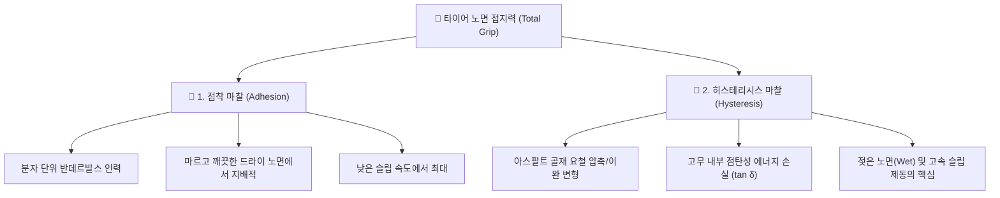

---
id: "tech_tire_shear_force_and_grip"
title: "타이어 접지력(Grip) 메커니즘 및 트레드 블록 전단 변형(Shear Force)"
type: resource
category_main: 타이어
category_sub: 타이어역학
topic: 타이어접지력및전단역학
date: 2026-09-10
status: 완료
tags:
  - 회사_업무
  - 타이어역학
  - 접지력
  - 전단응력
  - 제동물리
  - 히스테리시스
aliases:
  - "10_Tire_Shear_Force"
  - "10_Tire_Shear_Force"
---

# 🛞 타이어 접지력(Grip) 메커니즘 및 트레드 블록 전단 변형 (Shear Force)

> [!ABSTRACT] 📌 개요
> 타이어 트레드 고무가 노면과 접촉하여 마찰력(Grip)을 발생시키는 2대 원리(점착 마찰 및 히스테리시스 손실)와, 실제 슬립(Slip)이 발생하기 전 고무 블록 내부에서 발생하는 **전단 응력(Shear Stress) 및 전단 변형(Shear Strain)**의 물리적 수식 모델을 정의합니다.

---

## 🔬 1. 타이어 접지력(Grip)의 2대 물리 메커니즘

타이어의 총 그립력(마찰력)은 노면 미세 요철과 고무 사이의 **점착 마찰(Adhesion)** 및 **히스테리시스 마찰(Hysteresis)**의 합으로 결정됩니다:

```text
총 마찰력 (F_friction) = 점착 마찰력 (F_adhesion) + 히스테리시스 변형 마찰력 (F_hysteresis)
```



1. **점착 마찰 (Adhesion Force)**:
   * 고무 분자와 노면 표면 분자 사이의 반데르발스 인력에 의해 발생하는 분자 단위의 결합력입니다.
   * 마르고 깨끗한 드라이 노면 및 낮은 미끄럼 속도에서 지배적으로 작용합니다.
2. **히스테리시스 손실 마찰 (Hysteresis Loss)**:
   * 타이어 고무가 노면의 미세 요철(Micro/Macro Texture)을 타고 넘어가면서 발생하는 주기적인 고주파 압축-이완 변형에 따른 에너지 손실($\tan\delta$)입니다.
   * 젖은 노면(Wet) 및 슬립이 발생하는 실차 제동 환경에서 제동력을 지탱하는 핵심 메커니즘입니다.

---

## 📸 2. 트레드 블록 전단 변형 다이어그램 (Tire Shear Diagram)

트레드 블록은 힘을 받을 때 즉시 미끄러지지 않고, 고무의 탄성에 의해 먼저 전단 변형($L_{sh}$)을 일으킵니다:

![[_attachments/10_회사_업무/30_10_Tire_Shear_Force_diagram.png|550]]

---

## 📌 3. 개념 및 기호 정의

| 기호 | 설명 (Description) | 물리적 의미 |
| :---: | :--- | :--- |
| $X$ | 마찰력 (Friction force) | 노면과 타이어 접지면 사이의 접선력 |
| $S$ | 접촉 면적 (Contact area) | 블록의 유효 접지 면적 |
| $P$ | 접지 압력 (Contact pressure) | 블록에 작용하는 수직 압력 |
| $Z$ | 수직 하중 (Vertical load) | $Z = P \times S$ |
| $\mu$ | 마찰계수 (Coefficient of friction) | 고무와 노면 간 정/동마찰계수 |
| $C$ | 전단 응력 (Shear stress) | $C = \frac{X}{S}$ |
| $\gamma$ | 전단 변형률 (Shear strain) | $\gamma = \frac{L_{sh}}{h}$ |
| $G$ | 전단 탄성 계수 (Shear modulus) | 고무 컴파운드의 전단 강성 |
| $h$ | 트레드 높이 (Tread block thickness) | 블록의 두께/깊이 |
| $L_{sh}$ | 전단 거리 (Shear length) | 블록 상단 대비 하단의 수평 변위 |

---

## 🧠 4. 물리적 관계 및 슬립 발생 조건

### 4.1 전단 응력과 변형률 관계
* **전단 응력 (Shear Stress)**:
  $$C = \frac{X}{S}$$
* **탄성 재료 법칙 (Hooke's Law for Shear)**:
  $$C = G \cdot \gamma \implies \gamma = \frac{C}{G}$$
* **전단 변위 ($L_{sh}$)**:
  $$\gamma = \frac{L_{sh}}{h} \implies L_{sh} = \gamma \cdot h = \frac{C \cdot h}{G}$$

### 4.2 슬립(Slippage) 개시 임계 조건
* 슬립이 시작되는 쿨롱 마찰 한계 조건:
  $$X_{max} = \mu \cdot P \cdot S \implies C_{crit} = \mu \cdot P$$
* **슬립 시작 직전의 최대 전단 변위 ($L_{sh, max}$)**:
  $$L_{sh, max} = h \cdot \frac{\mu \cdot P}{G}$$

---

## ✅ 5. 핵심 요약 및 공학적 시사점
1. **변형 후 미끄러짐**: 트레드 블록은 제동력이 작용할 때 즉시 미끄러지지 않고 **먼저 고무의 전단 변형($L_{sh}$)**을 거칩니다.
2. **임계 전단 응력 도달**: 가해진 전단 응력이 쿨롱 마찰 한계($C_{crit} = \mu P$)를 초과하는 순간부터 노면과의 실질적인 상대 슬립(Slip)이 발생합니다.
3. **설계 영향 인자**:
   * 최대 전단 거리($L_{sh, max}$)는 **트레드 높이($h$), 마찰계수($\mu$), 접지압($P$)에 비례**합니다.
   * 고무 컴파운드의 **전단 탄성 계수($G$, 강성)에 반비례**합니다.
4. **실차 제동 적용**: 이 모델은 차량 초기 제동 시 타이어의 슬립율 형성 과정 및 ABS 진입 전 과도 응답성을 해석하는 기초 모델입니다.

---

## 🔗 연관 기술 문서
* 🚗 **[[04_Resources/21_제동/01_차량_제동_동역학_및_ABS_원리|차량 제동 동역학 및 ABS 원리]]**
* 📐 **[[10_차량동역학_측정점_기준점_운동역학_변환|차량동역학 (측정점 ➡️ 기준점 운동역학 변환)]]**
* ❄️ **[[04_Resources/30_스노우_노면_공학/00_스노우_노면_공학_통합_색인|스노우 노면 공학 통합 지식 색인 (MOC)]]**