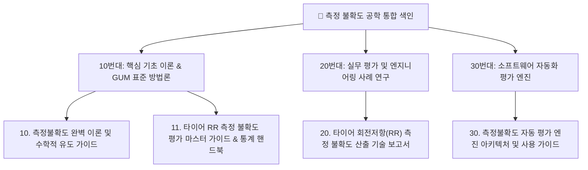

# 📐 측정 불확도 공학(Measurement Uncertainty) 통합 색인 (MOC)

> ⚡ **Quick Jump**: [🗺️ 1. 지식 구조](#️-지식-클러스터-구조-및-데이터-흐름) · [📑 2. 10단위 클러스터](#-10단위-지식-클러스터-상세-목록) · [🔗 3. 연계 모듈](#-실무-파이썬-모듈-및-대시보드-연계)

> [!ABSTRACT] 🎯 측정 불확도 공학 개요
> 본 색인은 ISO/IEC Guide 98-3 (GUM) 국제 표준에 입각한 **수학적 불확도 이론**, 타이어 회전저항(ISO 28580) 실무 평가, 그리고 `unoUtil.statistics.uncertainty` 자동 평가 소프트웨어 엔진을 총망라한 **측정 불확도 공학 마스터 지식 허브**입니다.

---

## 🗺️ 지식 클러스터 구조 및 데이터 흐름

---

## 📑 10단위 지식 클러스터 상세 목록

> [!NOTE]- 📖 1. 10번대: 핵심 기초 이론 & GUM 표준 방법론 [클릭하여 펼치기]
> | 번호 / 문서명 | 핵심 이론 및 공학 성과 | 바로가기 |
> | :--- | :--- | :---: |
> | **[[10_측정불확도_완벽_이론_및_수학적_유도_가이드\|10. 측정불확도 완벽 이론 및 수학적 유도 가이드]]** | 참값/오차/불확도 정의, A/B타입(직각/삼각/정규) PDF 2중 적분 유도, Welch-Satterthwaite 유효자유도 | [[10_측정불확도_완벽_이론_및_수학적_유도_가이드\|문서 보기]] |
> | **[[11_타이어_RR_측정_불확도_평가_마스터_가이드_및_통계_핸드북\|11. 타이어 RR 불확도 평가 마스터 가이드]]** | $s$ vs $SE$ 4단계 수학적 증명, GUM 3단계 계층구조, 약한 고리의 법칙, 13대 핵심 통계 사전 | [[11_타이어_RR_측정_불확도_평가_마스터_가이드_및_통계_핸드북\|문서 보기]] |

> [!NOTE]- 🏎️ 2. 20번대: 실무 평가 및 엔지니어링 사례 연구 [클릭하여 펼치기]
> | 번호 / 문서명 | 핵심 이론 및 공학 성과 | 바로가기 |
> | :--- | :--- | :---: |
> | **[[20_타이어_회전저항_RR_측정_불확도_산출_기술_보고서\|20. 타이어 회전저항(RR) 산출 보고서]]** | 3대 독립 영역 모델링, 6대 입력량 편미분 감도계수, 풀링 상대 분산, 합성 확장 불확도 2.46% | [[20_타이어_회전저항_RR_측정_불확도_산출_기술_보고서\|문서 보기]] |

> [!NOTE]- ⚙️ 3. 30번대: 소프트웨어 자동화 평가 엔진 [클릭하여 펼치기]
> | 번호 / 문서명 | 핵심 이론 및 공학 성과 | 바로가기 |
> | :--- | :--- | :---: |
> | **[[30_측정불확도_자동_평가_엔진_아키텍처_및_사용_가이드\|30. 측정불확도 자동 평가 엔진 아키텍처]]** | FlexibleUncertaintyEvaluator 객체 지향 엔진, 중심차분 수치 편미분, 피쉬본/파레토 자동 시각화 | [[30_측정불확도_자동_평가_엔진_아키텍처_및_사용_가이드\|문서 보기]] |

---

## 🔗 실무 파이썬 모듈 및 대시보드 연계
* 🐍 **파이썬 모듈**: `unoUtil.statistics.uncertainty` ([[uncertainty]])
* 🛞 **상위 지식 위키**: [[00_타이어_공학_통합_색인|타이어 공학 통합 색인]]
* 📚 **전역 포털**: [[04_Resources/00_지식_위키_통합_색인|04_Resources 마스터 대문]]
