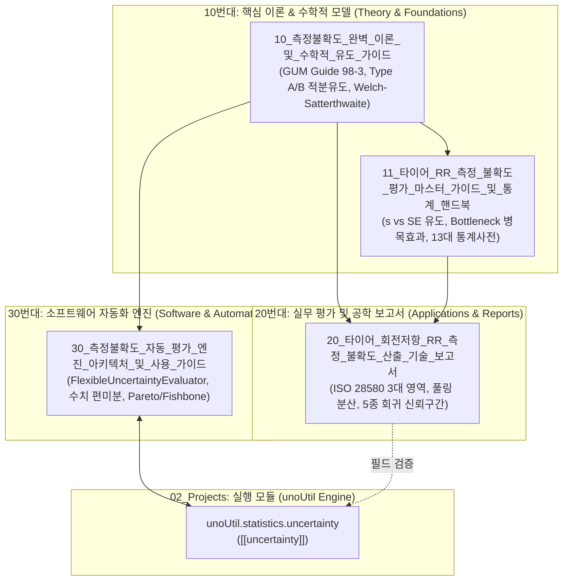

# 📐 측정 불확도 공학(Measurement Uncertainty) 통합 색인 (MOC)

> [!ABSTRACT] 📚 도메인 개요
> **측정 불확도 공학(Measurement Uncertainty Engineering)**은 계측 장비의 한계, 시험 환경의 시계열적 변동, 작업자 숙련도 및 통계적 회귀 잔차 등 측정 전 과정에서 발생하는 불확실성을 국제 표준 규격(**ISO/IEC Guide 98-3 GUM**, **ISO 28580**)에 의거하여 수학적·확률적으로 정량화하는 영구 지식 클러스터입니다.
> 
> "참값($Y$)은 결코 완벽히 알 수 없으며, 단일 오차($E$)는 계산할 수 없다"는 물리적 한계를 극복하고, **확률 분포의 분산과 표준편차($u$)**를 기반으로 공학적 신뢰 구간(95% 신뢰수준 확장 불확도 $U$)을 도출하는 핵심 이론과 실무 핸드북을 총괄합니다.

---

## 🗺️ 지식 클러스터 구조 및 데이터 흐름

---

## 📑 10단위 지식 클러스터 상세 목록

### 1. 📖 10번대: 핵심 기초 이론 & GUM 표준 방법론
* 📐 **[[10_측정불확도_완벽_이론_및_수학적_유도_가이드]]**:
  * ISO/IEC Guide 98-3 (GUM) 기반 참값, 오차, 측정불확도의 물리·철학적 정의
  * A타입 표준오차($SE = s/\sqrt{n}$) 및 B타입(직사각형 $a/\sqrt{3}$, 삼각형 $a/\sqrt{6}$, 정규분포 $a/k$) 확률밀도함수(PDF) 2중 정적분 엄밀 증명
  * 오차 전파의 법칙(Law of Propagation of Uncertainty) 및 중심차분법 수치 편미분($c_i = \partial f / \partial x_i$)
  * Welch-Satterthwaite 유효자유도($\nu_{\text{eff}}$) 산출식 및 옴의 법칙($R=V/I$) 수계산 완전 검증
* 📘 **[[11_타이어_RR_측정_불확도_평가_마스터_가이드_및_통계_핸드북]]**:
  * 표본표준편차($s$, 고유 산포) vs 표준오차($SE$, 표본평균 불확실성) 본질 분리 및 $SE = s/\sqrt{n}$ 4단계 수학적 증명
  * GUM 3단계 평가 계층 구조 ($u_i \to u_c \to U$)
  * 웰치-새터스웨이트 자유도 페널티 및 **약한 고리의 법칙 (Bottleneck Effect)** 규명 ($\nu_3 = 3$의 분모 독식으로 $\nu_{\text{eff}} = 13.65$ 급감)
  * 13대 핵심 통계 및 측정불확도 용어 상세 사전 완비

---

### 2. 🏎️ 20번대: 실무 평가 및 엔지니어링 사례 연구
* 📊 **[[20_타이어_회전저항_RR_측정_불확도_산출_기술_보고서]]**:
  * ISO 28580 / GUM 규격 기반 타이어 회전저항($F_r$) 3대 독립 영역 실무 산출 기술 보고서
  * 제1영역(계측기 센서 모델 $0.34\%$), 제2영역(7종 마스터 타이어 382회 풀링 분산 $0.76\%$), 제3영역(5종 기준시험기 선형 회귀 신뢰구간 $0.78\%$)
  * 합성 상대 표준불확도 $u_c = 1.14\%$ 및 95% 신뢰수준 최종 확장 불확도 $U = 2.46\%$ 도출
  * 지배적 오차 기여율(계측기 9% vs 타이어/회귀 91%) 분석 및 시험실 품질 관리 지침

---

### 3. ⚙️ 30번대: 소프트웨어 자동화 평가 엔진
* 🛠️ **[[30_측정불확도_자동_평가_엔진_아키텍처_및_사용_가이드]]**:
  * `uno_uncertainty.py` 기반 `FlexibleUncertaintyEvaluator` 객체 지향 불확도 자동화 엔진
  * 임의의 비선형 수학 함수에 대한 중심차분 수치 편미분 자동 연산
  * 피쉬본 다이어그램, 불확도 누적 차트, 파레토 기여율 차트 등 자동화 리포팅 아키텍처
  * 실차 제동 3대 파라미터(슬립율, 횡슬립각, 제동거리) 적용 검증

---

## ⚡ 핵심 공식 퀵 레퍼런스 (Cheat Sheet)

| 구분 | 수식 모델 | 설명 |
| :--- | :--- | :--- |
| **A타입 불확도** | $u_A = \frac{s}{\sqrt{n}} = \sqrt{\frac{\sum (x_i - \bar{x})^2}{n(n-1)}}$ | 반복 측정 데이터로부터 표본평균의 표준오차 산출 ($\nu = n-1$) |
| **B타입 직사각형** | $u_B = \frac{a}{\sqrt{3}}$ | 상·하한 $\pm a$ 내에서 균일하게 분포할 확률 (스펙 시트, 분해능) |
| **B타입 삼각형** | $u_B = \frac{a}{\sqrt{6}}$ | 중심값 부근의 발생 확률이 더 높은 대칭 삼각 분포 |
| **B타입 정규분포** | $u_B = \frac{U_{\text{cert}}}{k}$ | 교정성적서 상의 확장불확도를 포함인자 $k$(통상 $k=2$)로 나눈 값 |
| **감도계수 (수치미분)** | $c_i = \frac{\partial f}{\partial x_i} \approx \frac{f(x_1,\dots,x_i+h,\dots) - f(x_1,\dots,x_i-h,\dots)}{2h}$ | $h = \epsilon \cdot \max(\|x_i\|, 1)$ 기반 중심차분 편미분 계수 |
| **합성 표준불확도** | $u_c(y) = \sqrt{\sum_{i=1}^N c_i^2 u^2(x_i)}$ | 독립 입력량들의 1차 테일러 전개 오차 전파 합성 ($1\sigma$) |
| **유효자유도 (W-S)** | $\nu_{\text{eff}} = \frac{u_c^4(y)}{\sum_{i=1}^N \frac{c_i^4 u^4(x_i)}{\nu_i}}$ | Welch-Satterthwaite 근사식 (자유도가 작은 요인이 분모 독식) |
| **확장 불확도** | $U = k \times u_c(y)$ | $k = t_{0.95}(\nu_{\text{eff}})$ 적용 95% 신뢰수준 최종 불확도 구간 |

---

## 🔗 상위 및 연관 지식 네트워크 (Knowledge Network)

* **상위 지식 위키 대문**: [[00_지식_위키_통합_색인]]
* **타이어 도메인**: [[00_타이어_공학_통합_색인]]
* **제동 시스템 도메인**: [[00_제동_기술_통합_색인]]
* **사내 파이썬 라이브러리**: `unoUtil.statistics.uncertainty` ([[00_unoUtil_모듈개발_대시보드]], [[uncertainty]])
* **실차 선형 보정 이론**: [[27_실차_제동가감속_성능지수_수학적모델_및_시계열_선형보정_이론]]
