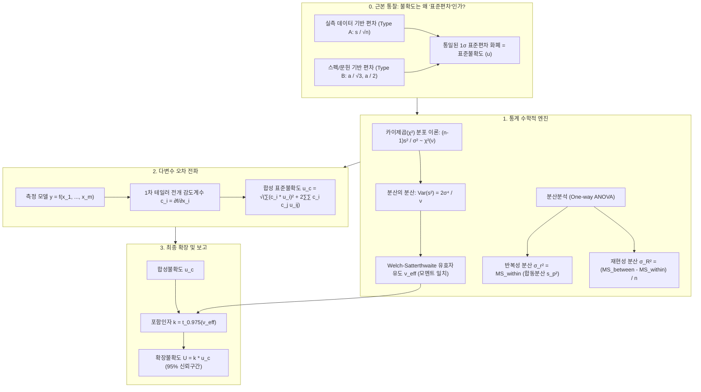

# 📐 측정불확도(Measurement Uncertainty) 완벽 이론 및 수학적 유도 가이드
> **ISO/IEC Guide 98-3 (GUM), 카이제곱($\chi^2$) 분포 이론, 분산분석(ANOVA), 그리고 공학 실무 사례집**

---

> [!ABSTRACT] 📖 본 가이드의 목적과 본질
> 측정불확도(Measurement Uncertainty)의 본질은 **"서로 다른 출처와 단위를 가진 모든 오차들을 『$1\sigma$ 표준편차』라는 단 하나의 통일된 화폐로 환산하여 결합하는 체계"**입니다.
> 
> 본 문서는 단순한 수식 나열을 넘어 다음의 근본적인 질문들에 수학적·통계적으로 명쾌한 답을 제시합니다:
> 1. **불확도는 왜 결국 편차($1\sigma$)의 개념인가?** (표준편차, 표준오차, 표준불확도의 엄밀한 계층 구분)
> 2. **표본분산은 왜 정규분포가 아닌 카이제곱($\chi^2$) 분포를 따르는가?** (코크란 정리 및 표본분산의 분산 $\text{Var}(s^2) = \frac{2\sigma^4}{\nu}$ 유도)
> 3. **분산분석(ANOVA)은 측정불확도에 어떻게 적용되는가?** (합동분산 $s_p^2$ 일치 증명 및 반복성/재현성 분산성분 분리 메커니즘)
> 4. **Welch-Satterthwaite 유효자유도는 어떻게 유도되는가?** (카이제곱 2차 모멘트 일치법과 병목 효과)
> 5. **다양한 공학 도메인 실전 사례**: 정밀 기계 부품 치수, 인장강도 재료 시험(ANOVA), 전기 옴의 법칙, ISO 28580 타이어 회전저항 복합 모델.



---

## 1. 근본 통찰: 불확도는 결국 '편차'의 개념이다

### 1.1 왜 그냥 '표준편차'라고 하지 않고 '표준불확도'라고 부르는가?

현업 엔지니어가 가장 먼저 맞닥뜨리는 의문은 **"불확도가 결국 흩어진 정도(산포)라면, 왜 통계학의 '표준편차'라는 익숙한 단어를 놔두고 '표준불확도'라는 낯선 용어를 쓰는가?"**입니다.

그 이유는 **"데이터가 존재하지 않아 통계 공식으로 표준편차를 직접 구할 수 없는 오차 요인들"까지도 전부 표준편차 단위로 강제 환산하여 하나로 합쳐야 하기 때문**입니다.

```
 [Type A: 데이터가 있는 요인]              [Type B: 데이터가 없는 요인]
  • 20회 반복 측정한 시험 데이터             • 버니어 캘리퍼스 분해능 (±0.01 mm)
  • 통계 공식으로 표본표준편차 계산          • 센서 교정성적서 오차 한계 (±0.2 N)
              │                                        │
              ▼                                        ▼
    통계적 표준편차 (s / √n)                 확률밀도함수 적분 (a / √3, a / 2)
              │                                        │
              └───────────────────┬────────────────────┘
                                  ▼
               ┌──────────────────────────────────────┐
               │  표준불확도 (Standard Uncertainty, u) │
               │  = "모든 오차 요인을 1σ 표준편차로      │
               │     통일해놓은 단 하나의 공통 화폐"      │
               └──────────────────────────────────────┘
```

1. **A타입 (Type A)**: 실측 데이터가 있으므로 표본표준편차($s$)를 구하고, 평균의 표준편차인 **표준오차($SE = s/\sqrt{n}$)**로 나타냅니다.
2. **B타입 (Type B)**: 장비 사양서에 "정밀도 $\pm 0.1\,\text{mm}$"라고만 적혀 있습니다. 실측 데이터가 없으므로 $\sum(x_i - \bar{x})^2$ 공식을 쓸 수 없습니다. 그러나 균등분포(직사각형)를 가정하고 적분을 수행하면 분산이 $\frac{a^2}{3}$이 나오므로, **$1\sigma$에 해당하는 가상의 표준편차가 $0.1 / \sqrt{3} \approx 0.058\,\text{mm}$**로 계산됩니다.
3. **공통 화폐로서의 표준불확도**:
   진짜 데이터로 계산한 표준편차(A타입)와 스펙에서 수학적으로 유도한 $1\sigma$ 상당액(B타입)을 한 바구니에 담아 더하기 위해, 둘을 아우르는 상위 개념으로 **"표준불확도(Standard Uncertainty, $u$)"**를 정의한 것입니다.

---

### 1.2 헷갈리기 쉬운 5가지 '편차'의 계층 사다리

|   계층    | 통계학적 개념                                   | 불확도 공학 용어                      | 물리적 실체 및 의미                                                                                           |
| :-----: | :---------------------------------------- | :----------------------------- | :---------------------------------------------------------------------------------------------------- |
| **1단계** | **편차** (Deviation)                        | -                              | 개별 측정값과 평균의 단순 차이 ($x_i - \bar{x}$). 합산하면 항상 0.                                                       |
| **2단계** | **표본표준편차** ($s$)                          | -                              | **대상 물체 고유의 산포 크기**. 시험을 1만 번 반복해도 0으로 줄지 않고 모표준편차 $\sigma$로 수렴함.                                     |
| **3단계** | **표준오차** ($SE = s/\sqrt{n}$)              | **A타입 표준불확도 ($u_A$)**          | **"표본평균($\bar{x}$)" 자체가 참값 주변에서 흔들리는 편차**. 시험 횟수($n$)를 늘리면 $\sqrt{n}$에 반비례하여 0으로 소멸함.                 |
| **4단계** | **합성 표준편차** ($\sqrt{\sum \sigma_i^2}$)    | **합성 표준불확도 ($u_c$)**           | 힘(N), 변위(mm), 온도($^\circ\text{C}$) 등 단위가 다른 요인들을 물리식의 감도계수($c_i$)로 환전하여 합성한 **전체 시스템의 $1\sigma$ 편차**. |
| **5단계** | **$2\sigma$ 신뢰구간** ($2 \times \text{SD}$) | **확장 불확도 ($U = k \cdot u_c$)** | $1\sigma$(약 68% 신뢰수준)는 위험하므로, **95% 신뢰수준을 보증하기 위해 오차 범위를 약 2배($k=2$) 넓힌 최종 성적서 보증 구간**.               |

---

## 2. 카이제곱($\chi^2$) 분포와 표본분산의 수학적 유도

왜 분산과 불확도를 다룰 때 항상 **카이제곱($\chi^2$) 분포**가 등장하며, 이것이 어떻게 유효자유도 공식으로 연결되는지 수학적으로 규명합니다.

### 2.1 카이제곱 분포의 정의와 물리적 기원
정규분포 $N(0, 1)$을 따르는 서로 독립인 $n$개의 표준정규 확률변수 $Z_1, Z_2, \dots, Z_n$이 있을 때, **이들의 제곱합이 따르는 확률분포가 바로 자유도 $n$인 카이제곱 분포($\chi^2(n)$)**입니다.
$$W = \sum_{i=1}^n Z_i^2 = \sum_{i=1}^n \left(\frac{x_i - \mu}{\sigma}\right)^2 \sim \chi^2(n)$$

- **카이제곱 확률밀도함수(PDF)**:
  $$f(w; \nu) = \frac{1}{2^{\nu/2} \Gamma(\nu/2)} w^{\frac{\nu}{2}-1} e^{-\frac{w}{2}} \quad (w > 0)$$
- **핵심 통계 모멘트 (기댓값과 분산)**:
  - $E[Z_i^2] = \text{Var}(Z_i) + (E[Z_i])^2 = 1 + 0 = 1$
  - $\text{Var}(Z_i^2) = E[Z_i^4] - (E[Z_i^2])^2 = 3 - 1 = 2$ (정규분포의 첨도 특성)
  - 따라서 독립 확률변수 합의 성질에 의해:
    $$E[W] = E\left[\sum_{i=1}^\nu Z_i^2\right] = \sum_{i=1}^\nu E[Z_i^2] = \nu$$
    $$\text{Var}(W) = \text{Var}\left(\sum_{i=1}^\nu Z_i^2\right) = \sum_{i=1}^\nu \text{Var}(Z_i^2) = 2\nu$$

---

### 2.2 표본분산($s^2$)의 카이제곱 분포 유도 (자유도 $n-1$의 비밀)

현실에서는 모평균 $\mu$를 알 수 없으므로 표본평균 $\bar{x}$를 대입하여 표본분산 $s^2 = \frac{1}{n-1}\sum (x_i - \bar{x})^2$을 계산합니다.

모평균 중심의 편차제곱합을 전개합니다:
$$\sum_{i=1}^n (x_i - \mu)^2 = \sum_{i=1}^n [(x_i - \bar{x}) + (\bar{x} - \mu)]^2 = \sum_{i=1}^n (x_i - \bar{x})^2 + n(\bar{x} - \mu)^2$$
양변을 모분산 $\sigma^2$으로 나눕니다:
$$\sum_{i=1}^n \left(\frac{x_i - \mu}{\sigma}\right)^2 = \frac{\sum_{i=1}^n (x_i - \bar{x})^2}{\sigma^2} + \left(\frac{\bar{x} - \mu}{\sigma/\sqrt{n}}\right)^2$$
각 항의 분포를 분석합니다:
1. 좌변: $n$개의 독립 표준정규분포 제곱합이므로 $\chi^2(n)$ 분포를 따릅니다.
2. 우변 두 번째 항: $\bar{x} \sim N(\mu, \sigma^2/n)$이므로 $\frac{\bar{x} - \mu}{\sigma/\sqrt{n}} \sim N(0, 1)$이며, 그 제곱은 $\chi^2(1)$ 분포를 따릅니다.
3. **코크란의 정리(Cochran's Theorem)**에 의해, 표본분산 항과 표본평균 항은 상호 독립입니다.
   따라서 적률생성함수(MGF)의 성질에 의해 우변 첫 번째 항은 반드시 자유도 $n-1$인 카이제곱 분포를 따라야 합니다:
   $$\frac{\sum_{i=1}^n (x_i - \bar{x})^2}{\sigma^2} = \frac{(n-1)s^2}{\sigma^2} \sim \chi^2(n-1) = \chi^2(\nu) \quad \blacksquare$$

---

### 2.3 표본분산 자체의 분산($\text{Var}(s^2)$) 수학적 도출

불확도 평가에서 가장 중요한 수학적 결론 중 하나입니다.
$\frac{\nu s^2}{\sigma^2} = W \sim \chi^2(\nu)$ 이므로, 표본분산 $s^2$은 다음과 같이 표현됩니다:
$$s^2 = \frac{\sigma^2}{\nu} W$$
양변에 분산 연산자 $\text{Var}$를 취합니다:
$$\text{Var}(s^2) = \text{Var}\left(\frac{\sigma^2}{\nu} W\right) = \left(\frac{\sigma^2}{\nu}\right)^2 \text{Var}(W)$$
앞서 유도한 카이제곱 분포의 분산 $\text{Var}(W) = 2\nu$를 대입합니다:
$$\text{Var}(s^2) = \left(\frac{\sigma^4}{\nu^2}\right) \cdot (2\nu) = \frac{2\sigma^4}{\nu} \approx \frac{2 s^4}{\nu} \quad \blacksquare$$

> **💡 이 유도가 왜 위대한가?**
> "표본분산 $s^2$ 자체도 통계적으로 흔들리며, 그 흔들림의 크기(분산)는 **분산의 제곱($s^4$)에 비례하고 자유도($\nu$)에 반비례한다**"는 사실을 증명한 것입니다.
> 이 공식이 바로 뒤에서 설명할 **Welch-Satterthwaite 유효자유도 공식의 분모($u_i^4 / \nu_i$)의 수학적 근원**입니다.

---

## 3. 분산분석(ANOVA)의 이론과 측정불확도 적용

측정 시스템의 오차는 단순히 하나의 요인에서만 오지 않습니다.
예를 들어 제품을 측정할 때 **"동일 작업자가 반복해서 생기는 오차(반복성, Repeatability)"**와 **"작업자나 시험 장비가 바뀔 때 생기는 오차(재현성, Reproducibility)"**가 뒤섞여 있습니다.
이를 수학적으로 완벽하게 분리해내는 도구가 바로 **일원배치 분산분석(One-Way ANOVA)**입니다.

```
                  ┌─────────────────────────────────────────┐
                  │       전체 변동 (Total Variance)        │
                  │   SS_total = SS_between + SS_within     │
                  └────────────────────┬────────────────────┘
                                       │
                    ┌──────────────────┴──────────────────┐
                    ▼                                     ▼
       ┌─────────────────────────┐           ┌─────────────────────────┐
       │ 그룹 간 변동 (Between)  │           │ 그룹 내 변동 (Within)   │
       │  (작업자/로트/장비 차이) │           │ (동일 조건 순수 반복오차) │
       ├─────────────────────────┤           ├─────────────────────────┤
       │ MS_between = SS_b / (k-1)│          │ MS_within = SS_w / N-k  │
       │ E = σ_error² + n * σ_op²│           │ E = σ_error² (합동분산) │
       └────────────┬────────────┘           └────────────┬────────────┘
                    │                                     │
                    ▼                                     ▼
       ┌─────────────────────────┐           ┌─────────────────────────┐
       │ 재현성 표준불확도       │           │ 반복성 표준불확도       │
       │ u_repro = √((MS_b-MS_w)/n)│         │ u_repeat = √(MS_within) │
       └─────────────────────────┘           └─────────────────────────┘
```

### 3.1 ANOVA의 변동 제곱합 분할 원리
$k$개의 서로 다른 그룹(예: $k$명의 작업자 또는 $k$종의 타이어 시편)이 있고, 각 그룹마다 $n$회씩 반복 측정하여 총 $N = k \times n$개의 데이터 $x_{ij}$가 수집되었다고 가정합니다 (균형 일원배치 모델).

데이터의 통계 모델:
$$x_{ij} = \mu + \alpha_i + \epsilon_{ij}$$
- $\mu$: 전체 총평균
- $\alpha_i \sim N(0, \sigma_{\text{between}}^2)$: 그룹 간 편차 효과 (재현성 성분)
- $\epsilon_{ij} \sim N(0, \sigma_{\text{within}}^2)$: 그룹 내 순수 측정 오차 (반복성 성분)

총 제곱합($SS_{\text{total}}$)은 대수적으로 그룹 간 제곱합($SS_{\text{between}}$)과 그룹 내 잔차 제곱합($SS_{\text{within}}$)으로 완벽히 분해됩니다:
$$\sum_{i=1}^k \sum_{j=1}^n (x_{ij} - \bar{x}_{\cdot\cdot})^2 = n\sum_{i=1}^k (\bar{x}_{i\cdot} - \bar{x}_{\cdot\cdot})^2 + \sum_{i=1}^k \sum_{j=1}^n (x_{ij} - \bar{x}_{i\cdot})^2$$
$$SS_{\text{total}} = SS_{\text{between}} + SS_{\text{within}}$$

---

### 3.2 평균제곱(Mean Square)과 합동분산($s_p^2$)의 일치

각 제곱합을 해당 자유도로 나누어 평균제곱을 구합니다:
1. **그룹 내 평균제곱 ($MS_{\text{within}}$ or $MS_E$)**:
   $$\nu_{\text{within}} = k(n - 1) = N - k$$
   $$MS_{\text{within}} = \frac{SS_{\text{within}}}{k(n - 1)} = \frac{\sum_{i=1}^k (n-1) s_i^2}{\sum_{i=1}^k (n-1)} = s_p^2$$
   > **💡 결론**: 분산분석의 잔차평균제곱($MS_{\text{within}}$)은 앞서 배운 **합동 분산(Pooled Variance, $s_p^2$)과 수학적으로 100% 동일**합니다!
   > 그 기댓값은 순수한 측정 기기 오차 분산입니다:
   > $$E[MS_{\text{within}}] = \sigma_{\text{within}}^2 = \sigma_{\text{repeatability}}^2$$

2. **그룹 간 평균제곱 ($MS_{\text{between}}$ or $MS_A$)**:
   $$\nu_{\text{between}} = k - 1$$
   $$MS_{\text{between}} = \frac{SS_{\text{between}}}{k - 1}$$
   그 기댓값은 순수 측정오차 분산에 그룹 간 변동이 표본수($n$)배 증폭되어 합산된 형태입니다:
   $$E[MS_{\text{between}}] = \sigma_{\text{within}}^2 + n \sigma_{\text{between}}^2$$

---

### 3.3 측정불확도에서의 반복성($u_r$)과 재현성($u_R$) 분산 성분 분리 메커니즘

위의 기댓값 연립방정식을 풀면, 뒤섞여 있던 두 오차 요인을 수학적으로 완벽하게 분리 추출할 수 있습니다:

1. **반복성 표준불확도 ($u_{\text{repeat}}$)**:
   $$u_{\text{repeat}} = \sqrt{MS_{\text{within}}} = s_p \quad (\text{자유도 } \nu = k(n-1))$$
2. **재현성 표준불확도 ($u_{\text{repro}}$)**:
   $$MS_{\text{between}} - MS_{\text{within}} = n \sigma_{\text{between}}^2$$
   $$\therefore u_{\text{repro}} = \sqrt{\max\left(0, \frac{MS_{\text{between}} - MS_{\text{within}}}{n}\right)} \quad (\text{자유도 } \nu = k-1)$$
   *(만약 샘플링 오차로 인해 $MS_{\text{between}} < MS_{\text{within}}$이 되면 물리적으로 분산이 음수가 될 수 없으므로 0으로 처리합니다.)*
3. **측정 시스템 종합 표준불확도**:
   두 요인은 직교하므로 RSS로 합성합니다:
   $$u_{\text{system}} = \sqrt{u_{\text{repeat}}^2 + u_{\text{repro}}^2}$$

이 방식이 바로 국제 표준(ISO 5725) 및 공업 통계의 **Gage R&R(게이지 반복성 및 재현성)** 평가의 수학적 뼈대입니다.

---

## 4. B타입 확률분포 적분 유도 및 자유도 이론

| 분포 형태 | 확률밀도함수 $f(x)$ | 분산 $\text{Var}(X) = \int x^2 f(x) dx$ | 표준불확도 $u_B$ | 적용 대상 |
| :--- | :--- | :--- | :---: | :--- |
| **직사각형** (Uniform) | $\frac{1}{2a} \; (-a \le x \le a)$ | $\frac{1}{2a} \left[\frac{x^3}{3}\right]_{-a}^a = \frac{a^2}{3}$ | **$\frac{a}{\sqrt{3}}$** | 디지털 분해능, 제조사 스펙 $\pm a$ |
| **삼각형** (Triangular) | $\frac{a - \|x\|}{a^2} \; (-a \le x \le a)$ | $\frac{2}{a^2} \left[\frac{ax^3}{3} - \frac{x^4}{4}\right]_0^a = \frac{a^2}{6}$ | **$\frac{a}{\sqrt{6}}$** | 두 균등분포 변수의 합, 중앙 집중 오차 |
| **U자형** (U-shaped) | $\frac{1}{\pi\sqrt{a^2 - x^2}} \; (-a < x < a)$ | $\frac{a^2}{\pi} \int_{-\pi/2}^{\pi/2} \sin^2\theta d\theta = \frac{a^2}{2}$ | **$\frac{a}{\sqrt{2}}$** | 항온조 On/Off 히터 제어, 사인파 전원 노이즈 |
| **정규분포** (Normal) | $\frac{1}{\sqrt{2\pi}\sigma} e^{-\frac{x^2}{2\sigma^2}}$ | $\sigma^2 = (U/k)^2$ | **$\frac{U}{k}$** | 공인 교정성적서 ($k=2, 95\%$) |

---

## 5. Welch-Satterthwaite 유효자유도($\nu_{\text{eff}}$)와 병목 효과

### 5.1 2차 모멘트 일치법(Moment Matching)을 통한 엄밀한 유도

합성 분산 $u_c^2 = \sum_{i=1}^m u_i^2$ (여기서 $u_i = c_i u(x_i)$)이 주어졌을 때:
1. 앞서 2.3절에서 증명한 표본분산의 분산 공식을 각 독립 성분에 적용합니다:
   $$\text{Var}(u_i^2) = \frac{2 u_i^4}{\nu_i}$$
2. 독립 성분 합의 분산은 분산의 합이므로:
   $$\text{Var}(u_c^2) = \sum_{i=1}^m \text{Var}(u_i^2) = \sum_{i=1}^m \frac{2 u_i^4}{\nu_i}$$
3. 합성 분산 $u_c^2$ 역시 단일 유효자유도 $\nu_{\text{eff}}$를 갖는 카이제곱 분포로 근사합니다:
   $$\text{Var}(u_c^2) = \frac{2 u_c^4}{\nu_{\text{eff}}}$$
4. 두 식을 일치시킵니다:
   $$\frac{2 u_c^4}{\nu_{\text{eff}}} = \sum_{i=1}^m \frac{2 u_i^4}{\nu_i} \implies \nu_{\text{eff}} = \frac{u_c^4}{\sum_{i=1}^m \frac{u_i^4}{\nu_i}} \quad \blacksquare$$

### 5.2 4차 거듭제곱의 지배: 약한 고리의 법칙 (Bottleneck Effect)

> [!WARNING] ⚠️ 자유도의 병목 현상
> 분모에 걸려 있는 **4차 거듭제곱($u_i^4$)**으로 인해, 크기가 큰 불확도 성분 중 **자유도가 가장 작은 성분 하나가 분모 전체를 90% 이상 독식**해 버립니다.
> 아무리 수백 회 측정한 요인($\nu = 300$)이 있더라도, 5회 측정한 회귀/기준기 요인($\nu = 3$)이 합성 불확도에 대등하게 섞이면 전체 유효자유도는 즉시 10 안팎으로 추락합니다.

---

## 6. 다양한 공학 도메인별 측정불확도 실전 평가 사례집

개념을 확실하게 잡을 수 있도록 실무에서 발생하는 **4가지 대표 도메인 사례**를 단계별 수치와 함께 전개합니다.

---

### [사례 1] 기계/가공: 마이크로미터를 이용한 금속 핀 외경 치수 측정

가장 직관적인 단일 물리량 측정 사례로, A타입 반복성과 B타입 기기 오차, 열팽창 오차가 결합하는 모델입니다.

#### 1) 측정 모델 및 조건
- **측정 대상**: 공칭 외경 $d_0 = 25.000\,\text{mm}$ 금속 핀
- **모델식**: $d = d_{\text{raw}} - \Delta d_{\text{temp}} = d_{\text{raw}} - d_0 \cdot \alpha \cdot (T - 20^\circ\text{C})$
  - $d_{\text{raw}}$: 마이크로미터 지시값
  - $\alpha$: 금속 열팽창계수 ($11.5 \times 10^{-6}\,/^\circ\text{C}$)
  - $T$: 측정실 온도 ($24.0^\circ\text{C}$, 기준온도 $20^\circ\text{C}$)

#### 2) 불확도 요인 평가
1. **외경 반복 측정 (Type A)**: 10회 측정 ($\bar{d} = 25.024\,\text{mm}, s = 0.0035\,\text{mm}$)
   $$u_A(d) = \frac{0.0035}{\sqrt{10}} = 0.00111\,\text{mm} \quad (\nu = 9)$$
2. **마이크로미터 교정성적서 (Type B 정규)**: 성적서 $U = 0.0020\,\text{mm}$ ($k=2$)
   $$u_{\text{cal}} = \frac{0.0020}{2} = 0.00100\,\text{mm} \quad (\nu = \infty)$$
3. **마이크로미터 디지털 분해능 (Type B 직사각형)**: 해상도 $0.001\,\text{mm}$ ($\pm 0.0005\,\text{mm}$)
   $$u_{\text{res}} = \frac{0.0005}{\sqrt{3}} = 0.00029\,\text{mm} \quad (\nu = \infty)$$
4. **온도 편차에 의한 열팽창 (Type B U자형)**:
   항온 제어 주기에 따라 온도가 $20^\circ\text{C}$ 대비 $\Delta T = 4.0 \pm 1.0^\circ\text{C}$ 진동
   - 열팽창량: $\Delta d = 25.0 \times (11.5 \times 10^{-6}) \times 4.0 = 0.00115\,\text{mm}$ 보정
   - 온도 진동 폭 $a_T = 1.0^\circ\text{C} \implies u(T) = \frac{1.0}{\sqrt{2}} \approx 0.707^\circ\text{C}$ (U자형)
   - 온도 감도계수: $c_T = \frac{\partial d}{\partial T} = -d_0 \alpha = -25.0 \times 11.5 \times 10^{-6} = -0.000288\,\text{mm/}^\circ\text{C}$
   - 온도 기여 불확도: $u_{\text{temp}} = |c_T| \cdot u(T) = 0.000288 \times 0.707 = 0.00020\,\text{mm}$ ($\nu = \infty$)

#### 3) 합성 및 확장 불확도 산출
- **최종 보정 외경**: $d = 25.024 - 0.00115 = 25.02285\,\text{mm}$
- **합성표준불확도 ($u_c$)**:
  $$u_c = \sqrt{0.00111^2 + 0.00100^2 + 0.00029^2 + 0.00020^2} = \sqrt{2.356 \times 10^{-6}} \approx 0.00153\,\text{mm}$$
- **유효자유도 ($\nu_{\text{eff}}$)**:
  B타입 요인들의 자유도가 모두 $\infty$이므로 분모에는 A타입 항만 남습니다:
  $$\nu_{\text{eff}} = \frac{u_c^4}{\frac{u_A^4}{9}} = 9 \times \left(\frac{0.00153}{0.00111}\right)^4 = 9 \times (1.378)^4 \approx 32.4$$
- **확장불확도 ($U_{95\%}$)**:
  $\nu = 32.4$에 대한 t-값 $k = 2.04$
  $$U = 2.04 \times 0.00153 \approx 0.0031\,\text{mm}$$
  $$\therefore d = (25.0229 \pm 0.0031)\,\text{mm} \quad (95\% \text{ 신뢰수준, } k=2.04)$$

---

### [사례 2] 재료/화학: 분산분석(ANOVA) 기반 시편 인장강도 시험 (반복성 & 로트 간 재현성 분리)

생산 로트가 바뀔 때 발생하는 재현성 오차를 ANOVA로 분리해내는 고급 실무 사례입니다.

#### 1) 시험 데이터 (3개 로트, 로트당 4회 반복 시험, $N=12$)
단위: $\text{MPa}$
- **Lot A**: $\{412, 415, 410, 413\} \implies \bar{x}_A = 412.5, s_A^2 = 4.33$
- **Lot B**: $\{418, 422, 419, 421\} \implies \bar{x}_B = 420.0, s_B^2 = 3.33$
- **Lot C**: $\{414, 416, 413, 417\} \implies \bar{x}_C = 415.0, s_C^2 = 3.33$
- **총평균**: $\bar{x}_{\cdot\cdot} = \frac{412.5 + 420.0 + 415.0}{3} = 415.83\,\text{MPa}$

#### 2) 일원배치 ANOVA 계산
1. **그룹 내 제곱합 ($SS_{\text{within}}$)**:
   $$SS_{\text{within}} = \sum (n-1)s_i^2 = 3(4.33) + 3(3.33) + 3(3.33) = 13.0 + 10.0 + 10.0 = 33.0$$
   $$\nu_{\text{within}} = k(n - 1) = 3 \times 3 = 9$$
   $$MS_{\text{within}} = \frac{33.0}{9} = 3.667\,\text{MPa}^2$$
2. **그룹 간 제곱합 ($SS_{\text{between}}$)**:
   $$SS_{\text{between}} = n \sum (\bar{x}_i - \bar{x}_{\cdot\cdot})^2 = 4 \times [(412.5 - 415.83)^2 + (420.0 - 415.83)^2 + (415.0 - 415.83)^2]$$
   $$SS_{\text{between}} = 4 \times [11.089 + 17.389 + 0.689] = 4 \times 29.167 = 116.67$$
   $$\nu_{\text{between}} = k - 1 = 3 - 1 = 2$$
   $$MS_{\text{between}} = \frac{116.67}{2} = 58.333\,\text{MPa}^2$$

#### 3) 불확도 분산 성분 분리 추출
1. **순수 시험 반복성 불확도 ($u_{\text{repeat}}$)**:
   $$u_{\text{repeat}} = \sqrt{MS_{\text{within}}} = \sqrt{3.667} \approx 1.915\,\text{MPa} \quad (\nu = 9)$$
2. **로트 간 재현성 불확도 ($u_{\text{repro}}$)**:
   $$u_{\text{repro}} = \sqrt{\frac{MS_{\text{between}} - MS_{\text{within}}}{n}} = \sqrt{\frac{58.333 - 3.667}{4}} = \sqrt{\frac{54.666}{4}} = \sqrt{13.667} \approx 3.697\,\text{MPa} \quad (\nu = 2)$$
3. **전체 인장강도 측정 불확도 합성**:
   $$u_c = \sqrt{u_{\text{repeat}}^2 + u_{\text{repro}}^2} = \sqrt{3.667 + 13.667} = \sqrt{17.334} \approx 4.163\,\text{MPa}$$
4. **유효자유도 산출 (Welch-Satterthwaite 병목 확인)**:
   $$\nu_{\text{eff}} = \frac{u_c^4}{\frac{u_{\text{repeat}}^4}{\nu_r} + \frac{u_{\text{repro}}^4}{\nu_R}} = \frac{(17.334)^2}{\frac{(3.667)^2}{9} + \frac{(13.667)^2}{2}} = \frac{300.47}{\frac{13.45}{9} + \frac{186.79}{2}} = \frac{300.47}{1.49 + 93.39} = \frac{300.47}{94.88} \approx 3.17$$
   > **💡 해석**: 반복성 자유도는 9였지만, 로트 수가 3개뿐이어서 자유도가 2에 불과했던 재현성 항($93.39$)이 분모의 98%를 독식하여 전체 유효자유도가 **3.17**로 붕괴했습니다.
5. **확장불확도**:
   $\nu = 3.17$에 대한 95% t-값은 $k = 3.14$
   $$U = 3.14 \times 4.163 \approx 13.07\,\text{MPa}$$
   $$\therefore \text{Tensile Strength} = (415.8 \pm 13.1)\,\text{MPa} \quad (95\%, k=3.14)$$

---

### [사례 3] 전기/전자: 옴의 법칙 저항 측정 ($R = V/I$)

- **측정 모델**: $R = V / I$ ($V = 10.00\,\text{V}, I = 2.00\,\text{A} \implies R = 5.000\,\Omega$)
- **전압 ($V$)**: 성적서 $U = 0.20\,\text{V}$ ($k=2$) $\implies u(V) = 0.10\,\text{V}, \nu_V = \infty$
- **전류 ($I$)**: 5회 반복 측정 $\implies s = 0.0158\,\text{A}, u(I) = \frac{0.0158}{\sqrt{5}} = 0.00707\,\text{A}, \nu_I = 4$
- **감도계수**: $c_V = \frac{1}{I} = 0.50\,\Omega/\text{V}$, $c_I = -\frac{V}{I^2} = -2.50\,\Omega/\text{A}$
- **기여량**: $u_V(R) = 0.050\,\Omega$, $u_I(R) = 0.0177\,\Omega$
- **합성불확도**: $u_c(R) = \sqrt{0.050^2 + 0.0177^2} = 0.0530\,\Omega$
- **유효자유도**: $\nu_{\text{eff}} = \frac{0.0530^4}{0 + \frac{0.0177^4}{4}} \approx 324$
- **확장불확도**: $k = 1.967 \implies U = 0.104\,\Omega$ ($R = 5.000 \pm 0.104\,\Omega$)

---

### [사례 4] 차량/타이어: ISO 28580 타이어 회전저항(RR) 3대 영역 복합 평가

글로벌 타이어 라벨링 시험에서 실제로 쓰이는 최고 난이도의 다변수 물리 모델입니다.

#### 1) 3대 영역 평가 체계
1. **제1영역 (계측기 모델)**:
   - 로드셀($F_x, F_{x,\text{skim}}$), 동적반경($DLR$), 하중, 온도 등 6대 변수 24회 반복 및 성적서 결합
   - 6대 변수 편미분 감도계수 전개 $\to u_1 = 0.34\%, \nu_1 = 55.68$
2. **제2영역 (마스터 타이어 7종 382회 풀링 재현성)**:
   - 타이어마다 저항 수준이 다르므로 상대 표준편차($\sigma_{\text{rel}} = s / \bar{RR}$)를 자유도로 가중 평균
   - 풀드 분산 $u_{\text{pooled, rel}} = 0.764\% \implies$ 규격 2회 평균 반영 $u_2 = \frac{0.764\%}{\sqrt{2}} \approx 0.76\%$
   - 분산 불균형에 따른 자유도 페널티: $\nu_{\text{total}} = 375 \to \nu_2 = 224.54$
3. **제3영역 (기준 시험기 선형 상관 회귀 오차)**:
   - 타이어 5종($n=5$) 선형 회귀선 $\hat{y} = \alpha + \beta x$
   - 잔차 표준편차 $s_{y.x} = 0.101\,\text{N}$, 자유도 $\nu_3 = 5 - 2 = 3$
   - 회귀선 신뢰구간 폭 환산: $u_3 = 0.78\%$

#### 2) 최종 종합
- **합성 상대 표준불확도**:
  $$u_c = \sqrt{0.34^2 + 0.76^2 + 0.78^2} \approx 1.14\%$$
- **Welch-Satterthwaite 유효자유도**:
  $$\nu_{\text{eff}} = \frac{1.14^4}{\frac{0.34^4}{55.68} + \frac{0.76^4}{224.54} + \frac{0.78^4}{3}} = \frac{1.689}{0.00024 + 0.00149 + 0.12338} = \frac{1.689}{0.12511} \approx 13.65$$
  *(제3영역의 $\nu_3=3$이 분모의 98.6%를 독식하는 병목 현상 발생)*
- **최종 확장 불확도**:
  $\nu = 13.65$에 대한 t-값 $k = 2.16$ 적용:
  $$U = 2.16 \times 1.14\% \approx 2.47\% \quad (\text{통상 관례 } k=2 \text{ 적용 시 } 2.29\%)$$

---

## 7. 핵심 공식 퀵 레퍼런스 (Cheat Sheet)

| 통계/불확도 개념 | 수학 공식 | 핵심 의미 |
| :--- | :---: | :--- |
| **표본평균** | $\bar{x} = \frac{1}{n}\sum x_i$ | 참값에 대한 최적 불편추정량 |
| **표본표준편차** | $s = \sqrt{\frac{1}{n-1}\sum (x_i - \bar{x})^2}$ | 대상 물체 고유의 산포 ($n-1$ 베셀 보정) |
| **표준오차 (A타입)** | $u_A = \frac{s}{\sqrt{n}}$ | 표본평균 $\bar{x}$가 흔들리는 $1\sigma$ 편차 |
| **카이제곱 통계량** | $\frac{(n-1)s^2}{\sigma^2} \sim \chi^2(n-1)$ | 표본분산의 확률 분포 |
| **분산의 분산** | $\text{Var}(s^2) = \frac{2\sigma^4}{\nu}$ | Welch-Satterthwaite 분모의 근원 |
| **합동 분산 (ANOVA)** | $s_p^2 = MS_{\text{within}} = \frac{\sum \nu_j s_j^2}{\sum \nu_j}$ | 복수 시험군의 공통 반복성 분산 |
| **재현성 분산 (ANOVA)** | $\sigma_{\text{repro}}^2 = \frac{MS_{\text{between}} - MS_{\text{within}}}{n}$ | 그룹/작업자/로트 간 순수 편차 분리 |
| **감도계수** | $c_i = \frac{\partial f}{\partial x_i}$ | 입력 단위 $\to$ 출력 단위 환전 가중치 |
| **합성 표준불확도** | $u_c = \sqrt{\sum [c_i u(x_i)]^2}$ | 독립 오차 요인들의 RSS $1\sigma$ 합성 |
| **유효 자유도** | $\nu_{\text{eff}} = \frac{u_c^4}{\sum \frac{u_i^4}{\nu_i}}$ | 2차 모멘트 일치법 기반 시스템 자유도 |
| **확장 불확도** | $U = k \cdot u_c$ | 95% 신뢰구간 보증 구간 ($k \approx 2$ or $t_{0.975}$) |

---

## 8. 🔗 관련 위키 문서 및 구현 코드 연계

- **상위 종합 색인**: [[00_측정_불확도_공학_통합_색인]], [[00_타이어_공학_통합_색인]], [[00_지식_위키_통합_색인]]
- **실무 기술 보고서**: [[20_타이어_회전저항_RR_측정_불확도_산출_기술_보고서]]
- **통계 실무 핸드북**: [[11_타이어_RR_측정_불확도_평가_마스터_가이드_및_통계_핸드북]]
- **파이썬 연산 엔진**: `unoUtil.statistics.uncertainty` ([[uncertainty]])
- **연관 첨부 파일**: [[타이어_RR_측정_불확도_평가_마스터_가이드_&_통계_핸드북.pdf]]
