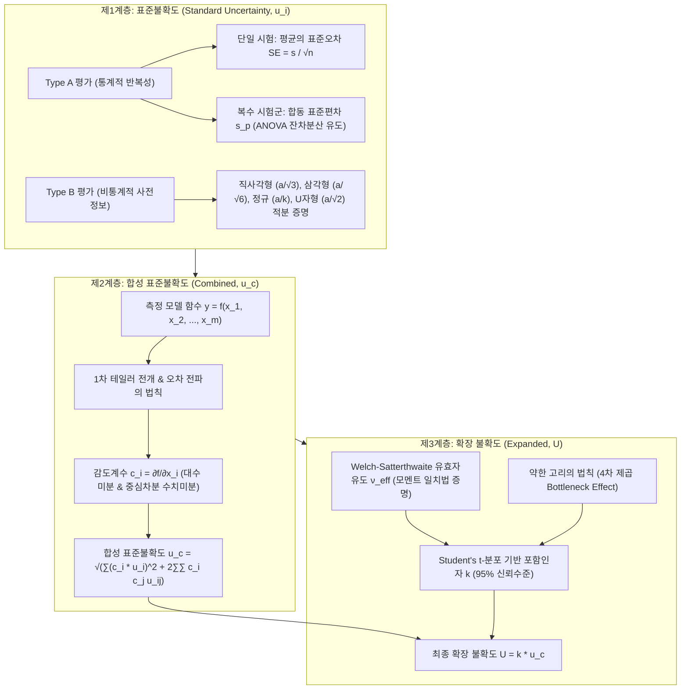

# 📐 측정불확도(Measurement Uncertainty) 완벽 이론 및 수학적 유도 가이드
> **ISO/IEC Guide 98-3 (GUM) 및 ISO 28580 지침 기반: 통계학적 유도부터 복합 실무 물리 모델까지**

---

> [!ABSTRACT] 📖 본 가이드의 목적과 구성
> 본 문서는 측정학(Metrology)의 근본 원리인 **참값, 오차, 불확도의 철학적·수학적 차이**를 정립하고, 국제 표준(**GUM: Guide to the Expression of Uncertainty in Measurement**)에 기반한 불확도 산출 전 과정을 엄밀한 수식 증명과 함께 제공합니다.
> 
> 특히 단순 교과서적 예제를 넘어, 실제 산업 현장에서 필수적으로 쓰이는 **복수 시험군 대상 합동 표준편차(Pooled Standard Deviation)의 분산분석(ANOVA) 연계 유도**, **다변수 비선형 물리 모델의 1차 테일러 감도계수 전개**, **시험기 간 선형 회귀 상관 오차(Proficiency Error)**, 그리고 **Welch-Satterthwaite 유효자유도 공식의 2차 모멘트 일치 증명과 약한 고리 법칙(Bottleneck Effect)**을 완벽한 실측 데이터(타이어 회전저항 ISO 28580) 예시와 함께 마스터할 수 있도록 집대성하였습니다.



---

## 1. 근본 개념: 참값, 오차, 그리고 측정불확도

### 1.1 철학적 배경 및 정의

측정학(Metrology)에서 가장 핵심적인 세 가지 개념은 **참값**, **오차**, 그리고 **측정불확도**입니다.

```
       [과거 패러다임: 오차론]                    [현대 패러다임: 불확도론 (GUM)]
  
       알 수 없는 참값 (Y)                           최적 추정값 (y, 표본평균)
             │                                              │
             ▼                                              ▼
    ┌─────────────────┐                        ┌───────────────────────────────┐
    │ 측정값 (y)       │                        │   신뢰구간 [ y - U , y + U ]   │
    │  오차 E = y - Y │                        │ (참값이 존재할 확률적 흩어짐)  │
    └─────────────────┘                        └───────────────────────────────┘
     (참값을 몰라 오차도 알 수 없음)                 (확률분포와 통계로 엄밀히 계산 가능)
```

1. **참값 (True Value, $Y$)**:
   - **정의**: 특정 조건 하에서 물리적으로 실재하는 유일하고 완벽한 참된 값입니다.
   - **한계**: 어떠한 정밀한 측정 장비를 사용하더라도 장비의 불완전성, 환경 노이즈, 양자적 한계 등으로 인해 **현실에서 참값은 영원히 정확하게 알 수 없습니다(Unknowable).**

2. **오차 (Error, $E$)**:
   - **정의**: 단일 측정 결과값 $y$와 참값 $Y$ 사이의 대수적인 차이입니다.
     $$E = y - Y$$
   - **성분 분해**: 오차는 **체계적 오차(Systematic Error, $e_{\text{sys}}$)**와 **우연 오차(Random Error, $e_{\text{ran}}$)**의 합으로 구성됩니다.
     $$E = e_{\text{sys}} + e_{\text{ran}}$$
     - **체계적 오차 ($e_{\text{sys}}$)**: 장비 영점 미조정, 센서 스케일 드리프트 등으로 인해 항상 일정한 크기와 방향으로 발생하는 오차입니다. 보정(Correction)을 통해 상쇄할 수 있습니다.
     - **우연 오차 ($e_{\text{ran}}$)**: 제어할 수 없는 미세한 노이즈로 인해 무작위로 발생하는 오차입니다. 기댓값 $E[e_{\text{ran}}] = 0$이며, 다회 측정 평균을 통해 줄일 수 있습니다.
   - **치명적 한계**: 참값 $Y$를 모르기 때문에, 개별 측정의 실제 오차 값 $E$는 **수학적으로 계산할 수 없고 오직 이론적 개념으로만 존재**합니다.

3. **측정불확도 (Measurement Uncertainty, $u$)**:
   - **정의**: "오차의 참값을 직접 밝혀낼 수 없다"는 현실을 수용하고, 대신 **"측정 결과에 부여된 값의 흩어짐(Dispersion)을 나타내며, 측정 대상의 참값이 존재할 것으로 합리적으로 추정되는 범위를 특성화하는 모수(Parameter)"**입니다.
   - **패러다임의 전환**: 오차는 단일한 미지의 점(Point)인 반면, **불확도는 확률 밀도 함수의 폭(표준편차 $1\sigma$ 단위)**으로 정량화됩니다. 따라서 불확도는 수학적으로 계산할 수 있고, 국제 표준(GUM)에 따라 객관적으로 표현할 수 있습니다.

### 1.2 정밀도, 정확도, 그리고 불확도의 비교

| 구분 | 정밀도 (Precision) | 정확도 / 진도 (Trueness / Accuracy) | 측정불확도 (Uncertainty) |
| :--- | :--- | :--- | :--- |
| **개념** | 동일 조건 반복 측정 시 결과들의 모여 있는 조밀도 | 측정 결과들의 평균값이 기준 참값에 얼마나 가까운가 | 측정 결과가 참값을 얼마나 신뢰성 있게 대변하는지의 흩어짐 폭 |
| **관련 오차** | 우연 오차 (Random Error)의 크기 대변 | 체계적 오차 (Systematic Error / Bias)의 작음 | **우연 오차 + 잔여 체계적 오차의 총합적 분산** |
| **정량화** | 표본표준편차 ($s$) | 편향 (Bias = $\bar{x} - Y_{\text{ref}}$) | 합성 표준불확도 ($u_c$) 및 확장 불확도 ($U$) |

---

## 2. 표준불확도(Standard Uncertainty, $u$) 산출 및 확률분포적 유도 배경

불확도 평가의 기본 계량 단위는 통계학의 **1 표준편차 ($1\sigma$)**에 해당하는 **표준불확도 (Standard Uncertainty, $u$)**입니다.

---

### 2.1 A타입 표준불확도 ($u_A$): 통계적 반복성 평가

동일 조건에서 $n$회 독립 반복 측정한 데이터 $\{x_1, x_2, \dots, x_n\}$의 평균 자체의 불확실성을 평가합니다.

#### ① 산술평균 ($\bar{x}$) 및 표본분산의 베셀 보정(Bessel's Correction) 유도
- **산술평균**: $\bar{x} = \frac{1}{n}\sum_{i=1}^n x_i$
- **표본분산 ($s^2$)**:
  $$s^2 = \frac{1}{n-1}\sum_{i=1}^n (x_i - \bar{x})^2$$

> **💡 왜 $n$이 아니라 $n-1$로 나누는가? (베셀 보정의 수학적 증명)**
> 
> 모평균을 $\mu$, 모분산을 $\sigma^2$이라 할 때, 편차 제곱합 $\sum (x_i - \bar{x})^2$의 기댓값을 전개합니다:
> $$x_i - \bar{x} = (x_i - \mu) - (\bar{x} - \mu)$$
> 제곱하여 전개하면:
> $$(x_i - \bar{x})^2 = (x_i - \mu)^2 - 2(x_i - \mu)(\bar{x} - \mu) + (\bar{x} - \mu)^2$$
> 모든 $i=1 \dots n$에 대해 합산하면:
> $$\sum_{i=1}^n (x_i - \bar{x})^2 = \sum_{i=1}^n (x_i - \mu)^2 - 2(\bar{x} - \mu)\sum_{i=1}^n (x_i - \mu) + n(\bar{x} - \mu)^2$$
> 여기서 $\sum_{i=1}^n (x_i - \mu) = n(\bar{x} - \mu)$이므로:
> $$\sum_{i=1}^n (x_i - \bar{x})^2 = \sum_{i=1}^n (x_i - \mu)^2 - n(\bar{x} - \mu)^2$$
> 양변에 기댓값 연산자 $E[\cdot]$를 취합니다:
> $$E\left[\sum_{i=1}^n (x_i - \bar{x})^2\right] = \sum_{i=1}^n E[(x_i - \mu)^2] - n E[(\bar{x} - \mu)^2] = n\sigma^2 - n \cdot \text{Var}(\bar{x})$$
> 뒤에서 유도하듯 $\text{Var}(\bar{x}) = \frac{\sigma^2}{n}$이므로:
> $$E\left[\sum_{i=1}^n (x_i - \bar{x})^2\right] = n\sigma^2 - n\left(\frac{\sigma^2}{n}\right) = (n-1)\sigma^2$$
> 따라서 모분산 $\sigma^2$의 **불편추정량(Unbiased Estimator)**이 되기 위해서는 반드시 $n-1$로 나누어야 합니다:
> $$E\left[\frac{1}{n-1}\sum_{i=1}^n (x_i - \bar{x})^2\right] = \frac{(n-1)\sigma^2}{n-1} = \sigma^2 \quad \blacksquare$$

#### ② A타입 표준불확도 수식 (평균의 표준오차, $SE$)
최종 측정값은 단일 데이터 $x_i$가 아니라 표본평균 $\bar{x}$이므로, 불확도는 평균의 표준편차인 **표준오차(Standard Error of the Mean)**가 됩니다:
$$u_A(\bar{x}) = \frac{s}{\sqrt{n}}$$

#### ③ Why $\sqrt{n}$인가? (수학적 증명)
모든 $x_i$가 상호 독립이고 분산이 $\sigma^2$일 때:
$$\text{Var}(\bar{x}) = \text{Var}\left(\frac{1}{n}\sum_{i=1}^n x_i\right) = \frac{1}{n^2}\sum_{i=1}^n \text{Var}(x_i) = \frac{1}{n^2}(n\sigma^2) = \frac{\sigma^2}{n}$$
따라서 표준편차는:
$$\sigma_{\bar{x}} = \sqrt{\text{Var}(\bar{x})} = \frac{\sigma}{\sqrt{n}} \implies u_A = \frac{s}{\sqrt{n}} \quad \blacksquare$$

| 구분 | 표본표준편차 ($s$) | 평균의 표준오차 ($SE = u_A$) |
| :--- | :--- | :--- |
| **의미** | 물성 및 계측 시스템 본래의 흩어짐 크기 | 표본평균 $\bar{x}$가 모평균 대비 흔들리는 크기 |
| **$n \to \infty$ 거동** | 참된 모표준편차 $\sigma$로 수렴 (0이 되지 않음) | **0으로 지속 수렴** ($\propto 1/\sqrt{n}$) |
| **자유도** | $\nu = n - 1$ | $\nu = n - 1$ |

---

### 2.2 복수 시험군 대상 합동 표준편차 (Pooled Standard Deviation, $s_p$) 완벽 이론

현업 시험(예: 타이어 시험, 화학 분석, 제동력 평가)에서는 단일 1회 시험 세션($n=2 \sim 3$회)만으로 반복성 불확도를 계산하면 **자유도가 극히 낮아($\nu = 1 \sim 2$) Student's t-분포 포함인자가 기하급수적으로 폭증**하거나, 우연히 데이터가 일치하여 **불확도를 심각하게 과소평가(0에 가깝게 오판)**하는 치명적 결함이 발생합니다.

이를 해결하기 위해 동일한 프로세스 하에서 수행된 **여러 시험군(서로 다른 타이어 규격, 서로 다른 날짜의 시험)의 분산을 결합**하는 **합동 분산(Pooled Variance)** 기법을 사용합니다.

```
 [시험군 1: 타이어 A]   [시험군 2: 타이어 B]   ...   [시험군 k: 타이어 K]
   n_1회 시험, s_1^2       n_2회 시험, s_2^2            n_k회 시험, s_k^2
           │                      │                           │
           └──────────────────────┼───────────────────────────┘
                                  ▼
             ┌─────────────────────────────────────────┐
             │       자유도 가중 합동 분산 (s_p^2)       │
             │     s_p^2 = ∑(ν_j * s_j^2) / ∑ ν_j      │
             └────────────────────┬────────────────────┘
                                  │
                                  ▼
             ┌─────────────────────────────────────────┐
             │  자유도 ν_total = ∑(n_j - 1) 대폭 확보   │
             │   → t-분포 k값이 안정적인 2.0 수준 수렴  │
             └─────────────────────────────────────────┘
```

#### ① 일원배치 분산분석(One-Way ANOVA) 잔차분산과의 수학적 일치성 증명
$k$개의 서로 다른 시험군이 있고, 각 그룹 $j$의 표본수가 $n_j$, 표본평균이 $\bar{x}_j$, 표본분산이 $s_j^2$라고 합시다.
각 시험군은 평균 레벨($\mu_j$)은 서로 다를 수 있지만, **측정 계측기 및 시험기의 고유 노이즈(모분산 $\sigma^2$)는 동일하다(등분산성, Homoscedasticity)**고 가정합니다.

각 그룹 내부의 편차 제곱합(Sum of Squares Within, $SS_{\text{within}}$ 또는 잔차 제곱합 $SS_E$)은:
$$SS_{\text{within}} = \sum_{j=1}^k \sum_{i=1}^{n_j} (x_{ij} - \bar{x}_j)^2$$
각 그룹의 표본분산 정의가 $s_j^2 = \frac{1}{n_j - 1}\sum_{i=1}^{n_j}(x_{ij} - \bar{x}_j)^2$이므로:
$$\sum_{i=1}^{n_j} (x_{ij} - \bar{x}_j)^2 = (n_j - 1) s_j^2 = \nu_j s_j^2$$
이를 대입하면:
$$SS_{\text{within}} = \sum_{j=1}^k \nu_j s_j^2$$
전체 그룹 내부의 총 자유도 $\nu_{\text{total}}$은:
$$\nu_{\text{total}} = \sum_{j=1}^k (n_j - 1) = \sum_{j=1}^k \nu_j = N_{\text{total}} - k$$
따라서 ANOVA의 잔차 평균제곱(Mean Square Error, $MS_E$)이자 **합동 분산($s_p^2$)**은 다음과 같이 유도됩니다:
$$s_p^2 = MS_{\text{within}} = \frac{SS_{\text{within}}}{\nu_{\text{total}}} = \frac{\sum_{j=1}^k \nu_j s_j^2}{\sum_{j=1}^k \nu_j} = \frac{\sum_{j=1}^k (n_j - 1) s_j^2}{\sum_{j=1}^k (n_j - 1)}$$

> **💡 합동 분산 $s_p^2$의 불편성(Unbiasedness) 증명**:
> 모든 그룹의 모분산이 $\sigma^2$으로 동일하므로, $E[s_j^2] = \sigma^2$입니다.
> $$E[s_p^2] = E\left[ \frac{\sum \nu_j s_j^2}{\sum \nu_j} \right] = \frac{\sum \nu_j E[s_j^2]}{\sum \nu_j} = \frac{\sum \nu_j \sigma^2}{\sum \nu_j} = \sigma^2 \frac{\sum \nu_j}{\sum \nu_j} = \sigma^2 \quad \blacksquare$$
> 즉, 합동 분산은 표본수가 서로 다른 그룹들을 완벽하게 편향 없이 단 하나의 통합 분산으로 대변합니다.

#### ② 절대 분산 풀링 vs 상대 분산(변동계수 $CV$, $\sigma_{\text{rel}}$) 풀링
측정 대상의 물리적 크기(평균값)가 그룹마다 크게 다른 경우(예: 저저항 타이어 $RR=5.0\,\text{N}$ vs 고저항 타이어 $RR=10.0\,\text{N}$):
- **절대 분산 풀링의 결함**: 저항이 큰 타이어는 물리적으로 산포($s$)도 커지는 경향이 있으므로, 절대값 분산($s^2$)을 그대로 풀링하면 대형 타이어의 노이즈가 소형 타이어를 왜곡합니다.
- **상대 분산 풀링의 필연성**: 각 그룹의 무차원 변동계수(상대 표준편차) $\sigma_{\text{rel}, j} = \frac{s_j}{\bar{x}_j}$를 구한 뒤, 이를 풀링합니다:
  $$u_{\text{pooled,rel}}^2 = \frac{\sum_{j=1}^k \nu_j \sigma_{\text{rel}, j}^2}{\sum_{j=1}^k \nu_j}$$
  $$u_{\text{pooled,rel}} = \sqrt{u_{\text{pooled,rel}}^2}$$

#### ③ 규격 시험 절차($n_{\text{eval}}$회 평균) 반영 표준불확도 환산
국제 규격(예: ISO 28580 타이어 회전저항)은 성적서 발행 시 "단 1회 측정이 아니라 연속 2회 측정의 평균값($n_{\text{eval}} = 2$)"을 공식 결과로 채택합니다.
따라서 프로세스 고유의 합동 재현성($u_{\text{pooled}}$)에 **표본평균 필터($\sqrt{n_{\text{eval}}}$)**를 적용해야 최종 평가 표준불확도가 완성됩니다:
$$u_{\text{eval}} = \frac{u_{\text{pooled}}}{\sqrt{n_{\text{eval}}}} \quad \left(\text{예: } u_2 = \frac{u_{\text{pooled}}}{\sqrt{2}}\right)$$

#### ④ 분산 불균형 시 Welch-Satterthwaite 유효자유도 감쇄 페널티
이론적으로 등분산성이 완벽하면 자유도는 단순히 총합 $\nu_{\text{total}} = \sum \nu_j$가 됩니다. 그러나 현실에서 특정 타이어 시편이 유독 거칠어 분산이 클 경우, 불균형에 따른 통계적 페널티가 발생하여 유효자유도가 삭감됩니다:
$$\nu_{\text{eff, pooled}} = \frac{\left( \sum_{j=1}^k \nu_j s_j^2 \right)^2}{\sum_{j=1}^k \frac{(\nu_j s_j^2)^2}{\nu_j}} = \frac{\left( \sum_{j=1}^k \nu_j s_j^2 \right)^2}{\sum_{j=1}^k \nu_j (s_j^2)^2} \le \sum_{j=1}^k \nu_j$$
*(코시-슈바르츠 부등식에 의해 모든 $s_j^2$가 완전히 동일할 때만 등호가 성립하며, 분산 편차가 클수록 $\nu_{\text{eff}}$는 급격히 감소합니다.)*

---

### 2.3 B타입 표준불확도 ($u_B$): 사전 정보 및 확률분포 적분 유도

장비 사양서, 교정 성적서, 물리적 한계치 등 비통계적 정보로부터 오차의 반폭(한계치) $a$가 주어졌을 때의 유도입니다.

```
       [직사각형 분포]                     [삼각형 분포]                      [U자형 분포]
        f(x)                              f(x)                              f(x)
      ┌──────┐ (1/2a)                      / (1/a)                         │\      /│
      │      │                            /                                │ \    / │
  ────┴──────┴───────                ────┴────┴──── ───                ────┴─────┴─── ───
     -a      a    (x)                    -a    a    (x)                    -a      a    (x)
    u = a / √3                         u = a / √6                         u = a / √2
```

#### ① 직사각형 (Uniform / Rectangular) 분포: $u_B = a/\sqrt{3}$
- **적용 조건**: 장비 분해능(Resolution), 디지털 디스플레이 양자화 오차, 제조사 스펙 $\pm a$ (분포 정보 없음).
- **수학적 유도**: $f(x) = \frac{1}{2a} \; (-a \le x \le a)$
  $$\text{Var}(X) = \int_{-a}^a x^2 f(x) dx = \frac{1}{2a}\int_{-a}^a x^2 dx = \frac{1}{2a}\left[\frac{x^3}{3}\right]_{-a}^a = \frac{1}{2a}\left(\frac{2a^3}{3}\right) = \frac{a^2}{3}$$
  $$\therefore u_B = \sqrt{\text{Var}(X)} = \frac{a}{\sqrt{3}} \approx 0.5774 \, a \quad \blacksquare$$

#### ② 삼각형 (Triangular) 분포: $u_B = a/\sqrt{6}$
- **적용 조건**: 두 독립 직사각형 분포의 합, 중앙값 부근 발생 확률이 가장 높고 경계로 갈수록 선형 감소.
- **수학적 유도**: $f(x) = \frac{a - |x|}{a^2} \; (-a \le x \le a)$
  $$\text{Var}(X) = 2 \int_0^a x^2 \frac{a - x}{a^2} dx = \frac{2}{a^2} \left[ a\frac{x^3}{3} - \frac{x^4}{4} \right]_0^a = \frac{2}{a^2}\left(\frac{a^4}{12}\right) = \frac{a^2}{6}$$
  $$\therefore u_B = \sqrt{\text{Var}(X)} = \frac{a}{\sqrt{6}} \approx 0.4082 \, a \quad \blacksquare$$

#### ③ U자형 (U-shaped / Bimodal) 분포: $u_B = a/\sqrt{2}$
- **적용 조건**: 항온조 온도 제어 사이클(히터 On/Off 진동), 사인파 전압 변조 오차 등 양 끝단 체류 시간이 가장 긴 물리계.
- **수학적 유도**: $x(t) = a \sin(\omega t)$라 하면, 확률밀도함수는 $f(x) = \frac{1}{\pi \sqrt{a^2 - x^2}} \; (-a < x < a)$
  $$\text{Var}(X) = \int_{-a}^a x^2 \frac{1}{\pi \sqrt{a^2 - x^2}} dx$$
  $x = a \sin\theta$로 치환 ($dx = a \cos\theta d\theta$):
  $$\text{Var}(X) = \frac{1}{\pi}\int_{-\pi/2}^{\pi/2} (a^2 \sin^2\theta) d\theta = \frac{a^2}{\pi}\left[\frac{\theta}{2} - \frac{\sin 2\theta}{4}\right]_{-\pi/2}^{\pi/2} = \frac{a^2}{\pi}\left(\frac{\pi}{2}\right) = \frac{a^2}{2}$$
  $$\therefore u_B = \sqrt{\text{Var}(X)} = \frac{a}{\sqrt{2}} \approx 0.7071 \, a \quad \blacksquare$$

#### ④ 정규 (Normal / Gaussian) 분포: $u_B = a/k$
- **적용 조건**: 공인 교정 성적서에 확장불확도 $U$와 포함인자 $k$(통상 $k=2$, 95%)가 명시된 경우.
  $$u_B = \frac{U}{k}$$

#### ⑤ B타입의 자유도 ($\nu_B$) 결정
교정성적서나 장비 규격은 확정된 사실로 간주되므로 통상 **$\nu_B = \infty$**로 부여합니다.
만약 사양의 불확실한 정도(신뢰도 한계 오차율 $R = \Delta u/u$)가 알려진 경우, GUM 부록 G.4.2에 따라 다음과 같이 추정할 수 있습니다:
$$\nu_B \approx \frac{1}{2}\left(\frac{\Delta u(x)}{u(x)}\right)^{-2}$$
*(예: 사양서 오차 한계의 신뢰도가 약 10%의 불확실성을 가진다면, $\nu_B \approx \frac{1}{2}(0.10)^{-2} = 50$)*

---

## 3. 민감도 계수($c_i$)와 오차 전파의 법칙 (합성표준불확도 $u_c$)

우리가 구하려는 최종 출력 물리량 $y$는 여러 입력량 $x_1, x_2, \dots, x_m$의 수학적 함수로 정의됩니다:
$$y = f(x_1, x_2, \dots, x_m)$$

### 3.1 오차 전파의 법칙 (Law of Propagation of Uncertainty) 테일러 유도
각 입력 변수의 참값을 $\mu_i$, 변동을 $\Delta x_i = x_i - \mu_i$라 할 때, 다변수 1차 테일러 급수로 전개합니다:
$$y - \mu_y \approx \sum_{i=1}^m \frac{\partial f}{\partial x_i} (x_i - \mu_i)$$
양변을 제곱하고 통계적 기댓값 $E[\cdot]$를 취하여 분산 $u_c^2(y)$를 구합니다:
$$u_c^2(y) = E\left[ (y - \mu_y)^2 \right] \approx E\left[ \left( \sum_{i=1}^m \frac{\partial f}{\partial x_i} (x_i - \mu_i) \right)^2 \right]$$
제곱합 항과 교차곱 항으로 전개하면:
$$u_c^2(y) = \sum_{i=1}^m \left(\frac{\partial f}{\partial x_i}\right)^2 E[(x_i - \mu_i)^2] + 2 \sum_{i=1}^{m-1}\sum_{j=i+1}^m \left(\frac{\partial f}{\partial x_i}\right)\left(\frac{\partial f}{\partial x_j}\right) E[(x_i - \mu_i)(x_j - \mu_j)]$$
통계학 정의에 의해 $E[(x_i - \mu_i)^2] = u^2(x_i)$, $E[(x_i - \mu_i)(x_j - \mu_j)] = u(x_i, x_j) = r(x_i, x_j) u(x_i) u(x_j)$이므로:
$$u_c^2(y) = \sum_{i=1}^m c_i^2 u^2(x_i) + 2 \sum_{i=1}^{m-1}\sum_{j=i+1}^m c_i c_j u(x_i, x_j)$$
입력 변수들이 상호 독립($r_{ij} = 0$)인 경우, 최종 **합성표준불확도(Combined Standard Uncertainty)**는 **제곱합의 제곱근(RSS, Root-Sum-Square)**이 됩니다:
$$u_c(y) = \sqrt{\sum_{i=1}^m [c_i \cdot u(x_i)]^2}$$

---

### 3.2 감도계수(Sensitivity Coefficient, $c_i$)의 공학적 의미
$$c_i = \frac{\partial f}{\partial x_i}$$
감도계수는 **서로 다른 물리 단위(N, mm, $^\circ\text{C}$, bar 등)를 출력 물리량의 단위(N)로 환전해주는 환율이자, 오차가 출력에 증폭되는 가중치** 역할을 수행합니다.

- **수치 미분 (중심차분법, Central Finite Difference)**:
  수식이 극히 복잡하여 해석적 편미분이 어려울 때 컴퓨터 알고리즘(`unoUtil.statistics.uncertainty`)은 중심차분을 사용합니다:
  $$c_i \approx \frac{f(x_1, \dots, x_i + h, \dots, x_m) - f(x_1, \dots, x_i - h, \dots, x_m)}{2h} \quad (\text{오차 } O(h^2))$$

---

### 3.3 복합 공학 물리 모델의 감도계수 편미분 완전 유도 (타이어 회전저항 힘 측정법)

실제 산업계에서 가장 까다로운 모델 중 하나인 **ISO 28580 타이어 회전저항(RR) 힘 측정법(Force Method)**을 통해 감도계수가 어떻게 대수적으로 유도되는지 확인합니다.

#### ① 지배방정식 (Governing Equation)
$$RR = F_{\text{drum}} \cdot [1 + K_t(Temp - 25)] \cdot \left[ (F_x - C_{\text{cross}} \cdot Load)\left(1 + \frac{DLR}{R_{\text{drum1}}}\right) - F_{x,\text{skim}}\left(1 + \frac{DLR_{\text{skim}}}{R_{\text{drum1}}}\right) \right]$$

- $F_x$: 측정된 총 종방향 힘 ($\text{N}$)
- $F_{x,\text{skim}}$: 무부하 접촉 상태의 기생 저항력 (베어링 마찰, 림 공기저항) ($\text{N}$)
- $Load$: 타이어에 인가된 수직 하중 ($\text{N}$)
- $C_{\text{cross}}$: 수직 하중이 전후방 로드셀에 유기되는 물리적 간섭(Crosstalk) 상쇄 계수
- $DLR, DLR_{\text{skim}}$: 부하 및 무부하 상태의 타이어 동적 하중 반경 ($\text{mm}$)
- $R_{\text{drum1}}$: 시험기 드럼 반경 ($853.8\,\text{mm}$)
- $Temp$: 시험실 주변 온도 ($^\circ\text{C}$, 기준온도 $25^\circ\text{C}$)
- $K_t$: 고무 점탄성 온도 보정 계수 ($0.008\,/^\circ\text{C}$)
- $F_{\text{drum}}$: 드럼 곡률 보정 계수 ($0.97847$)

편의상 온도 보정항을 $T_{\text{corr}} = 1 + K_t(Temp - 25)$, 곡률 보정항을 $F_D = F_{\text{drum}}$라 치환합니다.

#### ② 6대 입력 변수에 대한 편미분 전개 과정

1. **종방향 하중 로드셀 ($F_x$) 감도계수:**
   $F_x$는 대괄호 첫 번째 항에 선형으로 존재하므로:
   $$c_{F_x} = \frac{\partial RR}{\partial F_x} = F_D \cdot T_{\text{corr}} \cdot \left(1 + \frac{DLR}{R_{\text{drum1}}}\right)$$

2. **무부하 기생 저항력 ($F_{x,\text{skim}}$) 감도계수:**
   $F_{x,\text{skim}}$은 차감되는 음(-)의 선형 항이므로:
   $$c_{F_{x,\text{skim}}} = \frac{\partial RR}{\partial F_{x,\text{skim}}} = -F_D \cdot T_{\text{corr}} \cdot \left(1 + \frac{DLR_{\text{skim}}}{R_{\text{drum1}}}\right)$$

3. **수직 하중 ($Load$) 감도계수:**
   크로스토크 계수 $C_{\text{cross}}$와 결합되어 있으므로:
   $$c_{Load} = \frac{\partial RR}{\partial Load} = -F_D \cdot T_{\text{corr}} \cdot C_{\text{cross}} \cdot \left(1 + \frac{DLR}{R_{\text{drum1}}}\right)$$

4. **동적 하중 반경 ($DLR$) 감도계수:**
   $DLR$ 항만 미분하면 분모 $R_{\text{drum1}}$이 밖으로 나옵니다:
   $$c_{DLR} = \frac{\partial RR}{\partial DLR} = F_D \cdot T_{\text{corr}} \cdot \frac{F_x - C_{\text{cross}} \cdot Load}{R_{\text{drum1}}}$$

5. **무부하 동적 반경 ($DLR_{\text{skim}}$) 감도계수:**
   $$c_{DLR_{\text{skim}}} = \frac{\partial RR}{\partial DLR_{\text{skim}}} = -F_D \cdot T_{\text{corr}} \cdot \frac{F_{x,\text{skim}}}{R_{\text{drum1}}}$$

6. **주변 온도 ($Temp$) 감도계수:**
   $T_{\text{corr}}$ 항을 미분하면 $K_t$가 추출되므로, 전체 $RR$ 식에 연쇄법칙을 적용합니다:
   $$c_{Temp} = \frac{\partial RR}{\partial Temp} = \frac{K_t \cdot RR}{1 + K_t(Temp - 25)}$$

---

## 4. 기준기 간 비교 및 선형 상관 회귀 모델의 불확도 (Proficiency & Inter-laboratory Error)

연구소 자체 시험기(Candidate Machine, $x$)의 측정 결과를 국제 공인 기준 시험기(Reference Machine, $y$) 수준으로 보정하기 위해 **선형 회귀식($\hat{y} = \alpha + \beta x$)**을 수립할 때 발생하는 회귀 잔차 불확도의 유도입니다.

```
       Reference (y)
            ▲                • (y_i, x_i) 실측 데이터
            │              / 
            │            / ─── 회귀선 y_hat = α + βx
            │          / : 
            │        /   : 잔차 e_i = y_i - y_hat
            │      /     :
            │    / 
            └────────────────────────► Candidate (x)
```

### 4.1 OLS 잔차 분산 ($s_{y.x}^2$) 및 회귀 자유도
$n$종의 타이어에 대해 회귀식을 도출할 때:
- 기울기: $\beta = \frac{\sum (x_i - \bar{x})(y_i - \bar{y})}{\sum (x_i - \bar{x})^2}$
- 절편: $\alpha = \bar{y} - \beta \bar{x}$
- 잔차 제곱합 ($SSE$): $SSE = \sum_{i=1}^n (y_i - \hat{y}_i)^2$
- **잔차 분산 ($s_{y.x}^2$)**: 절편과 기울기 2개의 모수를 추정했으므로 자유도는 **$\nu = n - 2$**입니다.
  $$s_{y.x}^2 = \frac{SSE}{n - 2} = \frac{\sum_{i=1}^n (y_i - \hat{y}_i)^2}{n - 2}$$

### 4.2 회귀선 상의 예측치 신뢰구간 (Confidence Interval) 폭 유도
임의의 측정값 $x_0$를 회귀선에 대입하여 환산된 기준값 $\hat{y}_0 = \alpha + \beta x_0$의 통계적 표준오차 $u(\hat{y}_0)$는 다음과 같습니다:
$$u(\hat{y}_0) = s_{y.x} \sqrt{\frac{1}{n} + \frac{(x_0 - \bar{x})^2}{\sum_{i=1}^n (x_i - \bar{x})^2}}$$
- 중심부($x_0 = \bar{x}$)에서 불확도가 최소($s_{y.x}/\sqrt{n}$)가 되며, 평균에서 멀어질수록 쌍곡선 형태로 불확도가 증가합니다.
- 평가 구간 전반에 걸친 평균 신뢰구간 폭($\bar{U}_{CI}$)을 구하고 이를 평균 예측치($\bar{\hat{y}}$)로 나누어 **상관 회귀의 상대 표준불확도($u_{\text{rel, reg}}$)**를 결정합니다:
  $$u_{\text{rel, reg}} = \frac{\bar{u}(\hat{y})}{\bar{\hat{y}}} \quad (\text{자유도 } \nu = n - 2)$$

---

## 5. 유효자유도($\nu_{\text{eff}}$), 포함인자($k$), 그리고 확장불확도($U$)

합성표준불확도 $u_c$는 $1\sigma$ (신뢰수준 약 68%)입니다. 산업 현장의 표준인 **95% 신뢰구간**을 보증하기 위해 **확장불확도 (Expanded Uncertainty, $U$)**를 산출합니다:
$$U = k \cdot u_c$$

### 5.1 Welch-Satterthwaite 공식의 수학적 유도 (2차 모멘트 일치법)

서로 다른 분산 $s_i^2$와 서로 다른 자유도 $\nu_i$를 갖는 여러 정규 확률변수들의 선형 결합 분산이 주어졌을 때, 합성된 단일 t-분포의 **유효자유도($\nu_{\text{eff}}$)**는 어떻게 결정되는가?

#### 1단계: 카이제곱 분포와 표본분산의 분산
통계학에서 정규분포를 따르는 표본분산 $s_i^2$는 자유도 $\nu_i$인 카이제곱 분포와 다음 관계를 갖습니다:
$$\frac{\nu_i s_i^2}{\sigma_i^2} \sim \chi^2(\nu_i)$$
자유도가 $\nu$인 카이제곱 확률변수 $W$의 분산은 $2\nu$입니다 ($\text{Var}(\chi^2(\nu)) = 2\nu$).
따라서 표본분산 $s_i^2$ 자체의 통계적 분산은 다음과 같이 유도됩니다:
$$\text{Var}\left(\frac{\nu_i s_i^2}{\sigma_i^2}\right) = \frac{\nu_i^2}{\sigma_i^4}\text{Var}(s_i^2) = 2\nu_i \implies \text{Var}(s_i^2) = \frac{2\sigma_i^4}{\nu_i} \approx \frac{2 s_i^4}{\nu_i}$$

#### 2단계: 합성 분산의 분산 전개
합성 분산이 독립 성분들의 합 $u_c^2 = \sum_{i=1}^m u_i^2$ (여기서 $u_i = c_i s_i$)로 정의될 때, 합성 분산의 분산은 각 분산의 합입니다:
$$\text{Var}(u_c^2) = \sum_{i=1}^m \text{Var}(u_i^2) = \sum_{i=1}^m \frac{2 u_i^4}{\nu_i}$$

#### 3단계: 2차 모멘트 일치 (Moment Matching)
전체 시스템의 합성 분산 $u_c^2$ 역시 단일한 미지의 유효자유도 $\nu_{\text{eff}}$를 갖는 카이제곱 분포로 근사할 수 있다고 가정합니다:
$$\text{Var}(u_c^2) = \frac{2 u_c^4}{\nu_{\text{eff}}}$$
두 식을 서로 같다고 놓습니다:
$$\frac{2 u_c^4}{\nu_{\text{eff}}} = \sum_{i=1}^m \frac{2 u_i^4}{\nu_i}$$
양변에서 2를 약분하고 $\nu_{\text{eff}}$에 대해 정리하면 **Welch-Satterthwaite 공식**이 완벽히 유도됩니다:
$$\nu_{\text{eff}} = \frac{u_c^4}{\sum_{i=1}^m \frac{u_i^4}{\nu_i}} = \frac{u_c^4(y)}{\sum_{i=1}^m \frac{[c_i \cdot u(x_i)]^4}{\nu_i}} \quad \blacksquare$$

---

### 5.2 4차 거듭제곱의 지배: "약한 고리의 법칙 (Bottleneck Effect)"

Welch-Satterthwaite 공식의 핵심은 분모에 걸려 있는 **4차 거듭제곱($u_i^4$)**입니다.

> [!WARNING] ⚠️ 자유도의 병목 효과 (The Bottleneck Law)
> - 센서 계측이나 타이어 재현성 요인이 수백 회 시험을 거쳐 $\nu_1 = 55$, $\nu_2 = 224$의 거대한 자유도를 확보했더라도,
> - 상관성 회귀나 외부 시험 등 단 5개 샘플로 수행하여 **자유도가 극히 낮은 요인($\nu_3 = 3$)**이 합성 분산에 대등한 크기로 참여하는 순간:
>   $$\frac{u_3^4}{\nu_3} = \frac{u_3^4}{3}$$
> - 분모에서 이 3으로 나눈 항이 전체 분모의 **98% 이상을 독식**해 버립니다.
> - 그 결과 전체 시스템의 최종 유효자유도는 200 근처가 아니라 **13.65 수준으로 수직 낙하**합니다.
> - **엔지니어링 시사점**: 시스템의 불확도를 줄이기 위해 이미 충분한 시험(N=300)을 더 늘리는 것은 무의미하며, **가장 자유도가 낮은 "약한 고리(자유도 3)"의 표본수를 5개에서 10개로 늘리는 것**이 유효자유도를 끌어올리는 유일한 방법입니다.

---

### 5.3 포함인자 $k$의 엄밀한 결정
산출된 $\nu_{\text{eff}}$에 대해 95% 신뢰수준($\alpha = 0.05$) 양측 검정 Student's t-분포 분위수를 적용합니다:
- $\nu_{\text{eff}} \ge 100$: 정규분포 근사 $k = 1.960 \approx 2.00$
- $\nu_{\text{eff}} < 100$: $k = t_{0.975}(\nu_{\text{eff}})$
  *(예: $\nu_{\text{eff}} = 13.65 \implies k \approx 2.16$, $\nu_{\text{eff}} = 4 \implies k = 2.78$)*

---

## 6. 기초 실전 수식 연산 예시 (Ohm's Law: $R = \frac{V}{I}$)

기본 개념 확립을 위해 직류 회로에서 전압 $V$와 전류 $I$를 측정하여 저항 $R$을 계산하는 모델의 불확도를 단계별로 전개합니다.

### 6.1 측정 모델 및 입력 데이터
- **측정 모델**: $R = f(V, I) = \frac{V}{I}$
- **전압 ($V$)**: 교정성적서 상 $U = 0.20\,\text{V}$ ($k=2$, 정규분포), 실측치 $V = 10.00\,\text{V}$
  $$u(V) = \frac{0.20}{2} = 0.10\,\text{V}, \quad \nu_V = \infty$$
- **전류 ($I$)**: 5회 반복 측정 데이터 $\{1.98, 2.02, 1.99, 2.01, 2.00\}\,\text{A}$
  $$\bar{I} = 2.00\,\text{A}, \quad s_I = 0.01581\,\text{A}$$
  $$u(I) = \frac{0.01581}{\sqrt{5}} = 0.007071\,\text{A}, \quad \nu_I = 5 - 1 = 4$$

### 6.2 단계별 연산 과정
1. **명목 저항값**: $\bar{R} = \frac{10.00}{2.00} = 5.000\,\Omega$
2. **편미분 감도계수**:
   - $c_V = \frac{\partial R}{\partial V} = \frac{1}{I} = \frac{1}{2.00} = 0.500\,\Omega/\text{V}$
   - $c_I = \frac{\partial R}{\partial I} = -\frac{V}{I^2} = -\frac{10.00}{2.00^2} = -2.500\,\Omega/\text{A}$
3. **각 요인의 기여 불확도**:
   - $u_V(R) = c_V \cdot u(V) = 0.500 \times 0.10 = 0.0500\,\Omega$
   - $u_I(R) = |c_I| \cdot u(I) = |-2.500| \times 0.007071 = 0.01768\,\Omega$
4. **합성표준불확도 ($u_c(R)$)**:
   $$u_c(R) = \sqrt{0.0500^2 + 0.01768^2} = \sqrt{0.0025 + 0.0003125} = \sqrt{0.0028125} \approx 0.05303\,\Omega$$
5. **유효자유도 ($\nu_{\text{eff}}$)**:
   $$\nu_{\text{eff}} = \frac{u_c^4(R)}{\frac{u_V(R)^4}{\infty} + \frac{u_I(R)^4}{4}} = \frac{(0.0028125)^2}{0 + \frac{(0.01768)^4}{4}} = \frac{7.910 \times 10^{-6}}{\frac{9.766 \times 10^{-8}}{4}} = \frac{7.910 \times 10^{-6}}{2.441 \times 10^{-8}} \approx 324.0$$
6. **확장불확도 ($U$)**:
   $\nu_{\text{eff}} = 324$에 대한 95% t-값은 $k = 1.967$
   $$U = 1.967 \times 0.05303 \approx 0.104\,\Omega$$
   $$\therefore R = (5.000 \pm 0.104)\,\Omega \quad (95\% \text{ 신뢰수준, } k=1.97)$$

---

## 7. 최고급 실전 응용: 타이어 회전저항(RR) 3대 복합 영역 완벽 산출 사례

실제 글로벌 타이어 연구소의 R&D RR 시험기 실측 데이터를 기반으로, **수학적 센서 모델**, **복수 타이어 재현성 풀링**, 그리고 **기준기 선형 회귀 상관**이 결합된 3대 영역 복합 불확도를 완벽히 산출합니다.

```
┌─────────────────────────────────────────────────────────────────────────────┐
│                       타이어 회전저항(RR) 3대 평가 영역                      │
└──────────────────────────────────────┬──────────────────────────────────────┘
                                       │
        ┌──────────────────────────────┼──────────────────────────────┐
        ▼                              ▼                              ▼
┌──────────────────────────┐ ┌──────────────────────────┐ ┌──────────────────────────┐
│ 제1영역: 계측 센서 모델  │ │ 제2영역: 타이어 장기재현 │ │ 제3영역: 기준기 상관회귀 │
├──────────────────────────┤ ├──────────────────────────┤ ├──────────────────────────┤
│ • 로드셀/DLR/온도 24회   │ │ • 마스터 7종 N=382회     │ │ • 타이어 5종 회귀선 잔차 │
│ • 교정성적서 + 감도계수  │ │ • 상대 분산 풀링(Pooled) │ │ • 회귀 신뢰구간(CI) 폭   │
│ • u_1 = 0.34%, ν_1=55.68 │ │ • 2회 평균: u_2 = 0.76%  │ │ • u_3 = 0.78%, ν_3 = 3   │
│                          │ │ • 페널티 유효자유도 224  │ │                          │
└──────────────────────────┘ └──────────────────────────┘ └──────────────────────────┘
        │                              │                              │
        └──────────────────────────────┼──────────────────────────────┘
                                       ▼
             ┌──────────────────────────────────────────────────┐
             │       합성 상대 표준불확도 u_c = 1.14%           │
             │     병목 유효자유도 ν_eff = 13.65 (t_0.975=2.16) │
             │       최종 확장 불확도 U = 2.46% (약 2.5%)       │
             └──────────────────────────────────────────────────┘
```

---

### 7.1 제1영역: Mathematical Sensor Model (수학적 계측기 모델)

- **대표 명목 시험 조건**:
  $F_x = 46.1955\,\text{N}$, $F_{x,\text{skim}} = 8.7933\,\text{N}$, $Load = 7266.08\,\text{N}$, $Temp = 24.5031^\circ\text{C}$, $DLR = 327.65\,\text{mm}$, $DLR_{\text{skim}} = 353.19\,\text{mm}$
  $\implies \bar{RR} = 46.9991\,\text{N} \approx 47.00\,\text{N}$

#### 1) 입력량별 24회 통계(Type A) 및 교정성적서(Type B) 결합

$$u(x_i) = \sqrt{u_{\text{rep}}^2(x_i) + u_{\text{cal}}^2(x_i)}, \quad \nu_{\text{eff}}(x_i) = 24 \times \left(\frac{u(x_i)}{u_{\text{rep}}(x_i)}\right)^4$$

| 입력량 ($x_i$) | 반복 표준오차 $u_{\text{rep}}$ | 성적서 $u_{\text{cal}}$ | 합성 표준불확도 $u(x_i)$ | 개별 자유도 $\nu_i$ |
| :--- | :---: | :---: | :---: | :---: |
| $F_x$ (종방향 힘) | $0.07392\,\text{N}$ | $0.01848\,\text{N}$ | **$0.07620\,\text{N}$** | $27.09$ |
| $F_{x,\text{skim}}$ (기생 손실) | $0.08362\,\text{N}$ | $0.01848\,\text{N}$ | **$0.08564\,\text{N}$** | $26.40$ |
| $DLR$ (동적 반경) | $0.02415\,\text{mm}$ | $0.03500\,\text{mm}$ | **$0.04252\,\text{mm}$** | $230.82$ |
| $DLR_{\text{skim}}$ (무부하 반경) | $0.02074\,\text{mm}$ | $0.03500\,\text{mm}$ | **$0.04068\,\text{mm}$** | $355.45$ |
| $Load$ (수직 하중) | $2.32025\,\text{N}$ | $5.44956\,\text{N}$ | **$5.92295\,\text{N}$** | $1019.11$ |
| $Temp$ (온도) | $0.05319\,^\circ\text{C}$ | $0.05000\,^\circ\text{C}$ | **$0.07300\,^\circ\text{C}$** | $85.16$ |

#### 2) 감도계수 곱 및 제1영역 불확도 총괄표 (Budget Table)

| 입력량 ($x_i$) | 표준불확도 $u(x_i)$ | 감도계수 $c_i$ | 불확도 성분 $u_i(RR) = c_i u$ | 분산 기여율 |
| :--- | :---: | :---: | :---: | :---: |
| $F_x$ | $0.07620\,\text{N}$ | $1.35397$ | $0.10317\,\text{N}$ | $42.01\%$ |
| $F_{x,\text{skim}}$ | $0.08564\,\text{N}$ | $-1.37773$ | $0.11798\,\text{N}$ | $54.94\%$ |
| $DLR$ | $0.04252\,\text{mm}$ | $0.050035\,\text{N/mm}$ | $0.00213\,\text{N}$ | $0.02\%$ |
| $DLR_{\text{skim}}$ | $0.04068\,\text{mm}$ | $-0.010117\,\text{N/mm}$ | $0.00041\,\text{N}$ | $0.001\%$ |
| $Load$ | $5.92295\,\text{N}$ | $-0.0004383$ | $0.00260\,\text{N}$ | $0.03\%$ |
| $Temp$ | $0.07300\,^\circ\text{C}$ | $0.37749\,\text{N/}^\circ\text{C}$ | $0.02756\,\text{N}$ | $3.00\%$ |
| **제1영역 합성** | - | - | **$u_1 = 0.15917\,\text{N}$** | **$100.0\%$** |

- **상대 표준불확도**:
  $$u_{\text{rel}, 1} = \frac{0.15917\,\text{N}}{46.9991\,\text{N}} = 0.003387 \implies \mathbf{0.34\%}$$
- **제1영역 유효자유도 대입**:
  $$\nu_1 = \frac{(0.15917)^4}{\frac{(0.10317)^4}{27.09} + \frac{(0.11798)^4}{26.40} + \dots + \frac{(0.02756)^4}{85.16}} = \frac{6.4177 \times 10^{-4}}{1.1527 \times 10^{-5}} \approx \mathbf{55.68}$$

---

### 7.2 제2영역: Tire-dependent Reproducibility (타이어별 재현성 풀링)

마스터 타이어 7종의 장기 반복 시험 데이터($N_{\text{total}} = 382$)로부터 무차원 상대 표준편차를 풀링합니다.

| Tire ID | 시험횟수 ($N_i$) | 평균 $RR_i$ | 표준편차 $s_i$ | 상대 표준편차 $\sigma_{\text{rel}, i}$ | 자유도 $\nu_i$ | $\nu_i \sigma_{\text{rel}, i}^2$ | $\sigma_{\text{rel}, i}^4 / \nu_i$ |
| :--- | :---: | :---: | :---: | :---: | :---: | :---: | :---: |
| **Tire 01** | 112 | 5.649 N | 0.0715 N | 0.012653 (1.27%) | 111 | $1.777 \times 10^{-2}$ | $2.309 \times 10^{-10}$ |
| **Tire 02** | 125 | 7.842 N | 0.0378 N | 0.004821 (0.48%) | 124 | $2.882 \times 10^{-3}$ | $4.358 \times 10^{-12}$ |
| **Tire 03** | 25 | 8.936 N | 0.0535 N | 0.005983 (0.60%) | 24 | $8.591 \times 10^{-4}$ | $5.339 \times 10^{-11}$ |
| **Tire 04** | 55 | 7.729 N | 0.0444 N | 0.005746 (0.57%) | 54 | $1.783 \times 10^{-3}$ | $2.018 \times 10^{-11}$ |
| **Tire 05** | 18 | 9.442 N | 0.0761 N | 0.008062 (0.81%) | 17 | $1.105 \times 10^{-3}$ | $2.485 \times 10^{-10}$ |
| **Tire 06** | 23 | 7.509 N | 0.0494 N | 0.006572 (0.66%) | 22 | $9.503 \times 10^{-4}$ | $8.480 \times 10^{-11}$ |
| **Tire 07** | 24 | 6.406 N | 0.0446 N | 0.006965 (0.70%) | 23 | $1.116 \times 10^{-3}$ | $1.023 \times 10^{-10}$ |
| **합계** | **382** | - | - | - | **375** | $2.1903 \times 10^{-2}$ | **$7.473 \times 10^{-10}$** |

1. **상대 풀드 분산 ($u_{\text{pooled, rel}}^2$)**:
   $$u_{\text{pooled, rel}}^2 = \frac{\sum \nu_i \sigma_{\text{rel}, i}^2}{\sum \nu_i} = \frac{2.1903 \times 10^{-2}}{375} = 5.84074 \times 10^{-5}$$
   $$u_{\text{pooled, rel}} = \sqrt{5.84074 \times 10^{-5}} = 0.0076425 \implies 0.764\%$$
2. **규격 2회 평균 필터 적용 ($u_2$)**:
   현행 시험 성적서는 2회 측정 평균값을 발행하므로:
   $$u_{\text{rel}, 2} = \frac{u_{\text{pooled, rel}}}{\sqrt{n_{\text{eval}}}} = \frac{0.764\%}{\sqrt{2}} \approx \mathbf{0.76\%}$$
   *(단일 1회 측정 보고 기준 적용 시에는 $u_2 = 0.764\%$를 온전히 적용)*
3. **분산 불균형 유효자유도 페널티 산출**:
   $$\nu_2 = \frac{(u_{\text{pooled, rel}}^2)^2}{\sum_{i=1}^7 \frac{\sigma_{\text{rel}, i}^4}{\nu_i}} = \frac{(5.84074 \times 10^{-5})^2}{7.473 \times 10^{-10}} = \frac{3.4114 \times 10^{-9}}{7.473 \times 10^{-10}} \approx \mathbf{224.54}$$
   *(이론상 총합 자유도인 375 대비, Tire 01의 거친 산포로 인해 224.54로 안전하게 삭감됨)*

---

### 7.3 제3영역: Proficiency Error (기준기 상관 회귀 모델)

국제 공인 기준 시험기($y$)와 R&D 시험기($x$) 간 타이어 5종($n=5$) 선형 회귀:
$$\hat{y} = 0.29159 + 0.99623 x \quad (R^2 = 0.99605)$$

- 잔차 제곱합: $SSE = 0.030609$
- 자유도: $\nu_3 = 5 - 2 = \mathbf{3}$
- 잔차 표준편차: $s_{y.x} = \sqrt{\frac{0.030609}{3}} = 0.10101\,\text{N}$
- 평균 예측치: $\bar{\hat{y}} = 7.5760\,\text{N}$
- 전 구간 평균 신뢰구간 폭: $\bar{U}_{CI} = 0.05872\,\text{N}$
- **상관 회귀 상대 표준불확도**:
  $$u_{\text{rel}, 3} = \frac{\bar{U}_{CI}}{\bar{\hat{y}}} = \frac{0.05872}{7.5760} \approx \mathbf{0.78\%} \quad (\nu_3 = 3)$$

---

### 7.4 최종 3대 영역 종합 합성 및 확장 불확도

#### 1) 합성 상대 표준불확도 ($u_{c,\text{rel}}$)
$$u_{c,\text{rel}} = \sqrt{u_{\text{rel}, 1}^2 + u_{\text{rel}, 2}^2 + u_{\text{rel}, 3}^2}$$
$$u_{c,\text{rel}} = \sqrt{(0.003387)^2 + (0.007642)^2 + (0.007800)^2} = \sqrt{1.3071 \times 10^{-4}} \approx \mathbf{0.011433 \ (1.14\%)}$$

#### 2) 전체 시스템 유효자유도 ($\nu_{\text{eff}}$) 산출 (병목 현상 확인)
$$\nu_{\text{eff}} = \frac{u_{c,\text{rel}}^4}{\frac{u_{\text{rel}, 1}^4}{\nu_1} + \frac{u_{\text{rel}, 2}^4}{\nu_2} + \frac{u_{\text{rel}, 3}^4}{\nu_3}} = \frac{(0.011433)^4}{\frac{(0.003387)^4}{55.68} + \frac{(0.007642)^4}{224.54} + \frac{(0.007800)^4}{3}}$$
각 항의 수치를 직접 비교해 봅니다:
- 제1영역 분모항: $\frac{1.316 \times 10^{-10}}{55.68} = 2.36 \times 10^{-12}$ (0.19%)
- 제2영역 분모항: $\frac{3.411 \times 10^{-9}}{224.54} = 1.52 \times 10^{-11}$ (1.21%)
- **제3영역 분모항**: $\frac{3.702 \times 10^{-9}}{3} = \mathbf{1.234 \times 10^{-9}}$ (**98.60% 독식!**)

$$\nu_{\text{eff}} = \frac{1.7086 \times 10^{-8}}{1.2515 \times 10^{-9}} \approx \mathbf{13.65}$$

#### 3) 최종 확장 불확도 ($U$) 보고
- **포함인자 $k$**: 유효자유도 $\nu = 13.65$에 대한 t-분포 95% 임계값은 **$k = 2.16$**입니다. (통상 관례 적용 시 $k=2.00$)
- **엄밀한 t-분포 확장 불확도 ($U_{95\%}$)**:
  $$U_{\text{rel}} = 2.16 \times 1.1433\% \approx \mathbf{2.47\% \approx 2.5\%}$$
- **표준 관례 ($k=2$) 적용 확장 불확도**:
  $$U_{\text{rel}} = 2 \times 1.1433\% \approx \mathbf{2.29\% \approx 2.3\%}$$

#### 4) 파레토(Pareto) 분산 기여율 분석
- 제1영역 (센서 계측): $\frac{0.003387^2}{1.3071 \times 10^{-4}} \times 100\% = \mathbf{8.78\%}$
- 제2영역 (타이어 재현성): $\frac{0.007642^2}{1.3071 \times 10^{-4}} \times 100\% = \mathbf{44.68\%}$
- 제3영역 (상관식 오차): $\frac{0.007800^2}{1.3071 \times 10^{-4}} \times 100\% = \mathbf{46.54\%}$

> [!TIP] 💡 현업 품질 관리 총평
> 전체 불확도의 **91.2%**가 장비 센서가 아닌 **타이어 시편 자체의 장기 재현성(44.7%)**과 **상관식 회귀오차(46.5%)**에서 기인합니다.
> 따라서 수억 원을 들여 로드셀을 더 정밀한 센서로 교체하는 것보다, **상관성 평가 타이어 수를 현재 5종에서 10종 이상으로 확대($\nu_3 \ge 8$)하여 t-임계치 병목을 해소하는 것**이 불확도를 $2.0\%$ 이하로 낮추는 가장 경제적이고 과학적인 해결책입니다.

---

## 8. 핵심 통계 및 측정불확도 공식 총람 (Cheatsheet)

| 구분 | 기호 | 수학 공식 | 비고 |
| :--- | :---: | :---: | :--- |
| **표본평균** | $\bar{x}$ | $\frac{1}{n}\sum x_i$ | 참값에 대한 최적 추정량 |
| **표본표준편차** | $s$ | $\sqrt{\frac{1}{n-1}\sum (x_i - \bar{x})^2}$ | 베셀 보정 ($n-1$) 반영 고유 산포 |
| **평균의 표준오차** | $SE$ | $\frac{s}{\sqrt{n}}$ | A타입 표준불확도 ($u_A$) |
| **합동 분산** | $s_p^2$ | $\frac{\sum \nu_j s_j^2}{\sum \nu_j} = \frac{SS_{\text{within}}}{\nu_{\text{total}}}$ | ANOVA $MS_E$와 동일, 복수 시험군 결합 |
| **직사각형 불확도** | $u_B$ | $\frac{a}{\sqrt{3}}$ | 스펙 반폭 $a$ 균등분포 가정 |
| **삼각형 불확도** | $u_B$ | $\frac{a}{\sqrt{6}}$ | 중앙 집중 선형 감쇄 |
| **U자형 불확도** | $u_B$ | $\frac{a}{\sqrt{2}}$ | 사인파 진동, On/Off 히터 제어 |
| **감도계수** | $c_i$ | $\frac{\partial f}{\partial x_i}$ | 모델 함수 편미분, 단위 환전 가중치 |
| **합성 표준불확도** | $u_c$ | $\sqrt{\sum [c_i u(x_i)]^2}$ | 독립 오차 요인들의 RSS 직교 합성 |
| **유효 자유도** | $\nu_{\text{eff}}$ | $\frac{u_c^4}{\sum \frac{u_i^4}{\nu_i}}$ | Welch-Satterthwaite 2차 모멘트 근사 |
| **확장 불확도** | $U$ | $k \cdot u_c$ | 95% 신뢰수준 보증 ($k \approx 2$ 또는 $t_{0.975}$) |

---

## 9. 🔗 관련 위키 문서 및 구현 코드 연계

- **상위 종합 색인**: [[00_측정_불확도_공학_통합_색인]], [[00_타이어_공학_통합_색인]], [[00_지식_위키_통합_색인]]
- **실무 기술 보고서**: [[20_타이어_회전저항_RR_측정_불확도_산출_기술_보고서]]
- **통계 실무 핸드북**: [[11_타이어_RR_측정_불확도_평가_마스터_가이드_및_통계_핸드북]]
- **파이썬 연산 엔진**: `unoUtil.statistics.uncertainty` ([[uncertainty]])
- **연관 첨부 파일**: [[타이어_RR_측정_불확도_평가_마스터_가이드_&_통계_핸드북.pdf]]
