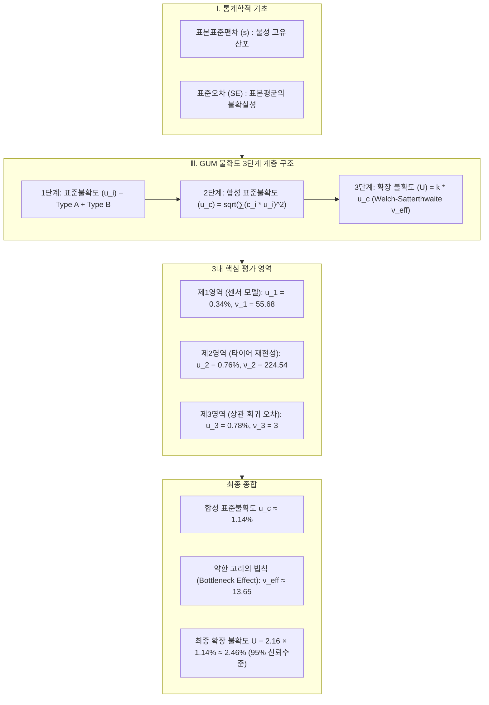

# 📘 타이어 RR 측정 불확도 평가 마스터 가이드 & 통계 핸드북

> **연관 원본 문서**: [[타이어_RR_측정_불확도_평가_마스터_가이드_&_통계_핸드북.pdf]]  
> **상위 색인**: [[00_측정_불확도_공학_통합_색인]], [[00_타이어_공학_통합_색인]], [[00_지식_위키_통합_색인]]  
> **상호 참조 기술 보고서**: [[20_타이어_회전저항_RR_측정_불확도_산출_기술_보고서]]  
> **이론 가이드**: [[10_측정불확도_완벽_이론_및_수학적_유도_가이드]]  
> **구현 모듈**: `unoUtil.statistics.uncertainty` ([[uncertainty]])

---

> [!ABSTRACT] 📖 핸드북 개요
> 본 가이드는 타이어 회전저항(Rolling Resistance, RR) 시험에서 발생하는 다양한 오차 요인의 물리적 실체를 규명하고, 이를 국제 표준(**ISO 28580 / GUM 지침**)에 부합하는 통계학적 표준불확도 및 유효 자유도로 가공하는 전 과정을 체계적으로 정리한 실무 핸드북입니다.



---

## Ⅰ. 통계학적 기초: 오차의 두 영역 분리

측정 데이터 분석에서 가장 중요하며 혼동하기 쉬운 두 가지 척도(**표준편차**와 **표준오차**)의 본질적 차이를 엄밀히 구분합니다.

| 구분 | 표본표준편차 ($s$, Sample Standard Deviation) | 표준오차 ($SE$, Standard Error) |
| :--- | :--- | :--- |
| **물리적 의미** | 측정 대상(타이어) 및 계측 장비가 본래 가지고 있는 **날것의 흩어짐(산포) 크기** | 낱개 데이터의 흩어짐이 아니라, 추출된 $n$개 데이터를 평균 낸 **'표본평균($\bar{X}$)' 자체가 참값(모평균 $\mu$) 대비 얼마나 신뢰할 수 있는가**를 나타내는 오차 범위 |
| **표본 크기($n$)와의 관계** | 시험 횟수($n$)를 10회에서 10,000회로 아무리 늘려도 $s$는 0으로 줄어들지 않고, **모분포의 참된 표준편차($\sigma$)로 수렴** | 시험 횟수($n$)가 늘어날수록 표준오차는 **0을 향해 지속적으로 감소** ($SE \propto 1/\sqrt{n}$) |
| **수렴/감소의 이유** | 1. 시험 횟수가 늘어나면 평균 근처 데이터 수(분자)도 증가하지만, 표본수($n-1$, 분모) 역시 비례하여 상쇄됨.<br>2. 표본수가 증가할수록 정규분포 양 극단 꼬리 영역의 아웃라이어가 추출될 확률이 필연적으로 발생하여 편차의 크기를 일정 수준으로 떠받침. | 평균을 취하는 행위는 무작위로 발생하는 양($+$)의 오차와 음($-$)의 오차를 합산하여 상쇄시키는 **필터 역할**을 수행함. 표본수가 증가할수록 표본평균이 참값에서 크게 벗어날 확률이 급격히 소멸함. |

---

## Ⅱ. 표준오차($SE$) 공식의 수학적 유도

단 한 번의 시험 세션($n$회 반복) 데이터로 '수없이 많은 반복 시험 시 표본평균들의 분산'을 도출하는 수학적 증명 과정입니다.

### 1단계: 평균 연산의 선형 결합 표현
데이터 $X_1, X_2, \dots, X_n$의 표본평균 $\bar{X}$는 각 데이터에 가중치 $\frac{1}{n}$을 부여한 선형 결합입니다:
$$\bar{X} = \frac{X_1 + X_2 + \dots + X_n}{n} = \frac{1}{n}X_1 + \frac{1}{n}X_2 + \dots + \frac{1}{n}X_n$$

### 2단계: 양변에 분산(Variance) 연산자 적용
독립 확률변수의 성질에 따라 분산 연산자 $\text{Var}$를 적용합니다:
$$\text{Var}(\bar{X}) = \text{Var}\left(\sum_{i=1}^n \frac{1}{n} X_i\right)$$

적용되는 두 가지 기본 통계 법칙:
1. 독립 확률변수 합의 분산은 각 분산의 합과 같음: $\text{Var}(A + B) = \text{Var}(A) + \text{Var}(B)$
2. 상수가 분산 밖으로 나갈 때는 제곱이 됨: $\text{Var}(c \cdot X) = c^2 \cdot \text{Var}(X)$

따라서 다음과 같이 전개됩니다:
$$\text{Var}(\bar{X}) = \left(\frac{1}{n}\right)^2 \text{Var}(X_1) + \left(\frac{1}{n}\right)^2 \text{Var}(X_2) + \dots + \left(\frac{1}{n}\right)^2 \text{Var}(X_n)$$

### 3단계: 등분산성 가정 및 약분
동일 시험 환경에서 수집된 각 데이터의 고유 분산이 동일하다고 가정하면 ($\text{Var}(X_i) = \sigma^2$):
$$\text{Var}(\bar{X}) = n \times \left(\frac{1}{n^2} \sigma^2\right) = \frac{\sigma^2}{n}$$

> **분산 차원의 결론**: 누적되는 힘($n$)보다 평균 필터의 압축력($n^2$)이 더 크기 때문에 표본평균의 분산은 모분산의 $\frac{1}{n}$로 축소됩니다.

### 4단계: 편차 도메인 복귀 (제곱근 적용)
분산에 제곱근을 취하여 원래 물리량 단위의 표준오차를 구합니다:
$$SE = \sqrt{\text{Var}(\bar{X})} = \sqrt{\frac{\sigma^2}{n}} = \frac{\sigma}{\sqrt{n}}$$

모표준편차 $\sigma$를 표본표준편차 $s$로 추정하면 최종 공식이 완성됩니다:
$$SE = \frac{s}{\sqrt{n}}$$

---

## Ⅲ. 측정 불확도의 3단계 계층 구조

GUM(Guide to the Expression of Uncertainty in Measurement)에 따른 불확도 평가 체계는 다음과 같이 구성됩니다:

```text
[ 1단계: 표준불확도 (u_i) ]
  - 개별 요인의 1배 표준오차 수준
  - Type A: u = s / sqrt(n)
  - Type B: u = U_cert / k 또는 a / sqrt(3)
         │
         ▼
[ 2단계: 합성 표준불확도 (u_c) ]
  - 감도계수(c_i)를 곱해 단위 통일: c_i = ∂f / ∂X_i
  - 오차 전파 법칙 적용: u_c = sqrt( ∑ (c_i * u_i)^2 )
         │
         ▼
[ 3단계: 확장 불확도 (U) ]
  - 웰치-새터스웨이트 공식으로 유효 자유도(ν_eff) 결정
  - t-분포 기반 포함인자(k) 산출 (통상 95% 신뢰수준)
  - 최종 보고서 표기: U = k * u_c
```

---

## Ⅳ. 제1영역: 수학적 계측기 모델 (Sensors)

### 1. 물리적 지배방정식
ISO 28580 힘 측정법(Force Method) 기준 회전저항력($F_r$) 기본 계산 모델:
$$F_r = (F_x - F_{x\_skim}) \times \frac{R}{DLR}$$

* $F_x$: 하중 조건에서의 전후방 힘 센서 측정값 ($\text{N}$)
* $F_{x\_skim}$: 무부하 접촉 상태의 기생 저항력 ($\text{N}$)
* $R$: 시험기 드럼 반경 ($\text{mm}$, 기계적 상수)
* $DLR$: 타이어 동적 하중 반경 ($\text{mm}$)

**대표 시험 기준값**:
* $F_x = 100.0\,\text{N}$, $F_{x\_skim} = 15.0\,\text{N}$, $R = 850.0\,\text{mm}$, $DLR = 300.0\,\text{mm}$
* 기준 회전저항력: $F_r = (100.0 - 15.0) \times \frac{850.0}{300.0} = 240.83\,\text{N}$

### 2. 센서별 표준불확도 산출 ($F_x$ 로드셀 예시)
1. **Type A (반복성 표준오차)**: 24회 반복 측정 ($n=24, \nu_A=23, s=0.49\,\text{N}$)
   $$u_A(F_x) = \frac{s}{\sqrt{n}} = \frac{0.49}{\sqrt{24}} \approx 0.10\,\text{N}$$
2. **Type B (교정성적서)**: 성적서 확장불확도 $U=0.16\,\text{N}$ ($k=2, \nu_B=\infty$)
   $$u_B(F_x) = \frac{U}{k} = \frac{0.16}{2} = 0.08\,\text{N}$$
3. **개별 센서 합성**:
   $$u(F_x) = \sqrt{u_A(F_x)^2 + u_B(F_x)^2} = \sqrt{0.10^2 + 0.08^2} \approx 0.128\,\text{N}$$

### 3. 편미분 및 감도계수($c_i$)를 통한 단위 통일
각 센서의 물리 단위($\text{N, mm, }^\circ\text{C}$)를 최종 회전저항력 단위($\text{N}$)로 일치시키기 위해 편미분을 수행합니다:

1. **$F_x$ 센서 감도계수 ($c_1$)**:
   $$c_1 = \frac{\partial F_r}{\partial F_x} = \frac{R}{DLR} = \frac{850.0}{300.0} \approx 2.8333$$
   $$c_1 \cdot u(F_x) = 2.8333 \times 0.128\,\text{N} \approx 0.3627\,\text{N}$$
2. **$F_{x\_skim}$ 센서 감도계수 ($c_2$)**:
   $$c_2 = \frac{\partial F_r}{\partial F_{x\_skim}} = -\frac{R}{DLR} = -\frac{850.0}{300.0} \approx -2.8333$$
   $$c_2 \cdot u(F_{x\_skim}) = -2.8333 \times 0.128\,\text{N} \approx -0.3627\,\text{N}$$
3. **$DLR$ 센서 감도계수 ($c_3$)**:
   $$c_3 = \frac{\partial F_r}{\partial DLR} = -(F_x - F_{x\_skim}) \frac{R}{DLR^2} = -(85.0) \frac{850.0}{300.0^2} \approx -0.8028\,\text{N/mm}$$
   $$c_3 \cdot u(DLR) = -0.8028\,\text{N/mm} \times 0.066\,\text{mm} \approx -0.0530\,\text{N}$$

### 4. 제1영역 합성 표준불확도 ($u_1$)
통일된 단위의 기여 성분을 직교 합성합니다:
$$u_1 = \sqrt{(c_1 u(F_x))^2 + (c_2 u(F_{x\_skim}))^2 + (c_3 u(DLR))^2}$$
$$u_1 = \sqrt{0.3627^2 + (-0.3627)^2 + (-0.0530)^2} = \sqrt{0.13155 + 0.13155 + 0.00281} \approx 0.5157\,\text{N}$$

상대 표준불확도($\%$)로의 변환:
$$u_{1,rel} = \frac{u_1}{F_r} \times 100 = \frac{0.5157\,\text{N}}{240.83\,\text{N}} \times 100 \approx 0.34\%$$

> **기여율 분석**: 두 로드셀($F_x, F_{x\_skim}$)의 분산 기여율이 전체 제1영역 분산의 **98.9%**를 차지하여 지배적인 요인임을 확인할 수 있습니다. 산출된 제1영역 유효 자유도는 $\nu_1 \approx 55.68$입니다.

---

## Ⅴ. 제2영역: 타이어별 재현성 (Reproducibility)

타이어는 복합 고무 제품으로서 시편 자체의 불균일성과 장착 반복성에 기인한 오차가 발생합니다.

### 1. 합동 분산 (Pooled Variance) 가중 평균
서로 다른 시험 횟수($n_j$)와 분산($s_{rel,j}^2$)을 갖는 7종 마스터 타이어($N=382$회)에 대해 자유도($\nu_j = n_j - 1$)를 가중치로 적용합니다:
$$u_{pooled}^2 = \frac{\sum_{j=1}^k \nu_j s_{rel,j}^2}{\sum_{j=1}^k \nu_j}$$
$$u_{pooled} = \sqrt{u_{pooled}^2} \approx 1.07\% \sim 1.15\%$$

### 2. 시험 규격 기준 표준불확도 ($u_2$) 환산
ISO 28580 시험 절차에 따라 최종 결과 보고 시 **2회 연속 시험의 평균값**을 채택하므로 표본평균 필터($\sqrt{2}$)를 적용합니다:
$$u_2 = \frac{u_{pooled}}{\sqrt{n_{eval}}} = \frac{1.07\% \sim 1.15\%}{\sqrt{2}} \approx 0.76\%$$

### 3. 분산 불균형에 의한 유효 자유도 페널티
웰치-새터스웨이트 공식에 타이어별 개별 분산을 대입합니다:
$$\nu_2 = \frac{\left(\sum_{j=1}^k \nu_j s_{rel,j}^2\right)^2}{\sum_{j=1}^k \frac{(\nu_j s_{rel,j}^2)^2}{\nu_j}} = \frac{\left(\sum_{j=1}^k \nu_j s_{rel,j}^2\right)^2}{\sum_{j=1}^k \nu_j (s_{rel,j}^2)^2}$$

* 이론적 최대 자유도: $\nu_{total} = 382 - 7 = 375$
* 실제 계산된 유효 자유도: $\nu_2 = 224.54$
* **통계적 해석**: 타이어별 산포 크기가 균일하지 않고 특정 거친 타이어가 분산을 주도함에 따라 통계적 불확실성 페널티가 부여되어 유효 자유도가 375에서 **224.54**로 보수적으로 하향 조정됩니다.

---

## Ⅵ. 불확도 평가 최종 종합 및 확장

### 1. 3대 영역 요약 테이블

| 평가 영역 | 물리적 의미 | 상대 표준불확도 ($u_i$) | 유효 자유도 ($\nu_i$) | 분산 기여율 |
| :--- | :--- | :---: | :---: | :---: |
| **제1영역 (계측기 모델)** | 센서 반복성 및 교정성적서 복합 오차 | $u_1 = 0.34\%$ | $\nu_1 = 55.68$ | 약 8.9% |
| **제2영역 (타이어 재현성)** | 마스터 7종 382회 장착/시편 재현성 오차 | $u_2 = 0.76\%$ | $\nu_2 = 224.54$ | 약 44.5% |
| **제3영역 (상관 회귀 오차)** | 기준기 대비 선형 상관 모델 잔차 오차 | $u_3 = 0.78\%$ | $\nu_3 = 3$ | 약 46.8% |

### 2. 합성 표준불확도 ($u_c$) 산출
상호 독립인 세 영역을 직교 합성합니다:
$$u_c = \sqrt{u_1^2 + u_2^2 + u_3^2} = \sqrt{0.34^2 + 0.76^2 + 0.78^2} = \sqrt{0.1156 + 0.5776 + 0.6084} \approx 1.14\%$$

### 3. 전체 시스템 유효 자유도 ($\nu_{eff}$) 산출
웰치-새터스웨이트 공식을 전체 시스템에 적용합니다:
$$\nu_{eff} = \frac{u_c^4}{\frac{u_1^4}{\nu_1} + \frac{u_2^4}{\nu_2} + \frac{u_3^4}{\nu_3}}$$
$$\nu_{eff} = \frac{1.14^4}{\frac{0.34^4}{55.68} + \frac{0.76^4}{224.54} + \frac{0.78^4}{3}} \approx \frac{1.6890}{0.00024 + 0.00149 + 0.12338} = \frac{1.6890}{0.12511} \approx 13.65$$

> [!WARNING] ⚠️ 약한 고리의 법칙 (Bottleneck Effect)
> 제1영역($\nu_1 = 55.68$)과 제2영역($\nu_2 = 224.54$)의 자유도가 매우 높음에도 불구하고, **타이어 5종 회귀로 인해 자유도가 $\nu_3 = 3$에 불과한 제3영역의 분모 항($0.12338$)이 전체 분모의 98% 이상을 독식**하여 최종 자유도가 **13.65**로 급격히 감소합니다.

### 4. 최종 확장 불확도 ($U$) 산출
* 유효 자유도 $\nu_{eff} = 13.65$에 대한 t-분포 양측 95% 신뢰수준 포함인자: $k = 2.16$ (자유도 $\infty$ 시 1.96 대비 보수적 반영)
* **최종 확장 불확도**:
$$U = k \times u_c = 2.16 \times 1.14\% \approx 2.46\%$$

---

## Ⅶ. 핵심 통계 및 불확도 용어 상세 사전

| 용어 | 영문 표기 | 정의 및 실무적 의미 |
| :--- | :--- | :--- |
| **표본평균** | Mean ($\bar{X}$) | 표본 데이터를 대표하는 중심 위치 척도. 무작위 오차 상쇄 필터. |
| **편차** | Deviation | 개별 측정값과 평균값 사이의 거리 ($X_i - \bar{X}$). 합산 시 항상 0. |
| **표본분산** | Variance ($s^2$) | 편차 제곱의 평균적 합. 오차 전파 시 합산되는 2차원 에너지 척도. |
| **자유도** | Degrees of Freedom ($\nu$) | 통계량 계산 시 자유롭게 변할 수 있는 독립 정보의 수 ($n - 1$). |
| **표준오차** | Standard Error ($SE$) | 표본평균 자체가 참값 주변에서 흔들리는 표준편차 ($s / \sqrt{n}$). |
| **표준불확도** | Standard Uncertainty ($u$) | 측정 결과의 의심 정도를 1배 표준편차 수준으로 표준화한 값. |
| **Type A 평가** | Type A Evaluation | 연속 반복 측정 데이터(Raw data)의 통계적 분석으로 산출하는 방식. |
| **Type B 평가** | Type B Evaluation | 교정성적서, 시방서, 문헌 등 기지의 정보 소스로 산출하는 방식. |
| **감도계수** | Sensitivity Coefficient ($c_i$) | 입력량 변화 대비 출력량 변화 비율 ($\partial f / \partial X_i$). 단위 환전 가중치. |
| **합동 분산** | Pooled Variance ($s_{pooled}^2$) | 표본수가 다른 여러 집단의 분산을 자유도 가중치로 결합한 대표 분산. |
| **합성 표준불확도** | Combined Uncertainty ($u_c$) | 모든 오차 요인의 분산을 직교 합성하여 도출한 전체 표준불확도. |
| **유효 자유도** | Effective DoF ($\nu_{eff}$) | 이질적 분산과 자유도를 결합했을 때 전체 시스템이 갖는 알짜 신뢰도. |
| **포함인자** | Coverage Factor ($k$) | 합성불확도에 곱해 95% 신뢰구간을 형성하는 안전계수 (t-분포 기반). |
| **확장 불확도** | Expanded Uncertainty ($U$) | 최종 시험 성적서에 대표값과 함께 보고되는 최종 오차 범위 ($k \cdot u_c$). |

---

## 🔗 관련 문서 및 코드 연계

* **상위 도메인 색인**: [[00_타이어_공학_통합_색인]]
* **기술 보고서**: [[20_타이어_회전저항_RR_측정_불확도_산출_기술_보고서]]
* **파이썬 불확도 연산 모듈**: `unoUtil.statistics.uncertainty` ([[uncertainty]])
* **첨부 원본**: [[타이어_RR_측정_불확도_평가_마스터_가이드_&_통계_핸드북.pdf]]
