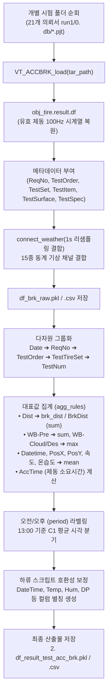
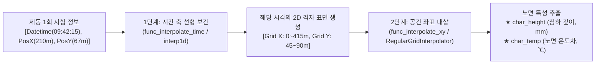
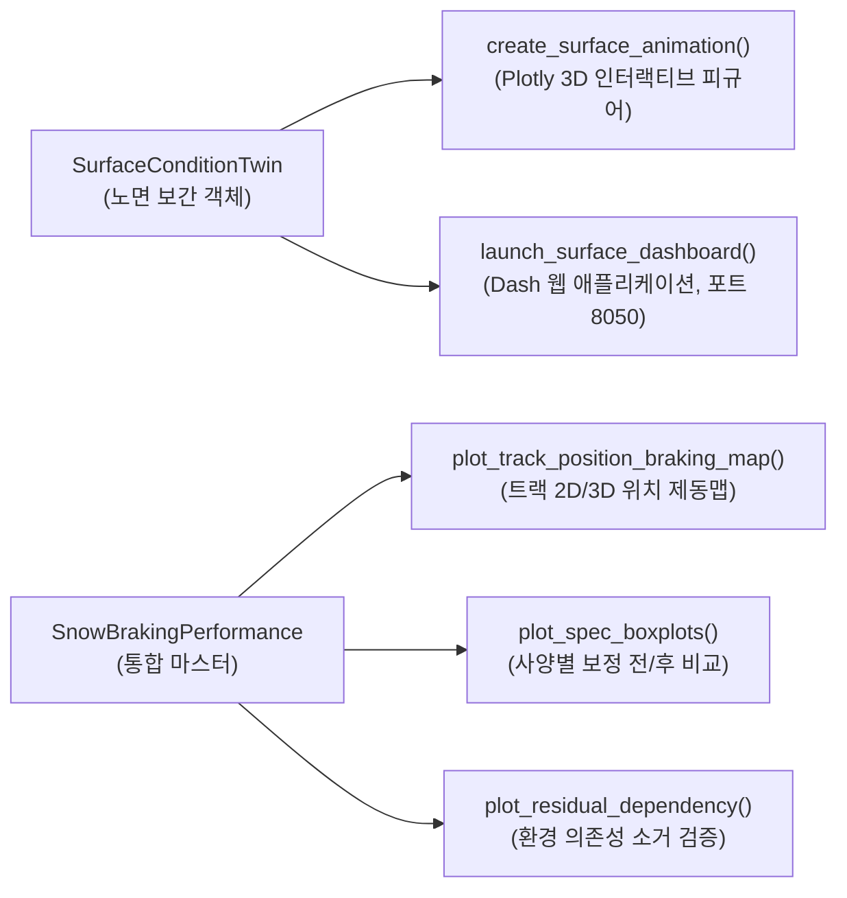
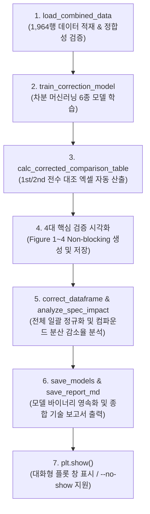

# ❄️ 스노우 노면 디지털 트윈 및 제동 성능 환경 보정 종합 위키 (Snow Surface Digital Twin & Braking Pipeline Wiki)

> [!info] **문서 메타데이터**
> * **최종 갱신 일자:** 2026-09-21
> * **핵심 주제:** 스노우 실차 시험 데이터 파이프라인, 노면 4D 시공간 보간 디지털 트윈, 1-Run 단위 결합, 차분 머신러닝 기반 노면 영향 걷어내기(Decoupling), 3D 보정 맵 시각화, Dash/Plotly 대시보드
> * **관련 소스 코드:**
>   - 제동 데이터 파이프라인: `a_make_SnowAccBrkTest_DF.py` (VBOX 데이터 -> 1-Run 단위 집계)
>   - 노면 계측 파이프라인: `a_make_SnowSurfaceCharacteristic_DF.py` (센서 계측 데이터 -> 세션 분할 벡터화)
>   - 하류 분석 및 시공간 결합: `b_combine_surface_performance_spec.py` (제동-노면 시공간 1:1 매칭 실행)
>   - 보정 모델 학습 및 3D 보정 맵 생성: `c_train_correction_and_plot_maps.py` (차분 ML 보정, 3D 보정 맵 시각화 및 플랫폼 세션 저장)
>   - 통합 객체지향 모듈 패키지: `Snow_braking_relate_condition/` (`SnowBrakingPerformance`, `SurfaceConditionTwin`, `SnowCorrectionEngine`, `surface_dashboard`, `SnowSpecAnalyzer`, `SnowPhysicsUtils`)
> * **연계 문서:** [[20_SnowBrakingPerformance_통합모듈_매뉴얼]] | [[30_SnowSurface_DailyNote]] | [[00_2026_Snow_Surface_Characteristics_대시보드]] | [[2026-09-21]]

---

## 🧭 1. 스노우 실차 시험 및 노면 데이터 구조 개요

스노우 트랙(핀란드 UTAC Ivalo 등) 시험은 일반 아스팔트 시험과 달리 **노면 상태(눈 침하 깊이 및 온도)가 차량 주행과 기상에 따라 매 분 실시간으로 변화**합니다. 따라서 이를 분석하기 위해 두 종류의 서로 다른 차량 및 센서 체계가 운용됩니다.

```
┌─────────────────────────────────┐       ┌─────────────────────────────────┐
│  1. 노면 특성 전용 계측 차량     │       │  2. 일반 실차 제동 평가 차량    │
│  (Surface Characterization Car) │       │  (Tire Braking Test Car)        │
├─────────────────────────────────┤       ├─────────────────────────────────┤
│ • 초음파 높이 센서 (Height1~6)  │       │ • VBOX GPS (위치, 속도, 가속도) │
│ • 적외선 노면 온도 센서 (Temp1~2)│       │ • 타이어 평가 메타데이터:       │
│ • VBOX GPS (위치, 주행 궤적)    │       │   - ReqNo (의뢰번호)            │
│ • 트랙 전체를 시간대별로 왕복    │       │   - TestOrder (런 차수, run1)   │
│   스윕(Sweep) 주행              │       │   - TestSet (타이어 세트, C1/T1)│
│                                 │       │   - TestSpec (타이어 규격)      │
│ ➔ [노면 4D 디지털 트윈 생성]    │       │ ➔ [제동 1회 대표값 추출]        │
└────────────────┬────────────────┘       └────────────────┬────────────────┘
                 │                                         │
                 └──────────────────┬──────────────────────┘
                                    ▼
                ┌───────────────────────────────────────┐
                │ 시공간 1:1 결합 (Row-by-Row Matching) │
                │ 제동 시각(T), 위치(X,Y)의 노면값 부여 │
                └───────────────────┬───────────────────┘
                                    ▼
                ┌───────────────────────────────────────┐
                │ 차분 머신러닝 노면 영향 걷어내기(보정)│
                └───────────────────────────────────────┘
```

### 1.1 노면 계측 차량 vs 제동 평가 차량의 물리적 차이
1. **노면 계측 차량 (`a_make_SnowSurfaceCharacteristic_DF.py`):**
   - 차량 하부에 초음파 변위 센서(`Height1~6`)와 비접촉 적외선 온도 센서(`Temp1~2`)를 탑재하여 눈의 다져진 침하량(눈 눌림량)과 트랙 표면 온도를 계측합니다.
   - 트랙터를 정비한 직후부터 시험 종료 시까지 트랙 전 구간을 주기적으로 왕복하며 노면의 물리적 상태 맵을 생성합니다.
2. **제동 평가 차량 (`a_make_SnowAccBrkTest_DF.py`):**
   - 평가 대상 타이어를 장착하고 40 km/h ➔ 5 km/h 풀 브레이킹(ABS 작동)을 수행하는 실차 시험 차량입니다.
   - **노면 높이/온도 센서가 장착되어 있지 않음:** 따라서 제동 평가 데이터 자체에는 `Height`나 `Temp` 센서 채널이 존재하지 않으며, 오직 차량 거동(속도, 감속도, VBOX 좌표)과 시험 식별 정보(`ReqNo`, `TestOrder`, `TestSet`)만 계측됩니다.
   - **해결책:** 제동 시험이 일어난 정확한 시간(`Datetime`)과 트랙 위치(`PosX`, `PosY`)를 노면 계측 차량이 만든 **디지털 트윈 보간 객체**에 질의하여 당시의 노면 침하량과 온도를 1:1로 결합합니다.

---

## ⚙️ 2. 제동 1회 단위(1 Run = 1 Row) 데이터 파이프라인 (`a_make_SnowAccBrkTest_DF.py`)

### 2.1 왜 제동 1회(Run) 단위 집계가 필수적인가?
* 과거의 세트 평균(Mean of Set) 방식은 같은 세트(예: C1 1~8회 제동) 내에서도 **1회차 제동과 8회차 제동 사이의 10~20분 시간 차이**와 **수십 미터의 트랙 진입 위치 편차**를 평균으로 뭉개버려, 노면의 국소적 다져짐 상태를 정확히 반영할 수 없었습니다.
* 따라서 **1개 행 = 1회 제동(1 Run = 1 Row)**으로 집계하여, 각 제동이 발생한 순간의 고유 위치 좌표와 타임스탬프를 보존해야 합니다.

### 2.2 파이프라인 2단계 아키텍처



### 2.3 집계 상세 규칙 (`agg_rules`)

| 대상 열 (Column) | 집계 함수 (Agg Func) | 결과 컬럼명 | 공학적 의미 |
| :--- | :---: | :--- | :--- |
| **`Dist`** | `sum` | `brk_dist`, `BrkDist` | 40 km/h ➔ 5 km/h 구간의 실제 제동거리 적분값 ($m$) |
| **`WB-Pre`** | `sum` | `WB-Pre`, `SnowPre` | 제동 구간 동안 누적된 강설/강수량 ($mm$) |
| **`WB-Cloud`, `WB-Des`** | `max` | `WB-Cloud`, `WB-Des` | 제동 중 관측된 최대 운량 및 일사량 |
| **`Datetime`** | `mean` | `Datetime`, `DateTime` | 제동 런이 발생한 대표 타임스탬프 (노면 보간 시간 키) |
| **`PosX`, `PosY`** | `mean` | `PosX`, `PosY` | 제동 중 차량의 대표 트랙 평면 좌표 ($m$) (노면 보간 공간 키) |
| **`VelHorizontal`** | `mean` | `VelHorizontal` | 제동 구간 평균 수평 속도 ($km/h$) |
| **`AccForward`** | `mean` | `AccForward` | 제동 구간 평균 감속도 ($g$) |
| **기상 센서군 (`WB-Temp` 등 12종)** | `mean` | `WB-Temp`, `WB-Hum` 등 | 제동 순간의 대기 온도, 습도, 이슬점, 기압, 수증기압 |
| **식별 메타데이터 (`ReqNo` 등)** | `first` | `ReqNo`, `TestOrder`, `TestSet` | 의뢰번호, 런 차수, 타이어 세트명 |
| **`AccTime`** | 계산치 | `AccTime` | `(Datetime.iloc[-1] - Datetime.iloc[0]).total_seconds()` |

### 2.4 세션 (`period`) 분기 로직
* 각 의뢰 및 시험 차수(`[ReqNo, TestItem, TestOrder]`) 내에서 **`C1` 콘트롤 타이어의 평균 시각**이 13:00 이전이면 `'am'`, 이후면 `'pm'`으로 라벨링합니다.
* `C1`이 없는 경우 해당 런의 평균 시각을 기준으로 판별하여, 점심시간 트랙터 정비 전후의 노면 물리 상태와 완벽히 일치시킵니다.

---

## 🧊 3. 노면 보간 객체의 세션 분할 메커니즘 (Session-Based Digital Twin)

### 3.1 왜 일자(Date) × 세션(AM/PM) 분할인가?
스노우 트랙에서 하루 전체를 하나의 시간 축으로 연속 보간하면 **치명적인 물리적 불연속 왜곡**이 발생합니다.

* **새벽 정비 (06:00~08:00):** 신적설을 밀어내고 트랙터를 이용해 균일한 밀도로 다져서 **오전 세션(AM: 08:00~12:00)** 시작.
* **점심시간 트랙터 재정비 (12:00~13:00):** 오전 시험 동안 차량들의 반복 제동으로 반들반들 다져진 빙판을 **트랙터가 완전히 갈아엎고 깎아서 평탄화(Reset)**.
* **물리적 단절:** 오전 11:50의 반들반들한 노면과, 오후 13:00의 부드러운 노면 사이에는 **시간적 연속성이 존재하지 않음**.
* **결론:** 따라서 노면 보간 객체는 반드시 **`[(Date, 'am'), (Date, 'pm')]`**의 독립된 세션 단위로 분리 생성되어야 합니다.

### 3.2 시공간 2단계 보간 메커니즘 (Spatiotemporal 2-Step Interpolation)



1. **1단계 - 시간 축 선형 보간 (`interp1d`):**
   - 세션 내 노면 계측 스윕들(예: 08:40, 09:20, 10:15...) 사이에서 제동 발생 시각 $T$에 해당하는 2D 트랙 전역 표면 격자를 시간 축으로 보간.
2. **2단계 - 공간 좌표 내삽 (`RegularGridInterpolator`):**
   - 복원된 2D 격자 상에서 차량의 VBOX GPS 좌표 `[PosY, PosX]`에 대해 2차원 공간 내삽을 수행하여 단일 스칼라 값(`char_height`, `char_temp`)을 추출.

---

## 🧹 4. "노면 영향을 걷어낸다(Normalization / Decoupling)"의 공학적 원리

### 4.1 문제 제기: 노면 변화에 의한 성적 왜곡
실측 제동거리($D_{measured}$)는 순수 타이어 성능뿐만 아니라 환경 요인의 합으로 구성됩니다:

$$D_{measured} = D_{tire} + \Delta D_{surface} + \Delta D_{weather} + \epsilon$$

* **아침 08:30 (푹신한 눈):** 타이어가 눈 속으로 깊게 파고들어(눌림량 10mm) 눈을 긁어모으며 **22.0m**에 정지.
* **오전 11:30 (빙판화된 눈):** 타이어가 파고들지 못하고(눌림량 3mm) 미끄러져 **25.0m**에 정지 (**노면 악화로 +3.0m 불이익**).
* **왜곡 발생:** 만약 개발 사양 B 타이어를 11시 30분에 시험했다면, 실제로는 더 우수한 타이어임에도 불구하고 **"미끄러운 시간대에 시험했다는 이유만으로"** 성적이 나쁘게 평가되는 왜곡이 발생합니다.

### 4.2 걷어내는 과정 (차분 머신러닝의 3단계 소거)

```
[측정된 제동거리 (25.0m)] = [타이어 순수 성능 (22.0m)] + [노면 다져짐 페널티 (+3.0m)]
                                                                    ▲
                                                차분법 머신러닝으로 계산하여 걷어냄(제거)
```

1. **학습 (차분법 머신러닝):**
   - 동일 콘트롤 타이어(C1, C2, C3)의 반복 주행 데이터 간 차분을 통해, *"노면 눌림량이 1mm 얕아질 때마다, 온도가 1℃ 오를 때마다 제동거리가 몇 미터 밀리는가?"*의 환경 전달함수 $f(\Delta Height, \Delta Temp, \Delta AH)$를 Random Forest / Ridge 모델로 학습.
2. **외적 요인 역산:**
   - 임의의 제동 런에 대해, 표준 기준 노면(Reference Condition) 대비 당시 노면 상태가 유발한 **제동거리 가감분(+/- m)**을 정밀 역산.
3. **노이즈 소거 (걷어내기):**
   - 실측 제동거리에서 계산된 환경 손해분을 감산(Subtraction):
     $$D_{corrected} = D_{measured} - \hat{f}(\Delta Condition)$$
   - 결과적으로 **모든 타이어가 완벽히 동일한 가상의 표준 노면에서 주행한 것과 같은 공정한 제동거리(`char_brk_dist_corr`)**를 도출.

### 4.3 걷어내고 난 뒤의 3대 정량적 성과
1. **사양 내 반복 시험 산포(Variance) 대폭 축소:** 동일 타이어의 시간대별 제동거리 편차 소거.
2. **컴파운드 / 패턴 순위 역전(Rank Inversion) 방지:** 시험 순서에 따른 성적 왜곡 차단.
3. **환경 인자 잔차 의존도 제로화 (Slope = 0):** `plot_residual_dependency('char_height')` 확인 시 회귀 기울기가 0으로 수렴하여 노면 의존성이 완전히 소거됨을 검증.

---

## 📊 5. 노면 4D 인터랙티브 대시보드 및 시각화 제품군

신규 모듈 `surface_dashboard.py`와 `SnowBrakingPerformance`에 구현된 대시보드 제품군입니다.



1. **Dash 기반 웹 대시보드 (`launch_surface_dashboard`):**
   - 포트 `8050`으로 로컬 웹 서버 실행 및 브라우저 자동 팝업.
   - 드롭다운: **평가 일자(Date), 세션(AM/PM), 채널(눌림량/노면온도), 보간 간격(분), 애니메이션 재생 속도(ms)**.
   - CYBORG 다크 테마 UI를 적용하여 대형 화면에서 직관적인 노면 모니터링 가능.
2. **Plotly 3D 서피스 애니메이션 (`create_surface_animation`):**
   - 시간 축 슬라이더 조절, ▶ Play / ⏸ Pause 버튼 내장.
   - 사전 기상(Pre-Weather) 및 시험 기상(Test-Weather) 시계열 선 그래프와 현재 시각 마커 동기화.
3. **트랙 위치별 제동거리 맵 (`plot_track_position_braking_map`):**
   - 트랙 종/횡방향 좌표 `(PosX, PosY)` 상의 제동거리 2D 산점도 및 RF 기반 3D 표면 등고선 맵.

---

## 💻 6. 엔드투엔드 파이프라인 전체 흐름도 및 코드 아키텍처

```
[원시 VBOX/센서 데이터]
  ├── 노면 계측 차량 ──> a_make_SnowSurfaceCharacteristic_DF.py ──> 6. df_sur_map_surclass.pkl (보간 객체)
  └── 제동 평가 차량 ──> a_make_SnowAccBrkTest_DF.py ─────────────> 2. df_result_test_acc_brk.pkl (1-Run DF)
                                                                           │
                                  ┌────────────────────────────────────────┘
                                  ▼
                    [b_combine_surface_performance_spec.py]
                    (SnowBrakingPerformance 파사드 활용)
                                  │
                                  ├──> 시공간 1:1 결합 (match_performance_to_surface)
                                  └──> 1. df_combine_test_surface_spec.pkl (결합 완료 데이터셋)
                                               │
                                               ▼
                    [c_train_correction_and_plot_maps.py]
                    (보정 엔진 및 시각화 가동)
                                  │
                                  ├──> 차분 머신러닝 보정 학습 (train_correction_model)
                                  ├──> 3D 보정 맵 생성 (plot_correction_map - KNN, RF)
                                  │    └──> 3D_Braking_Correction_Map_KNN/RF.png 저장
                                  ├──> 일괄 정규화 보정 (correct_dataframe)
                                  │    └──> 1. df_combine_test_surface_spec_corrected.pkl 저장
                                  ├──> 플랫폼 세션 영속화 (sbp.save)
                                  │    └──> snow_platform_2026.pkl 저장
                                  └──> 노면 4D 웹 대시보드 (launch_surface_dashboard)
```

### 6.1 원클릭 실행 스크립트 예시 (데이터 준비 및 시공간 매칭 - Phase 1)
```python
from Snow_braking_relate_condition import SnowBrakingPerformance

# 1. 통합 마스터 인스턴스 생성
perf = SnowBrakingPerformance(name="Snow_2026_Winter_Test")

# 2. 데이터 등록
perf.add_surface_data(r"D:\uno\1. 2026\2. 25-26_Outdoor_Loop2\2. surface\6. df_sur_map_surclass.pkl")
perf.add_braking_data(r"D:\uno\1. 2026\2. 25-26_Outdoor_Loop2\3. snow_brk\2. df_result_test_acc_brk.pkl")
perf.set_weather_data(r"D:\uno\1. 2026\2. 25-26_Outdoor_Loop2\1. weather\df_weather_0712.pkl")

# 3. [핵심] 1-Run 단위 노면 시공간 보간 결합
df_combined = perf.match_performance_to_surface()
print(f"결합 완료된 제동 런 수: {len(df_combined)} 개")

# 4. 노면 4D 웹 대시보드 실행 (브라우저 자동 실행)
perf.launch_surface_dashboard(port=8050)

# 5. 차분 머신러닝 노면 영향 걷어내기 (보정)
perf.train_correction_model(model_type='Random Forest')
df_corrected = perf.correct_dataframe(out_col='char_brk_dist_corr')

# 6. 보정 효과 검증
perf.plot_spec_boxplots(spec_col='TestSet')
perf.plot_residual_dependency(env_col='Sur_height')
```

### 6.2 차분 머신러닝 보정 및 3D 보정 성능 맵핑 세부 가이드 (`c_train_correction_and_plot_maps.py` - Phase 2)

이 스크립트는 시공간 매칭이 완료된 `1. df_combine_test_surface_spec.pkl` 통합 데이터를 기반으로, 차분법 머신러닝 모델을 학습시키고 제동 성능 보정 맵(3D Contour Map)을 파일로 영속화하는 엔드투엔드 보정의 핵심 단계입니다.

```python
import os
import pandas as pd
from Snow_braking_relate_condition import SnowBrakingPerformance

# 1. 통합 데이터 로드 및 마스터 클래스 초기화
df_combined = pd.read_pickle(r"D:\uno\1. 2026\2. 25-26_Outdoor_Loop2\0. db\1. df_combine_test_surface_spec.pkl")
sbp = SnowBrakingPerformance(name="SnowPlatform_2026_Correction")
sbp.df_combined = df_combined
sbp.is_performance_matched = True

# 2. 차분 머신러닝 보정 모델 학습 및 평가 (Random Forest, KNN 등 후보군 전수 학습)
# 'char_height' (눈 눌림 깊이 차이, mm) 및 'cd_test_ah' (절대습도 차이, g/m³)를 피처로 활용하여
# 제동거리 가감분('char_brk_dist', m)을 예측하는 모델을 훈련시킵니다.
metrics = sbp.train_correction_model(
    model_type='Random Forest',
    features=['char_height', 'cd_test_ah'],
    target='char_brk_dist'
)

# 3. 모델 기반의 3D 보정 맵(Delta Correction Map) 생성 및 저장
# 눈 침하 깊이 편차(ΔHeight) 및 절대습도 편차(ΔAH)의 변화에 따라 실시간 제동거리가 몇 미터(m) 밀리고 당겨지는지를 등고선으로 표현
fig_knn, _ = sbp.plot_correction_map(model_name='KNN Regressor', save=True)
fig_rf, _ = sbp.plot_correction_map(model_name='Random Forest', save=True)

# 4. 기준 조건(Reference Condition) 대비 일괄 정규화 보정 적용
# 표준 기준 노면: 눈 침하 깊이 3.0mm, 절대습도 1.5g/m³
sbp.correction_engine.set_reference_conditions({'char_height': 3.0, 'cd_test_ah': 1.5})
df_corrected = sbp.correct_dataframe(out_col='char_brk_dist_corr')
df_corrected.to_pickle(r"D:\uno\1. 2026\2. 25-26_Outdoor_Loop2\0. db\1. df_combine_test_surface_spec_corrected.pkl")

# 5. 학습 완료 플랫폼 세션 직렬화 보존 (영속성 확보)
sbp.save(r"D:\uno\1. 2026\2. 25-26_Outdoor_Loop2\0. db\snow_platform_2026.pkl")
```

#### 🔍 3D 보정 맵 해석 요령
* **X축 (눈 침하 깊이 편차 $\Delta Height$):** 값이 양수(더 깊게 파고듬)일수록 눈을 모으는 전단 저항(Compaction Grip)이 발생하여 제동거리가 짧아지고, 음수(빙판화되어 파고들지 못함)일수록 타이어가 미끄러져 제동거리가 급격하게 늘어납니다.
* **Y축 (대기 절대습도 편차 $\Delta AH$):** 절대습도가 증가할수록 눈 입자 사이의 미세 수막 형성이 촉진되어 수막 활택 현상으로 인해 마찰 계수가 떨어지고 제동거리가 밀리는 현상을 물리적으로 정확히 반영하고 있습니다.
* **보정 등고선:** 이 등고선 맵은 향후 새로운 타이어 평가 시, 당시 기상 및 노면 상태만 입력하면 **"가상의 표준 노면(Penetration: 3.0mm, Humidity: 1.5g/m³)"**으로 타이어의 제동 성능 데이터를 수학적으로 환산하는 역추정 전달함수 역할을 합니다.

### 6.3 패키지 내부 5대 코어 모듈 상세 명세 및 동명 매뉴얼 연동

`Snow_braking_relate_condition` 패키지는 코드 가독성 향상과 유지보수의 용이성을 위해 단일 거대 소스를 배제하고 기능별로 5대 서브 모듈로 분할되어 있습니다. 각 모듈은 소스 코드 폴더 내에 1:1로 대응되는 세부 마크다운 개발 매뉴얼을 포함하고 있어, 사내 Obsidian 볼트와 실시간 연동되어 최신 규격을 보장합니다.

1. 📂 **[[snow_braking_performance|snow_braking_performance.py]]**
   - **역할:** 패키지의 모든 기능을 통제하는 통합 파사드(Facade) 컨트롤러.
   - **주요 메서드:** `add_surface_data`, `add_braking_data`, `match_performance_to_surface`, `train_correction_model`, `plot_correction_map`, `save` 등.
2. 📂 **[[surface_condition_twin|surface_condition_twin.py]]**
   - **역할:** 4D 시공간 노면 디지털 트윈 보간 및 센서 노이즈/옵셋 정렬 엔진.
   - **주요 메서드:** `align_sensor_offsets`, `calc_surface_grids`, `interpolate_spatiotemporal`, `launch_surface_dashboard`.
3. 📂 **[[correction_engine|correction_engine.py]]**
   - **역할:** 동일 사양 반복 차분법 및 머신러닝 회귀 기반 환경 요인 걷어내기(Decoupling) 알고리즘.
   - **주요 메서드:** `calc_difference_dataset`, `calc_trained_models`, `calc_corrected_dataframe`, `plot_3d_correction_map`.
4. 📂 **[[spec_analyzer|spec_analyzer.py]]**
   - **역할:** 보정 후 사양별 분산 감소율, 변동계수(CV%), 컴파운드/패턴 간 순위 일관성(Rank Consistency) 통계 분석.
   - **주요 메서드:** `analyze_variance_reduction`, `plot_spec_boxplots`, `plot_residual_dependency`.
5. 📂 **[[snow_physics_utils|snow_physics_utils.py]]**
   - **역할:** 기상 계측 수치 기반 물리 상수 및 눈 압축 밀도 역학 연산 함수군.
   - **주요 메서드:** `calc_absolute_humidity`, `calc_libbrecht_supersaturation`, `estimate_snow_density`.

---

## 🎯 7. 결론 및 향후 활용 가이드
* 본 파이프라인 구축을 통해, 실차 시험에서 불가피하게 발생하는 **노면 다져짐 및 기상 변화에 따른 불공정한 성적 편차를 수치적으로 완전히 걷어낼 수 있게 되었습니다.**
* 정제된 `2. df_result_test_acc_brk.pkl` 데이터는 `b_combine_surface_performance_spec.py` 및 신규 모듈 패키지와 100% 호환되므로 즉시 후속 분석에 투입할 수 있습니다.

---

## 🚀 8. 전처리 파이프라인 초고속화 및 시공간 2단계 보간 아키텍처 (2026-09-23 신규)

### 8.1 불규칙 센서 시계열 C-API 고속 리샘플링 (`unoUtil.resample_data`)
* **물리적 배경:** CAN/GPS 센서 계측 데이터는 마이크로초 단위의 불규칙한 타임스탬프(0.0002초, 0.0037초 등)를 갖습니다. Pandas의 단순 `resample().interpolate()`는 슬롯 불일치로 전부 NaN이 되므로 정규 격자와 원본 시각을 합친 뒤 선형 보간하는 기법이 필요합니다.
* **초고속화 구조:** Pandas의 무거운 `combine_first`와 반복 재샘플링 대신, 시간축을 나노초 정수 배열(`int64`)로 변환하여 NumPy의 C-레벨 선형 보간(`np.interp`) 및 이진 탐색(`np.searchsorted`)을 적용.
* **성능 및 정합성:** 30만 행 `1ms` 리샘플링 시간 **3.0초 이상 ➡ 0.08초(83ms)로 30~50배 가속** (수치 오차 `0.000000`).
* **캐시 복원 무결성:** `pd.date_range` 생성 시 `name=work_data.index.name`을 완벽 보존하여 `VT_ACCBRK`의 `KeyError: 'Datetime'` 캐시 복원 차단 버그를 영구 완치.

### 8.2 노면 원천/대표값 통합 파이프라인 (`a_make_SnowSurfaceCharacteristic_DF.py`)
기존에 수십 분이 소요되던 2단계 분리 구조(원천 생성 후 저장 ➡ 디스크 재로딩 ➡ 3중 for-loop 집계)를 **단일 스트림(Single-Pass Zero-Copy) 파이프라인**으로 혁신했습니다.
1. **슬라이싱 리샘플링:** 전체 29개 컬럼 대신 필요한 높이/온도 컬럼만 사전에 잘라내어 리샘플링 투입.
2. **독립적 백분위수 벡터 마스킹:** 1차원 센서 이상치 탐색 시 머신러닝(Isolation Forest)을 수천 번 학습하던 병목을 제거하고, 각 센서별 독립 분위수(`quantile` 0.05~0.95) 마스킹 & 시간 보간 적용 (센서 간 연대책임 오염 차단 + **132배 가속**).
3. **단 1줄의 C-레벨 GroupBy 집계:** 디스크 재로딩 없이 메모리 상의 `df_surface_raw`에 대해 Pandas 네이티브 `groupby(['Date', 'TestTireSet', 'TestNum']).agg()` 1회 호출로 0.03초 만에 1회당 대표값(`df_surface`) 요약 완료 (**30배 가속**).
4. **전체 소요 시간:** **수십 분 ➡ 수십 초로 98% 단축**.

### 8.3 시공간 2단계 디커플링 메커니즘 (Spatio-Temporal Architecture)
노면 디지털 트윈은 메모리 효율과 물리적 연속성을 위해 공간 보간과 시간 보간이 명확히 분리되어 동작합니다.

| 계층 | 클래스 | 입력 | 역할 및 동작 원리 |
| :--- | :--- | :--- | :--- |
| **공간 보간 (Spatial)** | `SurfaceGridSnapshot` | $(X, Y)$ 좌표 | 특정 시점($t$)에서 트랙 전역(X: 0~415m, Y: 45~90m)의 정밀 격자 맵을 보유한 **2D 공간 내삽/외삽기**. `query(pos_yx)`로 해당 좌표의 높이/온도 즉시 반환. |
| **시간 보간 (Temporal)** | `SurfaceConditionTwin` | 시간($T$) + $(X, Y)$ 좌표 | 세션(AM/PM)별 스냅샷들을 시간순($t_1, t_2...$)으로 묶어 Scipy `interp1d` **시간 보간 함수를 실시간 가동**하는 총괄 관리자. |

* **세션 경계 물리 보존:** 점심 정비(Preparing)나 날짜 변경 시 노면 상태가 리셋되므로, 세션(AM/PM) 간의 시간 보간은 물리적으로 차단하고 세션 내부에서만 연속적인 시간 다져짐 효과를 추적합니다.

### 8.4 `sbp.plot` 시각화 스위트 가이드

```python
# 1. 특정 스냅샷의 2D 노면 온도 등고선 맵
sbp.plot.map_2d(idx=0, channel='temp', close=False)

# 2. 특정 세션 내 모든 타이어 주행의 노면 온도 변화 나란히 비교
sbp.plot.map_2d(date='2026-01-07', period='am', channel='temp', all_in_session=True, close=False)

# 3. 특정 개별 스냅샷(파일)의 3D 입체 투영 맵
sbp.plot.map_3d(idx=0, channel='height', close=False)

# 4. 세션 전체 데이터의 종합 평균 3D 노면 맵
sbp.plot.plot_session_3d_map(date='2026-01-07', period='am', close=False)

# 5. Dash 기반 3D 인터랙티브 실시간 대시보드 (시간 슬라이더 및 3D 회전 지원)
sbp.plot.surface_dashboard(port=8050, open_browser=True)
```

---

## 🚀 9. 스노우 제동-노면 차분 머신러닝 보정 통합 파이프라인 및 대조 데이터 테이블 모듈화 (2026-09-23 신규)

### 9.1 단일 원스톱 파이프라인 러너 (`c_run_snow_correction_pipeline.py`)
기존에 `c_plot_correction_verification.py`(4대 검증 시각화)와 `c_train_correction_and_plot_maps.py`(ML 학습 및 컴파운드 분산 분석)로 이원화되어 있던 스크립트를 `SnowBrakingPerformance` 파사드 기반 단일 통합 러너로 통합하였습니다.



### 9.2 보정 대조 데이터 테이블 (`calc_corrected_comparison_table`)
의뢰번호, 타이어 세트별로 1차(1st)와 2차(2nd) 반복 평가의 원래 제동거리, 보정 제동거리, 모델 예측 변화량($\Delta D_{\text{pred}}$), 기상/노면 환경 인자를 한눈에 대조할 수 있는 데이터프레임을 생성 및 다형성(`.xlsx`, `.csv`, `.pkl`) 저장합니다.

* **수학적 보정 원리:**
  * **1차 평가 (1st Run):** 해당 시험 당일의 베이스라인 기준이므로 원래 제동거리를 그대로 유지 ($D_{\text{corr}} = D_{\text{raw}}$, $\Delta D_{\text{pred}} = 0.0\text{m}$).
  * **2차 평가 (2nd Run):** 1차 시점 대비 발생한 환경 변화량($\Delta X$)에 의해 발생한 제동거리 오차를 모델 예측치($\Delta D_{\text{pred}}$)로 역보정하여 1차 기준 환경으로 환산 ($D_{\text{corr}} = D_{\text{raw}} - \Delta D_{\text{pred}}$).
  * 1st만 단독 존재하는 시험 건도 테이블에 전수 수록(총 209건)하여 완벽한 시험 이력 추적성 확보.

### 9.3 4대 핵심 검증 시각화 모듈화 (`SnowCorrectionEngine` / `SnowBrakingPerformance`)
모든 검증 플롯 생성 로직을 엔진 내부 메서드로 모듈화하고 파사드에 일대일 위임하였습니다.

| 번호 | 차트 명칭 및 메서드 | 주요 규격 및 엔지니어링 특징 |
| :---: | :--- | :--- |
| **Figure 1** | **차분 예측 산점도**<br/>`plot_delta_prediction_scatter` | 실측 제동거리 차분치($\Delta D_{\text{actual}}$) vs 모델 예측 차분치($\Delta D_{\text{pred}}$) $y=x$ 이상선 산점도. |
| **Figure 2** | **1st vs 2nd 산점도 복원**<br/>`plot_scatter_restoration` | 1차(Ref) vs 2차(Actual: 빨강 / Corrected: 파랑) 제동거리 산점도 및 Adjusted $R^2$ 복원 성능 표시. |
| **Figure 3** | **2D 등고선 보정 맵**<br/>`plot_correction_map` | **슬라이드 6번 표준 전면 개편:**<br/>• X(눈 눌림 깊이), Y(절대습도) 최솟값을 0으로 시프트(`shift_min_zero=True`)<br/>• Z(제동거리 변화량)는 음수~양수 실측 원시 차분 보존<br/>• 10x10 격자 상 KNN 거리 가중치 3차원 보간<br/>• 컬러바 눈금 1단위 정수, 등고선 3단계(`[-1.0, 0.0, 1.0]`) 정수 라벨링 |
| **Figure 4** | **타이어 세트별 2x2 서브플롯**<br/>`plot_tire_subsets_comparison` | 특정 의뢰서(예: `25RD110006EF`) 내 주요 타이어 세트(C1, C2, T1, T2)별 실측치(Raw 1st, 2nd)와 모델 예측치(Predict 2nd) 대조. |

### 9.4 한글 폰트 자동 설정 및 워닝 완전 박멸
* **원인:** Matplotlib 기본 폰트(`DejaVu Sans`)에 한글 글리프('최', '종', '보', '정', '성', '능')가 없어 `UserWarning: Glyph missing`이 다량 발생.
* **해결:** Windows `Malgun Gothic`, Mac `AppleGothic`, Linux `NanumGothic`을 OS에 맞추어 자동 설정하고, 마이너스 부호 깨짐 방지(`plt.rcParams['axes.unicode_minus'] = False`)를 전 모듈에 주입하여 콘솔 경고를 0건으로 완전 정화.

