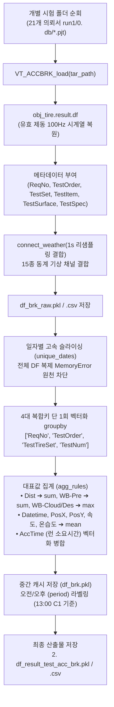
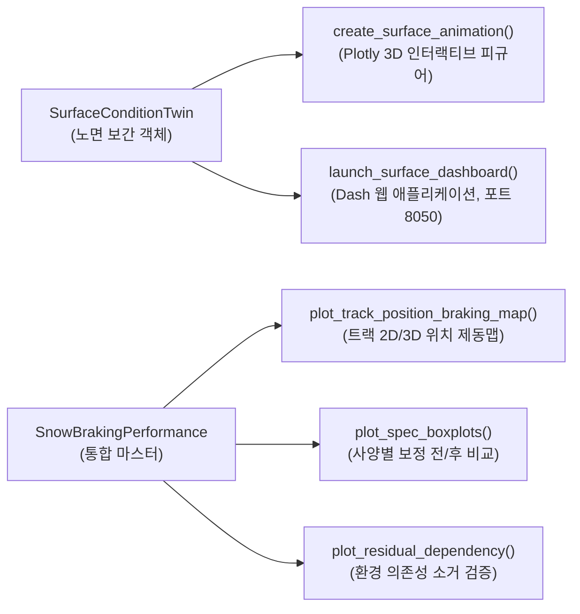

# ❄️ 31_스노우 노면 디지털 트윈 및 제동 성능 환경 보정 종합 위키 (Snow Surface Digital Twin & Braking Pipeline Wiki)

> [!ABSTRACT] 📖 문서 개요 및 시스템 메타데이터
> * **최종 갱신 일자:** 2026-09-18
> * **핵심 주제:** 스노우 실차 시험 데이터 파이프라인, 노면 4D 시공간 보간 디지털 트윈, 1-Run 단위 결합, 차분 머신러닝 기반 노면 영향 걷어내기(Decoupling), Dash/Plotly 대시보드
> * **상위 색인 (MOC):** [[04_Resources/30_스노우_노면_공학/00_스노우_노면_공학_통합_색인|00_스노우 노면 공학 통합 지식 색인]]
> * **연계 프로젝트 대시보드:** [[02_Projects/회사_업무/30_Snow_기반기술/20_2026_Snow_Surface_Characteristics/00_2026_Snow_Surface_Characteristics_대시보드|00_2026 Snow Surface Characteristics 프로젝트 대시보드]]
> * **관련 소스 코드:**
>   - 제동 데이터 파이프라인: `a_make_SnowAccBrkTest_DF.py`
>   - 노면 계측 파이프라인: `a_make_SnowSurfaceCharacteristic_DF.py`
>   - 하류 분석 및 보정 연계: `b_combine_surface_performance_spec.py`
>   - 통합 객체지향 모듈 패키지: `Snow_braking_relate_condition/` (`SnowBrakingPerformance`, `SurfaceConditionTwin`, `SnowCorrectionEngine`, `surface_dashboard`)
> * **연계 문서:** [[20_SnowBrakingPerformance_통합모듈_매뉴얼]] ｜ [[30_Snow_제동성능보정_알고리즘]] ｜ [[2026-09-15]]

---

## 🧭 1. 스노우 실차 시험 및 노면 데이터 구조 개요

스노우 트랙(핀란드 UTAC Ivalo 등) 시험은 일반 아스팔트 시험과 달리 **노면 상태(눈 침하 깊이 및 온도)가 차량 주행과 기상에 따라 매 분 실시간으로 변화**합니다. 따라서 이를 분석하기 위해 두 종류의 서로 다른 차량 및 센서 체계가 운용됩니다.

```
┌─────────────────────────────────┐       ┌─────────────────────────────────┐
│  1. 노면 특성 전용 계측 차량     │       │  2. 일반 실차 제동 평가 차량    │
│  (Surface Characterization Car) │       │  (Tire Braking Test Car)        │
├─────────────────────────────────┤       ├─────────────────────────────────┤
│ • 초음파 높이 센서 (Height1~6)  │       │ • VBOX GPS (위치, 속도, 가속도) │
│ • 적외선 노면 온도 센서 (Temp1~2)│       │ • 타이어 평가 메타데이터:       │
│ • VBOX GPS (위치, 주행 궤적)    │       │   - ReqNo (의뢰번호)            │
│ • 트랙 전체를 시간대별로 왕복    │       │   - TestOrder (런 차수, run1)   │
│   스윕(Sweep) 주행              │       │   - TestSet (타이어 세트, C1/T1)│
│                                 │       │   - TestSpec (타이어 규격)      │
│ ➔ [노면 4D 디지털 트윈 생성]    │       │ ➔ [제동 1회 대표값 추출]        │
└────────────────┬────────────────┘       └────────────────┬────────────────┘
                 │                                         │
                 └──────────────────┬──────────────────────┘
                                    ▼
                ┌───────────────────────────────────────┐
                │ 시공간 1:1 결합 (Row-by-Row Matching) │
                │ 제동 시각(T), 위치(X,Y)의 노면값 부여 │
                └───────────────────┬───────────────────┘
                                    ▼
                ┌───────────────────────────────────────┐
                │ 차분 머신러닝 노면 영향 걷어내기(보정)│
                └───────────────────────────────────────┘
```

### 1.1 노면 계측 차량 vs 제동 평가 차량의 물리적 차이
1. **노면 계측 차량 (`a_make_SnowSurfaceCharacteristic_DF.py`):**
   - 차량 하부에 초음파 변위 센서(`Height1~6`)와 비접촉 적외선 온도 센서(`Temp1~2`)를 탑재하여 눈의 다져진 침하량(눈 눌림량)과 트랙 표면 온도를 계측합니다.
   - 트랙터를 정비한 직후부터 시험 종료 시까지 트랙 전 구간을 주기적으로 왕복하며 노면의 물리적 상태 맵을 생성합니다.
2. **제동 평가 차량 (`a_make_SnowAccBrkTest_DF.py`):**
   - 평가 대상 타이어를 장착하고 40 km/h ➔ 5 km/h 풀 브레이킹(ABS 작동)을 수행하는 실차 시험 차량입니다.
   - **노면 높이/온도 센서가 장착되어 있지 않음:** 따라서 제동 평가 데이터 자체에는 `Height`나 `Temp` 센서 채널이 존재하지 않으며, 오직 차량 거동(속도, 감속도, VBOX 좌표)과 시험 식별 정보(`ReqNo`, `TestOrder`, `TestSet`)만 계측됩니다.
   - **해결책:** 제동 시험이 일어난 정확한 시간(`Datetime`)과 트랙 위치(`PosX`, `PosY`)를 노면 계측 차량이 만든 **디지털 트윈 보간 객체**에 질의하여 당시의 노면 침하량과 온도를 1:1로 결합합니다.

---

## ⚙️ 2. 제동 1회 단위(1 Run = 1 Row) 데이터 파이프라인 (`a_make_SnowAccBrkTest_DF.py`)

### 2.1 왜 제동 1회(Run) 단위 집계가 필수적인가?
* 과거의 세트 평균(Mean of Set) 방식은 같은 세트(예: C1 1~8회 제동) 내에서도 **1회차 제동과 8회차 제동 사이의 10~20분 시간 차이**와 **수십 미터의 트랙 진입 위치 편차**를 평균으로 뭉개버려, 노면의 국소적 다져짐 상태를 정확히 반영할 수 없었습니다.
* 따라서 **1개 행 = 1회 제동(1 Run = 1 Row)**으로 집계하여, 각 제동이 발생한 순간의 고유 위치 좌표와 타임스탬프를 보존해야 합니다.

### 2.2 파이프라인 2단계 아키텍처



### 2.3 집계 상세 규칙 (`agg_rules`)

| 대상 열 (Column) | 집계 함수 (Agg Func) | 결과 컬럼명 | 공학적 의미 |
| :--- | :---: | :--- | :--- |
| **`Dist`** | `sum` | `brk_dist`, `BrkDist` | 40 km/h ➔ 5 km/h 구간의 실제 제동거리 적분값 ($m$) |
| **`WB-Pre`** | `sum` | `WB-Pre`, `SnowPre` | 제동 구간 동안 누적된 강설/강수량 ($mm$) |
| **`WB-Cloud`, `WB-Des`** | `max` | `WB-Cloud`, `WB-Des` | 제동 중 관측된 최대 운량 및 일사량 |
| **`Datetime`** | `mean` | `Datetime`, `DateTime` | 제동 런이 발생한 대표 타임스탬프 (노면 보간 시간 키) |
| **`PosX`, `PosY`** | `mean` | `PosX`, `PosY` | 제동 중 차량의 대표 트랙 평면 좌표 ($m$) (노면 보간 공간 키) |
| **`VelHorizontal`** | `mean` | `VelHorizontal` | 제동 구간 평균 수평 속도 ($km/h$) |
| **`AccForward`** | `mean` | `AccForward` | 제동 구간 평균 감속도 ($g$) |
| **기상 센서군 (`WB-Temp` 등 12종)** | `mean` | `WB-Temp`, `WB-Hum` 등 | 제동 순간의 대기 온도, 습도, 이슬점, 기압, 수증기압 |
| **식별 메타데이터 (`ReqNo` 등)** | `first` | `ReqNo`, `TestOrder`, `TestSet` | 의뢰번호, 런 차수, 타이어 세트명 |
| **`AccTime`** | 계산치 | `AccTime` | `(Datetime.iloc[-1] - Datetime.iloc[0]).total_seconds()` |

### 2.4 세션 (`period`) 분기 로직
* 각 의뢰 및 시험 차수(`[ReqNo, TestItem, TestOrder]`) 내에서 **`C1` 콘트롤 타이어의 평균 시각**이 13:00 이전이면 `'am'`, 이후면 `'pm'`으로 라벨링합니다.
* `C1`이 없는 경우 해당 런의 평균 시각을 기준으로 판별하여, 점심시간 트랙터 정비 전후의 노면 물리 상태와 완벽히 일치시킵니다.

### 2.5 메모리 최적화 및 고속 벡터화 파이프라인 혁신
* **레거시 5중 중첩 루프 병목 해소**:
  - 기존에는 `Date` ➔ `ReqNo` ➔ `TestOrder` ➔ `TestTireSet` ➔ `TestNum`의 5단계 중첩 for 루프로 인해 수만 회의 슬라이싱과 객체 생성이 발생하여 막대한 연산 지연 및 `MemoryError`를 유발했습니다.
* **일자별 1단계 슬라이싱 (`unique_dates`)**:
  - 전체 DataFrame 정렬 및 복제를 배제하고 당일 데이터만 가볍게 슬라이싱(`df_day = df_brk_raw.loc[...]`)하여 메모리 누수를 원천 차단했습니다.
* **4대 복합 그룹 키 단 1회 벡터화 groupby 집계**:
  - `group_keys = ['ReqNo', 'TestOrder', 'TestTireSet', 'TestNum']` 기반으로 단 한 번의 벡터 연산 `df_day.groupby(group_keys, as_index=False).agg(**agg_rules)`을 수행하여 집계 시간을 초 단위로 단축했습니다.
* **런 소요 시간(`AccTime`) 벡터화 병합**:
  - `time_span = df_day.groupby(group_keys)['Datetime'].agg(...)`로 각 런의 실제 시작~종료 경과 시간을 벡터화 계산 후 병합합니다.
* **중간 결과 캐싱(`df_brk.pkl`)**:
  - 1-Run 집계 완료 직후 `df_brk.pkl`을 저장하여 중간 결과를 영구 보존하고, `period` 라벨링 안전 가드(`len(list_tmp_df) > 0`)를 추가했습니다.

---

## 🧊 3. 노면 보간 객체의 세션 분할 메커니즘 (Session-Based Digital Twin)

### 3.1 트랙터 정비(Preparing)에 따른 노면 물리적 리셋 원리
스노우 트랙에서 하루 전체를 하나의 시간 축으로 연속 보간하면 **치명적인 물리적 불연속 왜곡**이 발생합니다.
특히 현장 시험 데이터를 정밀 분석한 결과, 단순히 오전/오후로 기계적으로 자르는 것이 아니라 **트랙터 노면 정비(Preparing)의 물리적 리셋 여부**에 따라 세션을 정의해야 합니다:

```
[케이스 1: Preparing 2번 (오전 1회 + 점심 1회)] ➔ 오전 / 오후 2개 세션 분리
 08:30 ───────────── 11:30 (오전 세션: 다져짐 진행)
                     [12:00~13:00 트랙터 재정비 (Reset!)]
 13:00 ───────────── 16:00 (오후 세션: 새로운 노면 다져짐 진행)

[케이스 2: Preparing 1번 (아침 1회만 정비)] ➔ 종일 단일 세션 (연속 다져짐 누적)
 08:30 ──────────────────────────────────────── 16:00 (종일 세션: 리셋 없이 다져짐 누적)

[케이스 3: Preparing 없음 또는 혹한 1회 주행] ➔ 종일 단일 세션
```

* **Preparing 2번인 날 (01.07, 01.13, 01.15, 01.16, 01.18, 01.22):** 점심시간 트랙터가 노면을 갈아엎고 깎아서 리셋하므로 오전 11:50의 다져진 빙판과 오후 13:00의 부드러운 노면 사이에는 연속성이 없습니다 ➔ **`오전`**, **`오후`** 세션 분리.
* **Preparing 1번인 날 (01.19, 01.20, 01.21):** 점심 트랙터 정비 없이 종일 연속 주행했으므로, 노면 상태가 오전부터 오후까지 점진적으로 다져지는 단일 물리계입니다 ➔ **`종일`** 단일 세션.
* **Preparing 1번 (오후 전용 평가, 01.06):** 아침 혹한(-28℃ 이하)으로 평가 불가 후 오후 시작 전 1회 정비 ➔ **`오후`** 단일 세션.
* **Preparing 없음 & 혹한 1회 주행 (12.30, 12.31, 01.09, 01.10, 01.12, 01.14):** ➔ **`종일`** 단일 세션.

---

### 3.2 시즌 전 기간(16일) 일자별 세션(`Cond`) 및 정비 매핑 마스터

| 일자 (Date) | 노면 정비 (Preparing) | 세션 운영 형태 (`Cond`) | 고유 식별자 (`Cond_ID`) | 특징 및 보간 가이드 |
| :---: | :---: | :---: | :---: | :--- |
| **2025-12-30** | 없음 | **종일** | `2025-12-30_종일` | Set 0~5 종일 연속 다져짐 |
| **2025-12-31** | 없음 | **종일** | `2025-12-31_종일` | Set 0~5 극저온(-20℃ 이하) 연속 주행 |
| **2026-01-06** | 있음 (TR2) | **오후** | `2026-01-06_오후` | 아침 혹한 후 오후 1회 정비, Set 0~1 |
| **2026-01-07** | 2번 | **오전** / **오후** | `..._오전`, `..._오후` | 점심 정비로 오전(Set 0,1) / 오후(Set 2) 분리 |
| **2026-01-09** | 없음 (혹한) | **종일** | `2026-01-09_종일` | -33.8℃ 혹한, Set 0 단일 주행 후 종료 |
| **2026-01-10** | 없음 (혹한) | **종일** | `2026-01-10_종일` | 혹한 단일 주행 후 조기 종료 |
| **2026-01-12** | 없음 (혹한) | **종일** | `2026-01-12_종일` | 혹한 단일 주행 후 조기 종료 |
| **2026-01-13** | 2번 | **오전** / **오후** | `..._오전`, `..._오후` | 점심 정비 분리, Set 0,1(오전) / Set 2,3(오후) |
| **2026-01-14** | 없음 | **종일** | `2026-01-14_종일` | 정비 없이 종일 4개 세트 연속 주행 |
| **2026-01-15** | 2번 | **오전** / **오후** | `..._오전`, `..._오후` | 점심 정비 분리, Set 0,1(오전) / Set 2,3(오후) |
| **2026-01-16** | 2번 | **오전** / **오후** | `..._오전`, `..._오후` | 점심 정비 분리, Set 0,1(오전) / Set 2(오후) |
| **2026-01-18** | 2번 | **오전** / **오후** | `..._오전`, `..._오후` | 점심 정비 분리, Set 0,1(오전) / Set 2,3(오후) |
| **2026-01-19** | 1번 | **종일** | `2026-01-19_종일` | 아침 1회 정비 후 종일 유지 (Set 0, 1, 2) |
| **2026-01-20** | 1번 | **종일** | `2026-01-20_종일` | 아침 1회 정비 후 종일 유지 (Set 0, 1, 2) |
| **2026-01-21** | 1번 | **종일** | `2026-01-21_종일` | 아침 1회 정비 후 종일 유지 (Set 0, 2, 3, 4) |
| **2026-01-22** | 2번 (정상) | **오전** / **오후** | `..._오전`, `..._오후` | 점심 정비 분리, Set 0,1(오전) / Set 2,3(오후) |

---

### 3.3 노면 파이프라인 코드 구현 및 자동 라벨링 (`a_make_SnowSurfaceCharacteristic_DF.py`)

데이터 전처리 및 1-Run 집계 스크립트에 상기 규칙을 표준 함수로 구현하여 산출물(`df_surface.csv`, `df_surface.pkl`)에 영구 반영했습니다:

```python
def assign_surface_condition(dt):
    """일자 및 시간대 기반 노면 세션(Cond), 세션ID(Cond_ID), 노면정비(Preparing) 정보 매핑 함수"""
    date_str = dt.strftime('%Y-%m-%d')
    hour = dt.hour
    
    # 1. Preparing 2번 일자 (오전 / 오후 노면 리셋)
    days_two_prep = ['2026-01-07', '2026-01-13', '2026-01-15', '2026-01-16', '2026-01-18', '2026-01-22']
    if date_str in days_two_prep:
        cond = '오전' if hour < 12 else '오후'
        prep = '2번'
    # 2. 오후 전용 평가 일자
    elif date_str == '2026-01-06':
        cond = '오후'
        prep = '있음(TR2)'
    # 3. Preparing 1번 종일 지속 일자
    elif date_str in ['2026-01-19', '2026-01-20', '2026-01-21']:
        cond = '종일'
        prep = '1번'
    # 4. Preparing 없음 또는 혹한 단일 세션 일자
    elif date_str in ['2025-12-30', '2025-12-31', '2026-01-09', '2026-01-10', '2026-01-12', '2026-01-14']:
        cond = '종일'
        prep = '없음'
    else:
        cond = '오전' if hour < 12 else '오후'
        prep = '미기재'
        
    cond_id = f"{date_str}_{cond}"
    return cond, cond_id, prep

def add_surface_condition_columns(df):
    """데이터프레임의 Datetime 열을 기준으로 Cond, Cond_ID, Preparing 컬럼 추가"""
    if 'Datetime' not in df.columns:
        return df
    dts = pd.to_datetime(df['Datetime'])
    cond_info = [assign_surface_condition(dt) for dt in dts]
    df['Cond'] = [c[0] for c in cond_info]
    df['Cond_ID'] = [c[1] for c in cond_info]
    df['Preparing'] = [c[2] for c in cond_info]
    return df
```

---

### 3.4 노면 디지털 트윈 보간(`groupby('Cond_ID')`) 표준 절차
노면 보간 객체 생성 시, Preparing으로 단절된 노면 상태가 섞이지 않도록 **`Cond_ID` 그룹 단위로 독립 보간**을 수행해야 합니다:

```python
# [핵심] Cond_ID(물리적으로 연속된 노면) 단위로 격리하여 시간 보간 수행
for cond_id, df_cond in df_surface.groupby('Cond_ID'):
    df_cond = df_cond.sort_values('Datetime')
    # 동일 세션 내에서만 시계열 선형/스플라인 보간 수행
    df_cond_interpolated = df_cond.interpolate(method='time')
    # ...
```

---

### 3.5 노면일지 마스터 문서 연계 (`30_SnowSurface_DailyNote.md`)
본 세션 체계는 [[02_Projects/회사_업무/30_Snow_기반기술/20_2026_Snow_Surface_Characteristics/30_SnowSurface_DailyNote|30_SnowSurface_DailyNote (통합 노면일지)]]의 **3단계 전용 마스터 테이블**과 1:1로 정확하게 일치합니다:
* **[테이블 1] 일자별 환경 조건 및 노면 총괄 마스터 (`Daily Conditions` - 20행):** 시즌 전체 강설 타임라인 및 총평 조망.
* **[테이블 2] 세션별 제동 성능 및 노면 센서 수치 마스터 (`Performance Metrics` - 57행):** 텍스트를 배제한 순수 수치(Line 1~3, SRTT, 눌림량, 기온) 콤팩트 테이블.
* **[테이블 3] 세션별 주행 관측 및 엔지니어링 메모 마스터 (`Session Qualitative Notes` - 28행):** 시간대별 현장 평가자 주행 체감 및 센서 오류 메모.

---

## 🧹 4. "노면 영향을 걷어낸다(Normalization / Decoupling)"의 공학적 원리

### 4.1 문제 제기: 노면 변화에 의한 성적 왜곡
실측 제동거리($D_{measured}$)는 순수 타이어 성능뿐만 아니라 환경 요인의 합으로 구성됩니다:

$$D_{measured} = D_{tire} + \Delta D_{surface} + \Delta D_{weather} + \epsilon$$

* **아침 08:30 (푹신한 눈):** 타이어가 눈 속으로 깊게 파고들어(눌림량 10mm) 눈을 긁어모으며 **22.0m**에 정지.
* **오전 11:30 (빙판화된 눈):** 타이어가 파고들지 못하고(눌림량 3mm) 미끄러져 **25.0m**에 정지 (**노면 악화로 +3.0m 불이익**).
* **왜곡 발생:** 만약 개발 사양 B 타이어를 11시 30분에 시험했다면, 실제로는 더 우수한 타이어임에도 불구하고 **"미끄러운 시간대에 시험했다는 이유만으로"** 성적이 나쁘게 평가되는 왜곡이 발생합니다.

### 4.2 걷어내는 과정 (차분 머신러닝의 3단계 소거)

```
[측정된 제동거리 (25.0m)] = [타이어 순수 성능 (22.0m)] + [노면 다져짐 페널티 (+3.0m)]
                                                                    ▲
                                                차분법 머신러닝으로 계산하여 걷어냄(제거)
```

1. **학습 (차분법 머신러닝):**
   - 동일 콘트롤 타이어(C1, C2, C3)의 반복 주행 데이터 간 차분을 통해, *"노면 눌림량이 1mm 얕아질 때마다, 온도가 1℃ 오를 때마다 제동거리가 몇 미터 밀리는가?"*의 환경 전달함수 $f(\Delta Height, \Delta Temp, \Delta AH)$를 Random Forest / Ridge 모델로 학습.
2. **외적 요인 역산:**
   - 임의의 제동 런에 대해, 표준 기준 노면(Reference Condition) 대비 당시 노면 상태가 유발한 **제동거리 가감분(+/- m)**을 정밀 역산.
3. **노이즈 소거 (걷어내기):**
   - 실측 제동거리에서 계산된 환경 손해분을 감산(Subtraction):
     $$D_{corrected} = D_{measured} - \hat{f}(\Delta Condition)$$
   - 결과적으로 **모든 타이어가 완벽히 동일한 가상의 표준 노면에서 주행한 것과 같은 공정한 제동거리(`char_brk_dist_corr`)**를 도출.

### 4.3 걷어내고 난 뒤의 3대 정량적 성과
1. **사양 내 반복 시험 산포(Variance) 대폭 축소:** 동일 타이어의 시간대별 제동거리 편차 소거.
2. **컴파운드 / 패턴 순위 역전(Rank Inversion) 방지:** 시험 순서에 따른 성적 왜곡 차단.
3. **환경 인자 잔차 의존도 제로화 (Slope = 0):** `plot_residual_dependency('char_height')` 확인 시 회귀 기울기가 0으로 수렴하여 노면 의존성이 완전히 소거됨을 검증.

---

## 📊 5. 노면 4D 인터랙티브 대시보드 및 시각화 제품군

신규 모듈 `surface_dashboard.py`와 `SnowBrakingPerformance`에 구현된 대시보드 제품군입니다.



1. **Dash 기반 웹 대시보드 (`launch_surface_dashboard`):**
   - 포트 `8050`으로 로컬 웹 서버 실행 및 브라우저 자동 팝업.
   - 드롭다운: **평가 일자(Date), 세션(AM/PM), 채널(눌림량/노면온도), 보간 간격(분), 애니메이션 재생 속도(ms)**.
   - CYBORG 다크 테마 UI를 적용하여 대형 화면에서 직관적인 노면 모니터링 가능.
2. **Plotly 3D 서피스 애니메이션 (`create_surface_animation`):**
   - 시간 축 슬라이더 조절, ▶ Play / ⏸ Pause 버튼 내장.
   - 사전 기상(Pre-Weather) 및 시험 기상(Test-Weather) 시계열 선 그래프와 현재 시각 마커 동기화.
3. **트랙 위치별 제동거리 맵 (`plot_track_position_braking_map`):**
   - 트랙 종/횡방향 좌표 `(PosX, PosY)` 상의 제동거리 2D 산점도 및 RF 기반 3D 표면 등고선 맵.

---

## 💻 6. 엔드투엔드 파이프라인 전체 흐름도 및 코드 아키텍처

```
[원시 VBOX/센서 데이터]
  ├── 노면 계측 차량 ──> a_make_SnowSurfaceCharacteristic_DF.py ──> 6. df_sur_map_surclass.pkl (보간 객체)
  └── 제동 평가 차량 ──> a_make_SnowAccBrkTest_DF.py ─────────────> 2. df_result_test_acc_brk.pkl (1-Run DF)
                                                                           │
                                  ┌────────────────────────────────────────┘
                                  ▼
                    [b_combine_surface_performance_spec.py]
                    혹은 [SnowBrakingPerformance (OOP 파사드)]
                                  │
                                  ├──> 시공간 1:1 결합 (match_performance_to_surface)
                                  ├──> 차분 머신러닝 보정 (correct_dataframe)
                                  ├──> 노면 4D 웹 대시보드 (launch_surface_dashboard)
                                  └──> 최종 보정 성적서 및 검증 그래프 출력
```

### 6.1 원클릭 실행 스크립트 예시
```python
from Snow_braking_relate_condition import SnowBrakingPerformance

# 1. 통합 마스터 인스턴스 생성
perf = SnowBrakingPerformance(name="Snow_2026_Winter_Test")

# 2. 데이터 등록
perf.add_surface_data(r"D:\uno\1. 2026\2. 25-26_Outdoor_Loop2\2. surface\6. df_sur_map_surclass.pkl")
perf.add_braking_data(r"D:\uno\1. 2026\2. 25-26_Outdoor_Loop2\3. snow_brk\2. df_result_test_acc_brk.pkl")
perf.set_weather_data(r"D:\uno\1. 2026\2. 25-26_Outdoor_Loop2\1. weather\df_weather_0712.pkl")

# 3. [핵심] 1-Run 단위 노면 시공간 보간 결합
df_combined = perf.match_performance_to_surface()
print(f"결합 완료된 제동 런 수: {len(df_combined)} 개")

# 4. 노면 4D 웹 대시보드 실행 (브라우저 자동 실행)
perf.launch_surface_dashboard(port=8050)

# 5. 차분 머신러닝 노면 영향 걷어내기 (보정)
perf.train_correction_model(model_type='Random Forest')
df_corrected = perf.correct_dataframe(out_col='char_brk_dist_corr')

# 6. 보정 효과 검증
perf.plot_spec_boxplots(spec_col='TestSet')
perf.plot_residual_dependency(env_col='Sur_height')
```

---

## 🎯 7. 결론 및 향후 활용 가이드
* 본 파이프라인 구축을 통해, 실차 시험에서 불가피하게 발생하는 **노면 다져짐 및 기상 변화에 따른 불공정한 성적 편차를 수치적으로 완전히 걷어낼 수 있게 되었습니다.**
* 정제된 `2. df_result_test_acc_brk.pkl` 데이터는 `b_combine_surface_performance_spec.py` 및 신규 모듈 패키지와 100% 호환되므로 즉시 후속 분석에 투입할 수 있습니다.
