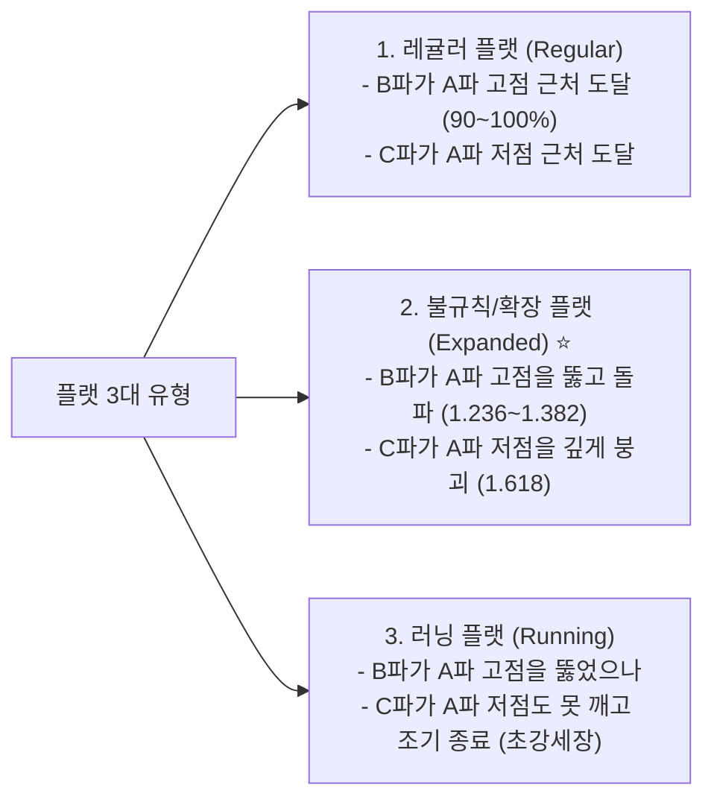

---
id: "resource_flat_criteria"
title: "21_엘리어트 플랫(3-3-5) 조정 파동"
type: resource
category_main: 트레이딩
category_sub: 파동이론
topic: 플랫
date: 2026-09-10
status: 완료
tags:
  - 트레이딩
  - 조정파동
  - 플랫
  - 불규칙플랫
aliases:
  - "플랫"
  - "Flat"
  - "불규칙플랫"
  - "러닝플랫"
  - "3-3-5조정"
  - "플랫 조정"
  - "플랫_조정"
  - "21_플랫_조정"
---

# 📦 플랫(Flat 3-3-5: 정규·불규칙·러닝) 판별 및 매매 기준

추세가 꺾이지 않고 박스권이나 변칙적인 휩소(속임수)를 주며 시간을 끄는 **횡보 조정(Sideways Correction)** 파동입니다.

---

## 1. 📐 형태 및 3대 유형 구조 (Form)
* **내부 하위 파동 구조**: **`3 - 3 - 5`**
  * **A파 (조정 3파)**: abc 구조 (지그재그와 가장 큰 차이점! A파가 3파임)
  * **B파 (조정 3파)**: abc 구조로 A파를 깊게 되돌림
  * **C파 (동인 5파)**: 임펄스 또는 엔딩 다이아고날로 강력하게 진행

---

## 2. 🎯 피보나치 비율 기준 (Fibonacci Ratios)

### ① 레귤러 플랫 (정규 플랫)
* **B파 되돌림**: A파의 **`0.900 ~ 1.000`** (직전 고점과 거의 대등)
* **C파 크기**: A파의 **`1.000 ~ 1.050배`** (박스권 하단 형성)

### ② 불규칙 / 확장 플랫 (Expanded Flat - 나스닥에서 가장 많이 털리는 패턴!) ⭐
* **B파 오버슈팅**: A파 고점을 넘어서며 A파의 **`1.236 ~ 1.382배`**까지 치솟음 (상승 돌파 페이크 트랩).
* **C파 패닉 셀**: A파 저점을 완전히 깨부수며 A파의 **`1.618배`** (심할 경우 2.618배)까지 수직 폭락.

### ③ 러닝 플랫 (Running Flat - 추세 초강세)
* **B파**: A파 고점을 돌파 (`1.050 ~ 1.236배`).
* **C파**: 매수세가 너무 강해 A파 저점에 도달하지 못하고 `0.618 ~ 0.886배`에서 조기 마감 후 폭등.

---

## 3. 📍 어떨 때 자주 나오는가? (출현 위치 & 시장 상황)
* **출현 위치**:
  * 전체 임펄스의 **`4번 파동`** (2파가 지그재그였을 때 4파는 플랫 확률 극대).
  * 강세장의 **`B번 파동`**.
* **시장 상황**:
  * 추세가 너무 강력하여 아래로 깊게 눌리지 않고, 고점에서 롱/숏 개미들의 스탑로스를 위아래로 다 터뜨리는 **무빙(지표 발표 전후)**이 나올 때.

---

## 4. 🚫 파동 필수 규칙 (절대 깨지면 안 되는 철칙)
* ❌ **철칙 1**: A파는 **반드시 3개의 파동(abc)**이어야 한다. (A파가 5파면 플랫 불가, 지그재그임!)
* ❌ **철칙 2**: B파는 최소 A파의 90% 이상 되돌려야 한다. (0.618 이하에서 꺾이면 지그재그)
* ❌ **철칙 3**: C파는 반드시 5개의 동인 파동(임펄스 또는 엔딩)으로 끝나야 한다.

---

## 5. 🎯 실전 매매 타점 및 손절 기준
* **타점 A (불규칙 플랫 B파 트랩 회피 & 숏 공략)**:
  * 직전 고점을 뚫고 올라갔는데 3파(abc)로 꺾이고 1.236~1.382에서 멈칫할 때, 돌파 매수를 하지 말고 **오히려 숏 진입!**
  * **손절(Stop Loss)**: A파의 1.382 확장 라인 바로 위.
* **타점 B (불규칙 플랫 C파 저점 롱 공략 - 초대박 타점)**:
  * A파 저점을 붕괴시키며 패닉 셀이 나올 때, 피보나치 `C = 1.618 * A` 라인 지지 확인 후 롱 진입!
  * **손절(Stop Loss)**: C파 최저점 틱 단위 손절.
* **익절 목표**:
  * 플랫 조정이 끝나면 원래 추세 방향으로 직전 고점을 가뿐히 넘어서는 폭발적 상승이 전개되므로 길게 홀딩.
