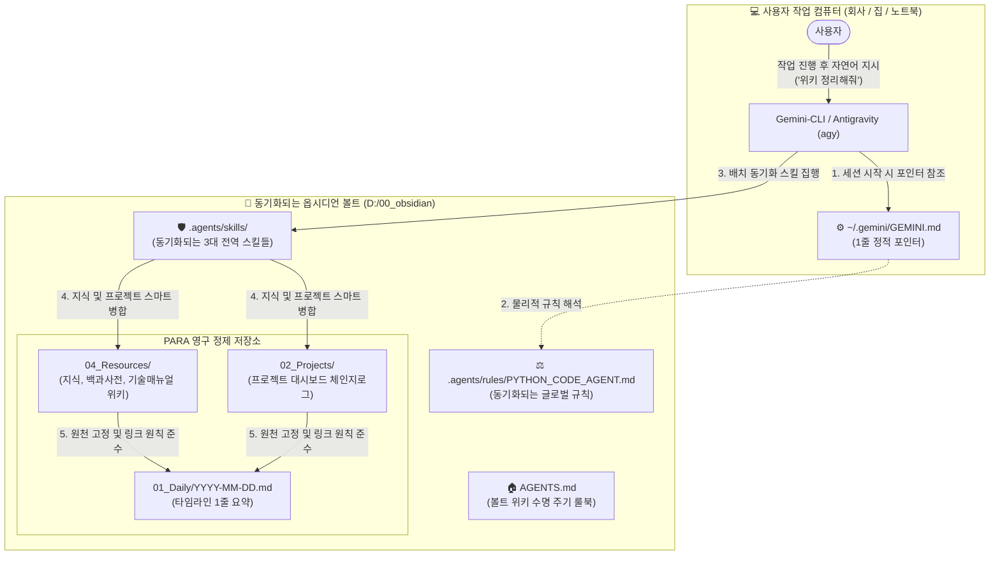

# 🧠 Antigravity CLI 옵시디언 위키 동기화 시스템 매뉴얼

> [!ABSTRACT] 📖 문서 개요
> 본 문서는 **Antigravity 및 제미나이 에이전트**를 사용하여 다중 기기(회사 PC, 집 PC 등)와 복수의 로컬 프로젝트 폴더를 오가며 개발을 수행할 때, **'실시간 이중 동기화 병목을 전면 폐지'**하고 **'로컬 매뉴얼 완성 후 일괄 위키 승격(Batch Sync)'**으로 지식을 안전하고 기품 있게 영구 자산화하는 글로벌 동기화 시스템 매뉴얼입니다.

---

## 🏛️ 1. 크로스 디바이스 동기화의 원리 및 이점

본 시스템은 에이전트가 직접 구동하는 모든 규칙과 스킬을 100% 원격 동기화가 지원되는 옵시디언 볼트 내부의 **`.agents/` 중앙 제어 허브**로 일원화함으로써 극대화된 크로스 디바이스 이식성을 제공합니다.



---

## 📂 2. 핵심 파일 및 디렉터리 구조

모든 실제 스킬과 규칙 파일이 **볼트 내부**에 안전하게 보존되므로, 사용자가 Git Pull 또는 클라우드 싱크를 실행하면 모든 컴퓨터가 100% 동일한 AI 어시스턴트 두뇌를 자동으로 장착하게 됩니다.

```text
📂 Vault Root (D:/00_obsidian)
├── ⚙️ _System/
│   └── setup-obsidian-sync.bat         # 🚀 [새 PC 셋업용] 더블 클릭 1초 등록기
├── 🧭 AGENTS.md                        # 볼트 최상위 룰북 (위키 수명 주기 및 Frontmatter 규격)
├── 🤖 .agents/                          # ★ [글로벌 에이전트 제어 허브] ★
│   ├── ⚖️ rules/
│   │   └── PYTHON_CODE_AGENT.md        # 글로벌 파이썬 품질/시각화 법률 (Single Source of Truth)
│   └── 🛡️ skills/
│       ├── 📂 code-audit-obsidian-docs/# 코드 감사 및 로컬 매뉴얼 작성 스킬
│       ├── 📂 obsidian-wiki-sync/      # 세션 로그/위키 배치 동기화 스킬
│       └── 📂 obsidian-inbox-processor/# 인박스 제로 및 대시보드 완전 병합 스킬
└── 📚 04_Resources/
    └── 90_AI_에이전트_시스템/           # 사용자 열람용 에이전트 백과사전 및 사용 설명서
```

---

## 🚀 3. 새 컴퓨터 / 집 PC 초기 셋업 가이드 (단 2단계!)

회사의 업무용 PC에서 열심히 규칙이나 스킬을 개선해 두었더라도, 퇴근 후 집에서 다음 2단계만 밟으면 즉시 최신화된 엔진이 세팅됩니다:

### [1단계] 옵시디언 볼트 동기화
* 평소 사용하시는 방식(Git Clone/Pull, GitHub Desktop, Obsidian Sync 등)으로 옵시디언 볼트(`00_obsidian`)를 새 컴퓨터의 `D:\00_obsidian` 경로로 동기화합니다.
* *이때, `.agents/rules/` 와 `.agents/skills/` 도 100% 완벽히 복제됩니다.*

### [2단계] `setup-obsidian-sync.bat` 실행 (1초 완료)
* 옵시디언 볼트 내 `_System/` 폴더로 이동합니다.
* **`setup-obsidian-sync.bat` 파일을 더블 클릭**하여 실행합니다.
* *내부 자동 수행 동작:*
  1. 현재 로컬 컴퓨터의 사용자 홈 디렉터리에 `~/.gemini/GEMINI.md` 포인터 파일을 자동 생성하여 볼트 내의 진짜 규칙(`PYTHON_CODE_AGENT.md`)을 읽으라고 포인터를 꽂아줍니다.
  2. 볼트 내의 3대 전역 스킬들(`.agents/skills/`)을 제미나이 전역 스킬 엔진으로 심볼릭 정션(Junction) 자동 셋업하여, 이 PC의 모든 디렉터리에서 스킬을 즉시 기동할 수 있도록 등록해 줍니다.

---

## 🧼 4. 로컬 중심 개발 및 배치 동기화(Batch Sync) 워크플로우

과거의 실시간 이중 동기화 방식은 코딩 흐름을 방해하므로, 아래의 **"배치 동기화"** 루틴에 맞추어 지식을 가공하고 영구 아카이빙합니다:

### ① 개발 및 자가 검수 단계 (로컬 독립)
* 파이썬 프로젝트(`unoUtil` 등) 내부에서 개발 및 디버깅을 자유롭게 수행합니다.
* 코드의 동작 및 단위 검증이 완료되면, 에이전트가 해당 파이썬 파일 하단에 3가지 이상의 다변화 예제 테스트(`if __name__ == "__main__":`)를 탑재하여 정상 구동되는지 테스트합니다.
* 에이전트가 동일 프로젝트 폴더 내에 1:1 마크다운 매뉴얼(`.md`)을 정성껏 작성해 둡니다. (이때, 옵시디언 볼트에는 절대 접근하지 않습니다.)

### ② 최종 승격 및 위키 등록 단계 (Batch-Sync)
* 모든 단위 개발 및 문서화가 끝난 후, 혹은 오늘 작업을 다 끝마치고 퇴근하기 전 대화창에 한마디를 내립니다:
  > **"오늘 한 작업 옵시디언 위키 정리해줘"**
* 에이전트는 로컬에서 성공적으로 검증 및 작성 완료된 개별 `.md` 매뉴얼과 모듈 대시보드를 옵시디언 볼트의 공식 프로젝트 폴더(`02_Projects/회사_업무/20_unoUtil_모듈개발/...`)로 일괄 복사 및 스마트 병합(Upsert)합니다.
* 동시에 오늘 자 데일리 노트(`01_Daily/YYYY-MM-DD.md`)를 열어 핵심 요약 체크리스트를 정갈하게 기록함으로써, 인생 타임라인 로그를 완성합니다.

---

## 🔗 5. 연관 문서
- ⚖️ **[[D:\00_obsidian\.agents\rules\PYTHON_CODE_AGENT.md|PYTHON_CODE_AGENT.md (글로벌 파이썬 마스터 규칙)]]**
- 🛡️ **[[10_AI_에이전트_명령어_및_스킬_가이드|10_AI 에이전트 명령어 및 스킬 운용 가이드]]**
- 📊 **[[50_Matplotlib_시각화_무중단_개발_표준|Matplotlib 시각화 무중단 개발 표준 및 save 다형성 처리 규격]]**
