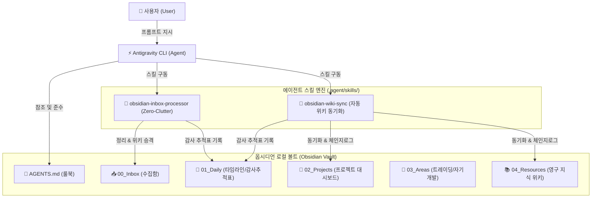

# 🤖 00_AI 에이전트 시스템 통합 지식 색인 (MOC)

> [!ABSTRACT] 🧭 시스템 개요
> 본 색인은 **Google DeepMind Antigravity CLI 에이전트**와 옵시디언(Obsidian) 로컬 볼트 간의 실시간 양방향 동기화, 자율 실행 모드 권한 제어, 커스텀 스킬 및 룰북 운용 체계를 총괄하는 마스터 위키 색인입니다.

---

## 🏛️ 1. 에이전트 시스템 아키텍처

---

## 📚 2. 핵심 가이드 및 매뉴얼 클러스터

### 10번대: 실무 명령어 & 스킬 운용
* 🧭 **[[10_AI_에이전트_명령어_및_스킬_가이드|10_AI 에이전트 명령어 및 스킬 운용 가이드]]**:
  * 인박스 정리 스킬(`obsidian-inbox-processor`), 위키 동기화 스킬, 나스닥 코칭 스킬 호출 및 트리거 프롬프트 가이드
  * 날짜별 임시 보고서 영구 흡수 원칙(Zero-Clutter Law) 및 감사 추적표 기록 프로토콜

### 20번대: CLI 인프라 & 보안 권한
* 🛡️ **[[20_Antigravity_CLI_실행모드_및_권한설정_가이드|20_Antigravity CLI 실행모드 및 권한설정 가이드]]**:
  * 샌드박스 보안 격리 모드, Full-Auto (Autonomous) 무인 자동 승인 모드 전환 방법
  * Windows PowerShell 샌드박스 정책 및 보안 권한 부여 지침

### 30번대: 옵시디언 동기화 & 위키 아키텍처
* 🧠 **[[30_Antigravity_CLI_옵시디언_위키_동기화_매뉴얼|30_Antigravity CLI 옵시디언 위키 동기화 매뉴얼]]**:
  * PARA 기반 폴더 수명 주기 및 이동 금지 불변 원칙
  * Frontmatter 코어 스키마, Dataview 연동, 10단위 클러스터링 네이밍 규약

### 40번대: 볼트 형상관리 & 원격 백업
* 🐙 **[[40_Obsidian_Git_자동동기화_및_원격백업_가이드|40_Obsidian Git 자동동기화 및 원격백업 가이드]]**:
  * GitHub Private + Obsidian Git(v2.39+) 기반 결정론적 스냅샷 백업 아키텍처
  * 최적 설정 규격, 커밋 메시지 제어, 회사 ↔ 집 다중 기기 2단계 무결점 동기화 루틴

---

## 🔗 3. 상위 및 연계 시스템
* 🏠 **[[04_Resources/00_지식_위키_통합_색인|04_Resources 지식 위키 통합 색인]]**
* 🧭 **[[AGENTS|AGENTS.md 시스템 룰북]]**
