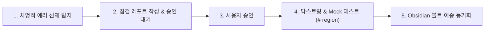

# 🤖 AI 에이전트 명령어 및 전역 스킬 운용 가이드

이 문서는 사용자가 Antigravity(Gemini CLI) 코딩 어시스턴트를 활용할 때 **상황별로 필요한 스킬을 즉시 발동시키고 최상의 품질을 얻을 수 있는 표준 자연어 명령어(Trigger Prompts) 및 운용 매뉴얼**입니다.

---

## 🧭 1. 빠른 명령어 치트시트 (상황별 호출 문장)

AI 에이전트와 대화할 때 아래의 문장을 입력하면 해당 전문 스킬이 즉각 기동되어 엔지니어링 표준 절차를 밟습니다:

| 상황 / 목적 | 추천 트리거 문장 (복사해서 사용) | 활성화되는 스킬 / 동작 |
| :--- | :--- | :--- |
| **코드 종합 점검** | `"최종점검 진행하자"` 또는 `"코드 점검해줘"` | `code-audit-obsidian-docs` • 문법/런타임 에러 선제 탐지 • 리포트 우선 승인(Report-First) |
| **점검 레포트 요청** | `"품질 점검 레포트 작성해줘"` | 코드 수정 전 변경 계획 및 아키텍처 진단 보고서 작성 |
| **문서 및 위키 동기화** | `"위키 업데이트해줘"` 또는 `"진행한거 정리해줘"` | `obsidian-wiki-sync` • 세션 내 Q&A/지식을 영구 위키(`04_Resources`)에 스마트 병합(Upsert) • 대시보드 체인지로그 누적 및 당일 데일리 타임라인 기록 |
| **독립 실행 예제 구현** | `"각 파일에 __main__ 자가 구동 예제(# region) 넣어줘"` | 외부 DB 없이 Mock 데이터로 즉시 테스트 가능한 블록 작성 |
| **닥스트링 표준화** | `"모든 함수에 닥스트링 자세히 달아줘"` | Args, Kwargs, Returns, Examples 100% 기술 |
| **장시간 자율 완결 작업** | `/goal <목표 내용>` (슬래시 커맨드) | 목표가 100% 달성될 때까지 멈추지 않고 검증 반복 |
| **단계별 계획 수립** | `/plan <작업 내용>` (슬래시 커맨드) | 대규모 리팩토링 착수 전 단계별 실행 계획 작성 |
| **상호 인터뷰 정렬** | `/grill-me <의사결정 주제>` | 설계 결정 전 사용자의 선호도와 요구사항을 역질문 |
| **인박스 전수 정리** | `"인박스 정리해줘"` 또는 `"인박스 비워줘"` | `obsidian-inbox-processor` • 지식/프로젝트/첨부 자동 분류 및 위키화 • 날짜별 임시 보고서(`YYMMDD_*.md`)의 대시보드 체인지로그 100% 흡수 및 낱개 파일 정리 (Zero-Clutter) • 당일 데일리에 감사 추적표(Audit Trail) 기록 • 인박스 제로(Inbox Zero) 달성 |
| **크로스 PC 환경 셋업** | `"옵시디언과 동기화해줘"` 또는 `"셋업 옵시디언과 동기화 해줘"` | `cross-device-agent-setup` • 새 PC에서 로컬 `~/.gemini/GEMINI.md`를 옵시디언 볼트(`D:\00_obsidian`) 단일 SSOT 포인터로 1초 만에 자동 생성 • 기기 간 규칙 충돌 원천 차단 및 볼트 무결성 점검 |
| **CLI 전체 자동 실행** | `agy` (터미널 단축 명령어) | 읽기/쓰기/터미널 승인 팝업 없이 100% 무인 자동 실행 (`--dangerously-skip-permissions`) |
| **CLI 안전 검증 실행** | `agy-safe` (터미널 단축 명령어) | 조회는 프리패스, 파일 쓰기 및 중요 명령어 실행 시 사용자 승인 확인 |

---

## 🛡️ 2. 핵심 전역 스킬: `code-audit-obsidian-docs`

### ① 개요 및 위치
* **전역 배포 경로**: `C:\Users\HANTA\.gemini\config\skills\code-audit-obsidian-docs\SKILL.md`
* **볼트 동기화 경로**: `D:\00_obsidian\.agents\skills\code-audit-obsidian-docs\SKILL.md`
* **적용 범위**: PC 내 **모든 파이썬 프로젝트** (`unoUtil`, `Braking_AutoBuild`, `VT_TireTest` 등)

### ② 5대 실행 라이프사이클 (The 5-Step Pipeline)

1. **치명적 결함 무관용 (Zero-Tolerance)**:
   * 미정의 변수, `import` 구문 오작성, 역직렬화(Unpickling) 호환성 에러, 파일 핸들 누수는 사용자에게 묻지 않고 즉시 수정합니다.
2. **리포트 우선 승인 (Report-First Approval)**:
   * 구조 변경, 대규모 리팩토링, 프로퍼티 재설계 등은 반드시 [점검 레포트]를 작성하여 사용자 승인을 득한 후 코드를 수정합니다.
3. **닥스트링 100% 완전성**:
   * 기능 설명, 파라미터 타입, 반환값, 사용 예제를 빠짐없이 기술합니다.
4. **`__main__` 자가 구동 블록**:
   * `# region` 블록으로 외부 파일 없이도 모듈 단위 단독 검증이 가능하도록 구성합니다.
5. **계층적 매뉴얼 이중 동기화**:
   * 로컬 프로젝트와 옵시디언 볼트에 동시 생성 및 최신 상태를 유지합니다.

---

## 💡 3. 실무 실전 프롬프트 예시 (Best Practice)

### 예시 A: 새로운 모듈 개발 후 최종 마무리할 때
> "방금 작성한 모듈에 대해 **최종점검 진행하자**. 에러 있는지 먼저 확인해주고, 개선점은 레포트로 보고한 다음, 닥스트링이랑 `# region` 자가 구동 예제 만들고 옵시디언에도 매뉴얼 동기화해줘."

### 예시 B: 버그 발생 시 원인 분석 및 보고서가 필요할 때
> "스크립트 실행 중 에러가 발생했어. 치명적인 에러는 즉시 선제 해결해주고, 왜 이런 문제가 생겼는지 점검 레포트 폼으로 작성해서 옵시디언에 정리해줘."

### 예시 C: 다른 프로젝트에 동일한 룰을 적용할 때
> "이 프로젝트에도 내 전역 점검 스킬(`code-audit-obsidian-docs`) 규칙을 적용해서 코드 감사와 옵시디언 매뉴얼 작업을 진행해줘."

---

## 🔗 4. 연관 문서 및 백링크
- 🛡️ **[[20_Antigravity_CLI_실행모드_및_권한설정_가이드|Antigravity CLI 실행 모드 및 권한 설정 가이드 (agy vs agy-safe)]]**
- 🤖 **[[30_Antigravity_CLI_옵시디언_위키_동기화_매뉴얼|Antigravity CLI 옵시디언 위키 동기화 매뉴얼]]**
- 💼 **[[unoUtil|unoUtil 사내 개발도구 허브]]**
- 📘 **[[Gemini_Python_코드_생성_규칙|Python 코드 생성 규칙]]**
- 📋 **[[VT_ACCBRK_최종_점검_레포트|VT_ACCBRK 모듈군 최종 점검 레포트 (2026-09-10)]]**
