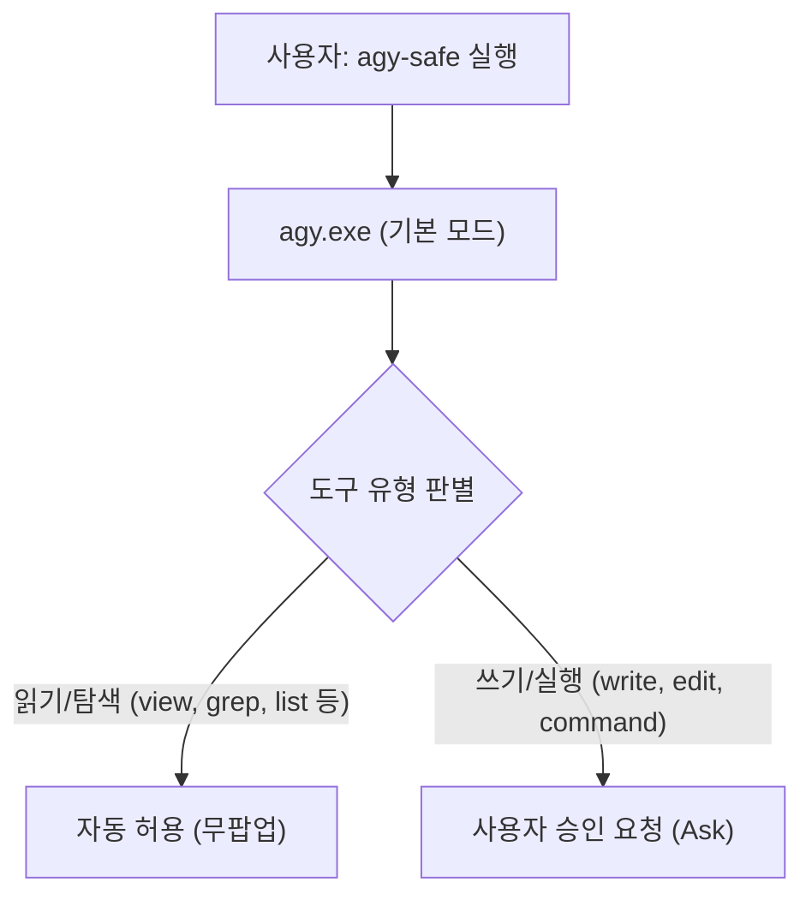

---
id: "antigravity_execution_permissions_guide"
title: "20_Antigravity CLI 실행모드 및 권한설정 가이드"
type: resource
category_main: 지식
category_sub: AI_에이전트
topic: Antigravity_권한_설정
date: 2026-09-14
status: 완료
tags:
  - AI에이전트
  - Antigravity
  - agy
  - agy-safe
  - 권한설정
  - 매뉴얼
  - 자동화
aliases:
  - "agy-safe"
  - "agy 권한 설정"
  - "Antigravity 권한 모드"
  - "Antigravity_CLI_실행모드_및_권한설정_가이드"
  - "20_Antigravity_CLI_실행모드_및_권한설정_가이드"
---

# 🛡️ Antigravity CLI 실행 모드 및 권한 설정 가이드 (`agy` vs `agy-safe`)

> [!ABSTRACT] 📖 문서 개요
> 본 문서는 **Antigravity CLI(`agy`)**를 운용할 때, 반복적인 도구 승인 팝업으로 인한 병목을 해소하고 작업 성격(전자동 초고속 개발 vs 신중한 검증)에 따라 실행 권한을 유연하게 전환할 수 있도록 구축한 **권한 모드 체계(`agy` vs `agy-safe`)의 원리, 세팅 방법 및 다른 PC 이식 가이드**입니다.

---

## 🧭 1. 권한 모드 비교표

| 명령어 | 실행 모드 | 권한 동작 방식 | 추천 사용 상황 |
| :--- | :--- | :--- | :--- |
| **`agy`** | **전자동 풀 승인 모드**<br>*(Full-Auto / YOLO)* | • 읽기, 쓰기, 터미널 실행 등 **모든 도구 승인 팝업 없이 100% 자동 승인**<br>• 내부 플래그: `--dangerously-skip-permissions` | • 대규모 리팩토링, 빠른 디버깅<br>• 믿을 수 있는 환경에서 연속 코딩<br>• 장시간 자율 작업 (`/goal` 등) |
| **`agy-safe`** | **안전 검증 모드**<br>*(Safe Review)* | • **읽기/탐색 도구**: 기본 자동 승인 (`view_file`, `list_dir`, `grep_search`, `find_by_name` 등)<br>• **쓰기/명령어 도구**: **사용자에게 확인 팝업 표시** (`write_to_file`, `replace_file_content`, `run_command` 등) | • 처음 보는 레포지토리 탐색<br>• 핵심 프로덕션 코드 신중 수정<br>• 파일 덮어쓰기 전 최종 육안 확인 |
| **`agy-raw`** | **기본 바이너리 모드** | • 아무 플래그 없이 Antigravity 기본 설정 그대로 실행 | • CLI 설정 테스트 및 옵션 커스텀 조합 |

---

## ⚙️ 2. 작동 원리 및 내부 메커니즘

### ① `agy` (풀 승인 모드)
Antigravity CLI는 기본적으로 사용자의 파일 시스템과 터미널을 보호하기 위해 파일 수정이나 명령 실행 시 권한 승인을 요구합니다.  
`--dangerously-skip-permissions` 플래그를 붙여 실행하면 모든 툴 호출 승인 절차를 스킵하여 질문 없이 즉시 결과를 도출합니다.


### ② `agy-safe` (안전 검증 모드)
조회/탐색(Read-Only) 도구는 안전하므로 즉시 실행되지만, 영구적인 변경을 일으키는 쓰기/삭제/터미널 명령(Write/Execute)은 사용자에게 확인 팝업을 띄워 안전망을 제공합니다.



---

## 🚀 3. 새 컴퓨터 / 다른 환경 세팅법 (1초 등록)

새로운 컴퓨터(집, 회사, 연구실 노트북 등)로 이동했을 때 언제든지 볼트 내부의 스크립트 하나로 즉시 세팅할 수 있습니다.

### 방법 1: 배치 파일 더블 클릭 (가장 쉬움)
1. 옵시디언 볼트 내 `_System/` 폴더로 이동합니다.
2. **`setup-agy-shortcuts.bat` 파일을 더블 클릭**합니다.
3. 현재 사용자의 PowerShell 프로필(PowerShell 7 및 Windows PowerShell 5.1 모두)에 `agy`, `agy-safe`, `agy-raw` 함수가 자동 등록됩니다.

### 방법 2: 터미널에서 직접 실행
PowerShell 콘솔에서 볼트 폴더로 이동 후 아래 명령어를 입력합니다:
```powershell
powershell -ExecutionPolicy Bypass -File "._System\setup-agy-shortcuts.ps1"
```

---

## 📜 4. PowerShell 프로필 코드 원본

수동으로 확인하거나 프로필에 직접 추가하고 싶을 때는 아래 코드를 `$PROFILE`에 삽입합니다:

```powershell
# ==============================================================================
# Antigravity CLI (agy) - Permission & Execution Shortcuts
# ==============================================================================

# 1. agy (모든 권한 자동 승인 모드)
function agy {
    $agyCmd = (Get-Command agy.exe -ErrorAction SilentlyContinue).Source
    if (-not $agyCmd) { $agyCmd = "$env:LOCALAPPDATA\agy\bin\agy.exe" }
    & $agyCmd --dangerously-skip-permissions @args
}

# 2. agy-safe (읽기 프리패스 / 쓰기 확인 모드)
function agy-safe {
    $agyCmd = (Get-Command agy.exe -ErrorAction SilentlyContinue).Source
    if (-not $agyCmd) { $agyCmd = "$env:LOCALAPPDATA\agy\bin\agy.exe" }
    & $agyCmd @args
}

# 3. agy-raw (기본 순정 바이너리 모드)
function agy-raw {
    $agyCmd = (Get-Command agy.exe -ErrorAction SilentlyContinue).Source
    if (-not $agyCmd) { $agyCmd = "$env:LOCALAPPDATA\agy\bin\agy.exe" }
    & $agyCmd @args
}
```

---

## 🛠️ 5. 외부 에디터(External Editor / PyCharm) 연동 및 멈춤 방지 가이드

### ① 터미널 일시 정지(Blocking) 발생 원인
* Gemini CLI / Antigravity 운용 중 작업 계획(Plan Mode) 검토나 긴 텍스트 입력(`Ctrl+G`, `Ctrl+X`) 트리거 시, CLI는 외부 에디터를 호출합니다.
* 이때 기본 에디터(`preferredEditor` 또는 환경변수 `EDITOR`)가 지정되어 있지 않으면, CLI는 **"에디터를 선택하라"는 다이얼로그를 띄우며 사용자의 입력을 무한 대기(일시 정지)**하게 됩니다.

### ② 파이참(PyCharm) 환경변수 영구 등록 원리
* JetBrains IDE(PyCharm)는 CLI 설정 파일의 내장 키 목록에 직접 포함되어 있지 않으므로, 윈도우 사용자 환경변수 **`EDITOR`** 및 **`VISUAL`**을 통해 1순위로 호출되도록 연동합니다.
* 반드시 **`--wait`** 플래그를 포함해야 파이참의 해당 탭이 닫힐 때까지 CLI가 동기식으로 대기한 뒤 수정 사항을 안전하게 수납합니다.

```cmd
:: 윈도우 CMD / PowerShell 공용 영구 등록 명령어
setx.exe EDITOR "\"D:\JetBrains\Apps\PyCharm\bin\pycharm64.exe\" --wait"
setx.exe VISUAL "\"D:\JetBrains\Apps\PyCharm\bin\pycharm64.exe\" --wait"
```

### ③ 무오염·안전성 보증 (No Workspace Pollution)
* **임시 폴더 격리**: 프로젝트 폴더나 소스 레포지토리에 임시 파일이 생성되지 않으며, OS 시스템 임시 폴더(`%TEMP%\...`)의 1회용 버퍼 파일만 사용합니다.
* **자동 정리**: 파이참에서 파일 저장(`Ctrl+S`) 후 탭 닫기(`Ctrl+F4`)를 수행하면 CLI가 내용을 즉시 읽어 들인 후 임시 파일은 자동 소멸됩니다.

---

## 🔗 6. 연관 문서
- 🤖 [[30_Antigravity_CLI_옵시디언_위키_동기화_매뉴얼|Antigravity CLI 옵시디언 위키 동기화 매뉴얼]]
- 📋 [[10_AI_에이전트_명령어_및_스킬_가이드|AI 에이전트 명령어 및 스킬 운용 가이드]]
- 🧭 [[AGENTS|옵시디언 PARA + LLM 위키 시스템 운용 룰북 (AGENTS.md)]]
