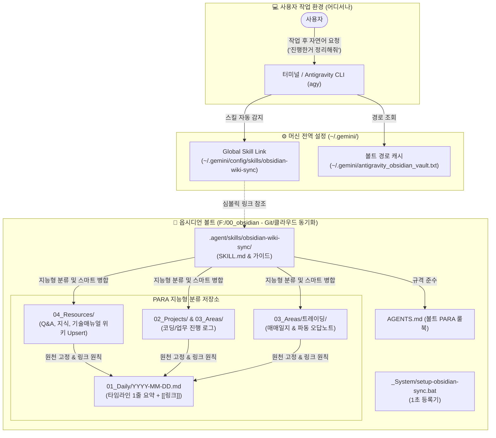

# 🧠 Antigravity CLI 옵시디언 위키 동기화 시스템 매뉴얼

> [!ABSTRACT] 📖 문서 개요
> 본 문서는 **Antigravity CLI(`agy`)**를 통해 다양한 폴더 및 여러 컴퓨터에서 개발, 공부, 트레이딩, Q&A 작업을 수행할 때, **"내가 이제까지 진행한거 정리해줘"**라는 간단한 말 한마디로 세션의 모든 작업과 지식을 옵시디언 PARA 시스템에 LLM 위키 스타일로 자동 분류·기록해 주는 **전역 동기화 시스템의 구조, 사용법 및 커스터마이징 가이드**입니다.

---

## 🏛️ 1. 시스템 아키텍처 및 원리

사용자가 어떤 드라이브(C:, D:, F: 등)의 어떤 폴더에서 터미널을 열어 작업하든, 심지어 집/회사/노트북 등 컴퓨터가 바뀌더라도 옵시디언 볼트만 동기화되어 있다면 동일하게 동작하도록 설계되었습니다.



---

## 📂 2. 핵심 파일 및 디렉터리 구조

모든 원본 스킬과 룰은 **옵시디언 볼트 내부**에 저장되므로, 옵시디언을 다른 컴퓨터에 동기화(Git pull 등)하면 설정과 지침이 100% 동일하게 따라갑니다.

```text
📂 Vault Root (F:/00_obsidian)
├── ⚙️ _System/
│   ├── setup-obsidian-sync.bat         # 🚀 [새 컴퓨터용] 더블 클릭 1초 등록기
│   └── setup-obsidian-sync.ps1         # 🚀 PowerShell 기반 전역 등록 스크립트
├── 🤖 .agent/skills/obsidian-wiki-sync/  # 🧠 [스킬 원본] Antigravity 동기화 엔진
│   ├── SKILL.md                        # 스킬 트리거 및 5단계 실행 프로세스 정의
│   └── references/
│       ├── classification-guide.md     # 지식(Q&A) vs 프로젝트 vs 업무 세부 분류표
│       └── para-rules.md               # Frontmatter 규격 및 문서 이동 금지 룰
├── 🧭 AGENTS.md                        # 볼트 최상위 룰북 (사서 에이전트 행동 지침)
├── 📅 01_Daily/                        # 타임라인 대문 (1줄 요약 + [[문서링크]])
├── 🎯 02_Projects/                     # 프로젝트 및 자격증/시험 목표 로그
├── 🔄 03_Areas/                        # 회사 업무 및 트레이딩 지속 관리
└── 📚 04_Resources/                    # 지식 위키 (매뉴얼, 기술 자료, 개념 정의)
    └── 🤖 AI_에이전트_시스템/           # AI 도구, 프롬프트, 위키 자동화 매뉴얼
```

---

## 🚀 3. 새 컴퓨터 / 새 환경 세팅법 (단 2단계!)

집 PC, 회사 PC, 노트북 등 새로운 컴퓨터에서 작업할 때의 초기 세팅 방법입니다:

### 1단계: 옵시디언 볼트 동기화
* 평소 사용하시는 방식(Git clone/pull, Obsidian Sync, 클라우드 드라이브 등)으로 옵시디언 볼트를 새 컴퓨터로 가져옵니다.

### 2단계: `setup-obsidian-sync.bat` 실행 (1초 완료)
* 옵시디언 볼트 내 `_System/` 폴더로 이동합니다.
* **`setup-obsidian-sync.bat` 파일을 더블 클릭**합니다.
* *내부 자동 수행 작업:*
  1. 현재 컴퓨터에서의 볼트 절대 경로(예: `C:\...\00_obsidian` 또는 `D:\...`)를 자동 감지합니다.
  2. 사용자 환경변수 `OBSIDIAN_VAULT` 및 `~/.gemini/antigravity_obsidian_vault.txt`에 경로를 기록합니다.
  3. `~/.gemini/config/skills/obsidian-wiki-sync`로 정션(Junction) 링크를 생성하여, **이 PC의 어느 폴더에서나 에이전트가 이 스킬을 쓸 수 있도록 전역 등록**합니다.

> [!TIP] 💡 터미널에서 직접 실행하고 싶을 때 (원라이너)
> 만약 윈도우 파일 탐색기를 열지 않고 PowerShell 터미널에서 바로 실행하고 싶다면, 볼트 폴더에서 아래 명령어 한 줄을 입력하시면 됩니다:
> ```powershell
> powershell -ExecutionPolicy Bypass -File "._System\setup-obsidian-sync.ps1"
> ```

---

## 🗣️ 4. 실전 사용법 (트리거 발화 예시)

터미널에서 코딩, 디버깅, 라이브러리 질의응답, 공부 등을 진행한 뒤, **어느 폴더에서든 대화창에 자연스럽게 아래처럼 말하면 즉시 동작**합니다:

| 사용자 요청 발화 예시 | 에이전트 동작 결과 |
| :--- | :--- |
| **"내가 이제까지 진행한거 정리해줘"** | 세션 전체를 분석하여 지식 위키(Resources)와 프로젝트 로그(Projects)를 업데이트하고 데일리 노트에 1줄 링크 기록 |
| **"오늘 한 작업 옵시디언에 기록해줘"** | 오늘 진행된 코드 수정, 이슈 해결 내역을 해당 프로젝트 노트와 오늘 데일리 노트에 반영 |
| **"방금 내가 질문하고 대답 들은거 지식 위키에 업데이트해줘"** | 세션 중 발생한 Q&A, 개념, 에러 해결법만 정제하여 `04_Resources`에 스마트 병합(Upsert) |
| **"오늘 작업 데일리에 정리해줘"** | 오늘 자 `01_Daily/YYYY-MM-DD.md` 타임라인에 오늘 성과를 1줄 요약 체크리스트로 등록 |

---

## 🧠 5. 지능형 분류 및 저장 원칙 (PARA Classification)

에이전트는 세션 내용을 분석하여 아래 원칙에 따라 정확한 폴더에 문서를 배치합니다:

### ① 지식 / 매뉴얼 / Q&A ➡️ `04_Resources/`
* **대상**: "이 라이브러리 어떻게 써?", "이 수학/공학 공식 유도해줘", "이 에러 왜 생겨?" 등 질문-답변 내역
* **작성 방식**: 
  * 기존 문서가 있으면 관련 섹션 아래에 `### YYYY-MM-DD 업데이트` 형태로 **스마트 병합(Upsert)**
  * 신규 문서면 표준 Frontmatter(`type: resource`, `topic: ...`) 부여 후 생성
  * 주요 키워드는 `[[문서명]]` 위키링크 자동 연결

### ② 코딩 / 프로젝트 작업 로그 ➡️ `02_Projects/` 또는 `03_Areas/회사_업무/`
* **대상**: 특정 모듈 개발, 버그 픽스, 리팩토링, 성능 최적화, 산출물이 있는 작업
* **작성 방식**: 변경된 파일 목록, 문제 해결 원인, 기술적 의사결정(Rationale), 남은 과제(TODOs) 기록

### ③ 자격증 / 학습 ➡️ `02_Projects/자격증_시험/` & `04_Resources/데이터분석_지식/`
* **대상**: 빅데이터분석기사, ADP, 영어회화, 머신러닝 공부 내용 정리

### ④ 데일리 노트 타임라인 반영 ➡️ `01_Daily/YYYY-MM-DD.md` (불변의 법칙)
* **절대 긴 본문을 데일리에 복붙하지 않음!**
* 실제 생성/수정된 문서를 `[[문서명]]` 위키링크로 걸고, **한 줄 핵심 체크리스트 요약**만 타임라인에 남김:
  ```markdown
  - [x] **[개발/unoUtil]** VT_ACCBRK 가속/제동 데이터 전처리 모듈 리팩토링 완료 ([[VT_ACCBRK_가이드]])
  - [x] **[지식/타이어]** Slip Ratio에 따른 Tire Shear Force 역학 이론 정리 ([[10_Tire_Shear_Force]])
  ```

---

## 🛠️ 6. 유지보수 및 커스터마이징 가이드

시스템을 수정하거나 규칙을 추가하고 싶을 때 편집해야 하는 파일 안내입니다:

### 1) 새로운 분류 기준이나 저장 폴더를 추가하고 싶을 때
* 📄 **수정 파일**: `F:\00_obsidian\.agent\skills\obsidian-wiki-sync\references\classification-guide.md`
* ✍️ **방법**: 마크다운 표나 섹션에 새로운 카테고리(예: `취미_테라리움`, `공모전_준비` 등)와 저장 규칙을 추가하면 에이전트가 이를 읽고 즉시 반영합니다.

### 2) 트리거 발화 키워드를 바꾸고 싶을 때
* 📄 **수정 파일**: `F:\00_obsidian\.agent\skills\obsidian-wiki-sync\SKILL.md`
* ✍️ **방법**: 상단 Frontmatter의 `description` 항목에 사용자가 자주 쓰는 문구(예: `"세션 로그 남겨줘"`, `"위키 박제해줘"` 등)를 추가합니다.

### 3) Frontmatter 필수 메타데이터 속성을 변경하고 싶을 때
* 📄 **수정 파일**: `F:\00_obsidian\AGENTS.md` 및 `SKILL.md`
* ✍️ **방법**: Core Schema의 키 목록(`id`, `title`, `type`, `category_main`, `tags` 등)을 수정합니다.

### 4) 볼트 위치(드라이브 문자 등)가 변경되었을 때
* 📄 **해결책**: 새 경로의 `_System/setup-obsidian-sync.bat`을 다시 한 번 더블 클릭하거나, `~/.gemini/antigravity_obsidian_vault.txt` 파일 안의 경로 문자열을 직접 수정합니다.

---

## ❓ 7. 자주 묻는 질문 및 문제 해결 (FAQ)

> [!NOTE] Q1. 다른 프로젝트 폴더(C드라이브)에서 "정리해줘"라고 했는데 스킬이 안 떠요.
> **해결책**: 해당 PC에서 `_System/setup-obsidian-sync.bat`을 실행했는지 확인하세요. 실행 시 `~/.gemini/config/skills/obsidian-wiki-sync`가 생성되어 전역에서 사용 가능해집니다.

> [!NOTE] Q2. 기존에 잘 작성해 둔 문서 내용이 날아가거나 덮어써질 위험은 없나요?
> **답변**: 절대 없습니다. 스킬 내부 지침에 `Upsert(스마트 병합)` 원칙이 강제되어 있어, 기존 파일이 있을 경우 기존 본문을 보존한 채 하단에 날짜별 업데이트 섹션만 추가하도록 설계되어 있습니다.

> [!NOTE] Q3. 데일리 노트 날짜가 다른 날짜로 들어가지 않나요?
> **답변**: 에이전트는 시스템의 현재 로컬 타임스탬프를 기준으로 오늘 날짜(`YYYY-MM-DD.md`)를 정확히 찾아 진입합니다. 파일이 없으면 자동으로 오늘 날짜 데일리를 생성하고 링크를 겁니다.

---

### 2026-09-29 업데이트: 단일 마스터 MOC 및 스크롤 프리 대시보드 스마트 병합 원칙
* **단일 마스터 MOC 일원화(Single Master MOC Law)**: 프로젝트 하위 폴더별 서브 대시보드 난립을 금지하고, 루트의 단일 마스터 대시보드 1곳에 모든 서브모듈을 직접 바인딩하도록 표준화함.
* **스크롤 프리 아키텍처 연동**: ⚡ Quick Jump 앵커 바와 접기형 콜아웃(`> [!NOTE]- ...`)을 탑재하여 대규모 프레임워크 문서도 1화면 조망형으로 자동 구성함.
* **임시 보고서 완전 흡수 (Zero-Clutter)**: `WORK_STATUS.md` 등의 임시 파일은 마스터 대시보드 체인지로그에 100% 흡수 후 안전 삭제하여 Inbox Zero를 유지함.
* **상세 참조**: [[60_단일_마스터_MOC_및_스크롤프리_대시보드_아키텍처_표준]]

---

### 2026-10-13 업데이트: 크로스 PC 단일 SSOT 연동 및 원클릭 동기화 아키텍처 확립
* **크로스 PC 단일 SSOT 연동 원칙 (Cross-Device SSOT Pointer Law)**: 복수의 컴퓨터 사용 시 로컬 머신 설정(`~/.gemini/GEMINI.md`)에 세부 작업 규칙을 중복 기재하여 발생하던 기기 간 규칙 충돌을 원천 차단하고, 로컬 설정 파일을 옵시디언 볼트(`D:\00_obsidian`) 위임 포인터로 경량화 일원화함.
* **원클릭 자동 셋업 스킬(`cross-device-agent-setup`) 신설**: 새 PC에서 `"옵시디언과 동기화해줘"`, `"셋업 옵시디언과 동기화 해줘"`, `"옵시디언 동기화해줘"` 명령 시 해당 머신의 로컬 포인터를 1초 만에 자동 생성하고 환경 무결성을 즉시 검증하도록 구축함.
* **옵시디언 앱 비의존 원칙**: GUI 프로그램을 실행할 필요 없이 디스크의 볼트 폴더 동기화 상태만으로 에이전트가 파일 시스템을 직접 해석하여 완전 구동됨을 확립.
* **상세 참조**: [[70_크로스_PC_단일_SSOT_연동_및_원클릭_동기화_가이드]]

