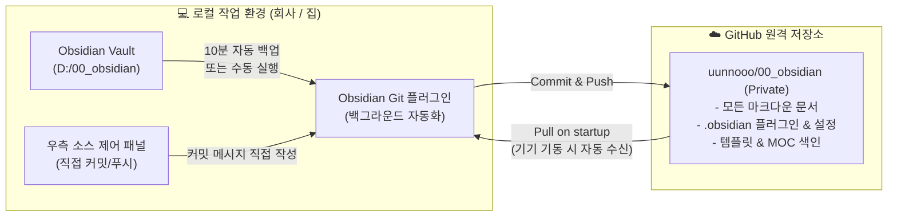

# 🐙 40_Obsidian Git 원격 동기화 및 백업 운용 가이드

> [!ABSTRACT] 📖 가이드 개요
> 본 문서는 옵시디언 로컬 볼트(`D:\00_obsidian`)를 **GitHub 비공개(Private) 저장소**와 연동하고, 커뮤니티 플러그인인 **`Git (Obsidian Git v2.39+)`**을 활용하여 무결점 자동 백업 및 다중 기기(회사 ↔ 집) 간 원격 동기화 파이프라인을 운용하기 위한 실무 표준 가이드입니다.

---

## 🏛️ 1. 아키텍처 개요 및 개편 배경

기존 구글 드라이브 동기화(`google-drive-sync`)의 단순 타임스탬프 덮어쓰기 방식에서 발생하던 파일 미삭제 잔존, 빈 폴더 누적, 기기간 충돌 문제를 해결하기 위해 **Git 해시 기반 스냅샷 동기화** 체계로 전면 전환되었습니다.



---

## ⚙️ 2. Obsidian Git (v2.39+) 권장 최적 설정

최신 버전 `Git` 플러그인(`v2.39+`)의 옵션 체계에 맞춘 핵심 세팅 규격입니다:

| 섹션 (헤딩) | 설정 항목명 | 설정값 | 설정 목적 및 동작 설명 |
| :--- | :--- | :---: | :--- |
| **Automatic** | `Auto backup interval (minutes)` | `10` | 10분마다 작업 내용을 자동으로 커밋 및 푸시 (0: 꺼짐) |
| **Pull** | `Pull on startup` | **ON** | 옵시디언 앱 실행 시 깃허브의 최신 커밋을 먼저 안전하게 당겨옴 |
| **Commit-and-sync** | `Pull on commit-and-sync` | **OFF** | 단일 PC 작업 시 불필요한 Pull 단계를 제거하여 `Commit ➡️ Push` 초고속 직결 |
| **Miscellaneous** | `Disable informative notifications` | **OFF (권장)** | 백업/푸시 성공 시 우측 상단 토스트 알림을 띄워 정상 완료 여부를 시각적으로 확인 |

---

## ✍️ 3. 백업 및 커밋 메시지 운용 방법

### ① 완전 자동 백업 (평상시)
* 작성 중 아무런 조작을 하지 않아도 **10분 주기**로 자동 실행됩니다.
* 기본 자동 커밋 템플릿: `vault backup: YYYY-MM-DD HH:mm:ss`

### ② 수동 즉시 백업 (단축키 실행)
* 단축키 **`Ctrl + P`** (명령어 팔레트) 실행 후:
  * **`Git: Commit-and-sync`**: 현재 모든 변경사항을 기본 템플릿 메시지로 즉시 커밋 & 깃허브 푸시
  * **`Git: Commit-and-sync with specific message`**: 상단에 입력창이 뜨며, 원하는 작업 커밋 메시지(예: `feat: 나스닥 매매일지 추가`)를 직접 입력하여 푸시

### ③ 우측 소스 제어 패널(Source Control View) 활용
* 우측 사이드바의 Git 아이콘 클릭 시 전용 소스 제어 패널 노출:
  1. 상단 텍스트 박스에 커밋 메시지 직접 입력
  2. 상단 체크(`✓` Commit) 버튼 클릭
  3. 상단 위쪽 화살표(`↑` Push) 버튼 클릭으로 깃허브 업로드 완료

---

## 🏠 4. 집(외부) PC 초기 동기화 2단계 가이드

깃허브 저장소에는 문서뿐만 아니라 `.obsidian` 폴더(플러그인, 단축키, 대시보드 세팅)가 100% 보존되어 있으므로, **집에서는 플러그인을 일일이 다시 설치할 필요가 없습니다.**

### [1단계] 저장소 복제 (Git Clone)
집 PC의 터미널(CMD, PowerShell 또는 Git Bash)에서 원하는 경로로 복제합니다:
```bash
git clone https://github.com/uunnooo/00_obsidian.git D:\00_obsidian
```

### [2단계] 옵시디언에서 기존 보관소 열기
1. 옵시디언 실행 ➡️ 보관소 선택 화면에서 **"기존 폴더를 보관소로 열기(Open folder as vault)"** 클릭
2. 방금 다운로드한 `00_obsidian` 폴더 선택
3. 첫 화면에서 *"커뮤니티 플러그인 제한 모드"* 팝업 시 **[제한 모드 끄기 / 활성화]** 클릭
4. 즉시 회사와 동일한 대시보드, 템플릿, Git 플러그인이 100% 복원되어 작동 시작!

> [!TIP] 💡 집 컴퓨터에 Git이 없는 경우
> * **[Git for Windows](https://git-scm.com/)**: 설치 프로그램 다운로드 후 기본값(Next-Next-Install)으로 1분 만에 설치
> * **[GitHub Desktop](https://desktop.github.com/)**: GUI 마우스 클릭 환경 선호 시, 설치 후 로그인 ➡️ `Clone a repository` 버튼으로 마우스 클릭 복제 가능

---

## 🔄 5. 회사 ↔ 집 일상 루틴

* **기기 켤 때**:
  * `Pull on startup: ON` 설정으로 인해, **옵시디언을 켜는 순간 다른 기기에서 작업했던 최신 내용이 자동으로 즉시 다운로드(Pull)**됩니다.
* **기기 끌 때**:
  * 10분 자동 백업이 작동하거나, 옵시디언 종료 직전 **`Ctrl + P` ➡️ `Git: Commit-and-sync`** 한 번만 실행하면 깃허브로 안전하게 업로드 완료됩니다.
* **데이터 안전성**:
  * 비공개 깃허브 저장소에 버전별 히스토리가 영구 보존되어 랜섬웨어, 디스크 고장, 실수로 인한 내용 삭제 시에도 언제든 특정 시점으로 롤백 복구가 가능합니다.
