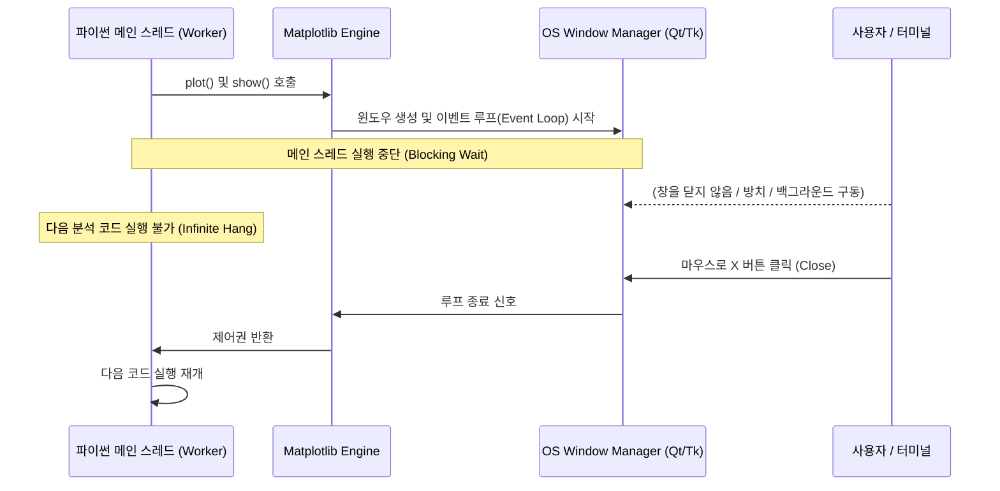

# 📊 50_Matplotlib 시각화 무중단(Non-blocking) 엔지니어링 표준

> [!ABSTRACT] 🧭 지식 개요
> 본 문서는 대규모 데이터 분석, 배치(Batch) 파이프라인, AI 서브에이전트 및 무인 자동화 환경에서 Matplotlib 기반 시각화 코드가 유발하는 **GUI 이벤트 루프 블로킹(Process Hang) 문제를 규명**하고, 이를 원천 방지하기 위한 **무중단(Non-blocking) 시각화 엔지니어링 표준**을 정립한 영구 기술 레퍼런스입니다.

---

## 1. ⚠️ 문제 상황 및 메커니즘 분석

### 1.1 `plt.show()`의 내부 동작과 이벤트 루프 가로채기
파이썬의 GUI 백엔드(`Qt5Agg`, `TkAgg`, `MacOSX` 등)에서 `matplotlib.pyplot.show()`가 호출되면 다음 현상이 발생합니다:



1. **메인 스레드 동기 블로킹**: Matplotlib은 OS 윈도우 관리자로부터 `WM_CLOSE` 또는 `Destroy` 이벤트를 수신할 때까지 메인 스레드를 일시 중지시킵니다.
2. **백그라운드 태스크 및 에이전트 행(Hang)**: 비동기 서브프로세스, CI/CD 러너, CLI 백그라운드 태스크에서 `plt.show()`가 실행되면 창을 닫을 주체가 없어 프로세스가 영구 교착(Deadlock/Timeout) 상태에 빠집니다.
3. **GDI 핸들 및 메모리 누수**: 창을 닫더라도 `plt.close(fig)`를 명시적으로 호출하지 않으면 Matplotlib의 내부 전역 상태 레지스트리(`_pylab_helpers.Gcf`)에 Figure 객체가 영구 상주하여 10만 포인트 이상의 실차 계측 데이터 시각화 시 RAM 소진 및 크래시가 유발됩니다.

---

## 2. 🛡️ 무중단(Non-blocking) 3대 표준 규칙

```text
[규칙 1] plt.show() 호출 전면 금지 (No-Show Rule)
[규칙 2] 이미지 파일 명시적 저장 (Explicit File Persistence)
[규칙 3] plt.close(fig) 즉시 메모리 해제 (Deterministic Deallocation)
```

### 2.1 표준 템플릿 코드 (Standard Non-blocking Pattern)

```python
import matplotlib.pyplot as plt
from pathlib import Path
from typing import Optional, Union, Tuple, Any

def render_plot(
        df_data: pd.DataFrame,
        save_path: Optional[Union[str, Path]] = None,
        close_fig: bool = True
) -> Tuple[plt.Figure, Any]:
    """
    분석 데이터를 렌더링하고 무중단 방식으로 저장/반환합니다.

    Args:
        df_data (pd.DataFrame): 시각화 대상 데이터프레임.
        save_path (Optional[Union[str, Path]]): 이미지 파일 저장 경로.
        close_fig (bool): 저장 후 plt.close() 호출 여부. 기본값 True.

    Returns:
        Tuple[plt.Figure, Any]: 생성된 Figure 및 Axes 객체.
    """
    fig, ax = plt.subplots(figsize=(12, 6))

    # 데이터 시각화 처리
    ax.plot(df_data['Distance'], df_data['Velocity'], 'b-', label='Velocity Profile')
    ax.set_xlabel("Distance (m)")
    ax.set_ylabel("Velocity (km/h)")
    ax.grid(True, linestyle='--', alpha=0.6)
    ax.legend(loc='best')
    plt.tight_layout()

    # 1. 파일 저장 (지정된 경우)
    if save_path is not None:
        save_path = Path(save_path)
        save_path.parent.mkdir(parents=True, exist_ok=True)
        plt.savefig(save_path, dpi=200, bbox_inches='tight')

    # 2. 결정론적 메모리 해제 (GUI 블로킹 및 RAM 누수 차단)
    if close_fig:
        plt.close(fig)

    # 3. Figure 및 Axes 객체 반환 (상위 파이프라인 및 노트북 결합 지원)
    return fig, ax
```

---

## 3. 🏎️ 실무 프로젝트 적용 사례

### 3.1 `GPStoXYCord` 트랙 궤적 시각화 (`unoUtil.gpsProcessing`)
* **기존**: 실차 VBB 13.8만 행 변환 후 `plt.show()`를 호출하여 사용자가 창을 닫을 때까지 이후 단위 테스트가 멈춤.
* **개선**: `show` 인자를 전면 배제하고 `save_path`로 `example_dry_brk_lane8_trajectory.png` 생성 후 `close_fig=True`로 `plt.close(fig)` 즉각 실행.
* **성과**: 13.8만 포인트 시각화 및 저장이 **10초 이내에 완전 무중단(Non-blocking)**으로 완료되며 메인 스위트 PASS 종료.

### 3.2 `VT_ACCBRK` 제동 시험 종합 분석 플로터 (`_PLOTTER_TIRE_`, `_PLOTTER_PROJECT_`)
* 실차 제동 20~50 Run의 감속도, 슬립률, 속도 분포 그래프 10여 개를 생성할 때 각각의 창을 띄우지 않고, `2. fig/` 폴더에 일괄 PNG 저장 후 HTML 리포트와 자동 연동되도록 표준화.

---

## 4. 🔗 상호 위키 링크

* 📘 **엔지니어링 표준**: [[Gemini_Python_코드_생성_규칙]]
* 🛰️ **적용 모듈**: [[GPStoXYCord]] | [[10_GPStoXYCord]]
* 🏎️ **실차 분석 엔진**: [[00_VT_ACCBRK_대시보드]] | [[plotter_tire]]
* 🧭 **에이전트 인덱스**: [[00_AI_에이전트_시스템_통합_색인]] | [[04_Resources/00_지식_위키_통합_색인|00_지식_위키_통합_색인]]
