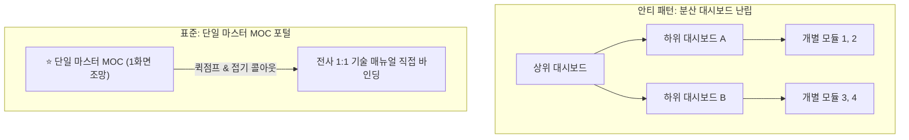

# 🏛️ 단일 마스터 MOC 및 스크롤 프리 대시보드 아키텍처 표준

> ⚡ **Quick Jump**: [🎯 1. 도입 배경](#-1-도입-배경-및-문제-의식) · [📜 2. 단일 마스터 MOC 원칙](#-2-단일-마스터-moc-일원화-원칙-single-master-moc-law) · [🎨 3. 스크롤 프리 2대 설계 표준](#-3-스크롤-프리scroll-free-2대-설계-표준) · [🔗 4. 하위 호환 별칭 바인딩](#-4-무중단-하위-호환-별칭aliases-바인딩-표준) · [🛡️ 5. 인박스 제로 프로토콜](#️-5-인박스-제로inbox-zero-및-완전-통합-원칙)

> [!ABSTRACT] 💡 핵심 요약
> 방대한 서브모듈과 문서를 거느린 프로젝트 및 지식 클러스터에서 **그래프 뷰 MOC 노드 중복**과 **스크롤 피로도(Scroll Fatigue)**를 원천 차단하고, **단 1장의 마스터 대시보드로 전체 아키텍처를 1초 만에 조망·탐색**할 수 있도록 정립된 옵시디언 볼트 전사 엔지니어링 표준입니다.

---

## 🎯 1. 도입 배경 및 문제 의식

과거 프로젝트 규모가 커짐에 따라 서브패키지별로 개별 대시보드(`00_*_대시보드.md`)를 분산 생성하는 방식은 다음과 같은 치명적인 문제를 야기했습니다:
1. **그래프 뷰(Graph View) MOC 노드 중복**: 상위 대시보드와 하위 대시보드가 뒤엉켜 허브-스포크(Hub-Spoke) 지식 구조가 왜곡됨.
2. **스크롤 압박 및 인지 부하**: 수십~수백 개의 모듈 링크가 한 페이지에 길게 나열되어 첫 화면에서 전체 구조를 한눈에 파악하기 어려움.
3. **분산 문서 관리 파편화**: 진행 상황이나 변경 이력을 업데이트할 때 어디에 기록해야 할지 모호해지며 `WORK_STATUS.md` 등의 임시 파일이 양산됨.

---

## 📜 2. 단일 마스터 MOC 일원화 원칙 (Single Master MOC Law)



* **원칙 1 (Single MOC Rule)**: 프로젝트 또는 지식 클러스터 루트에 **단 1개의 마스터 대시보드(`00_*_대시보드.md` 또는 `00_*_색인.md`)만 유지**합니다.
* **원칙 2 (No Sub-Dashboards)**: 하위 폴더별 서브 대시보드(`00_file_reader_대시보드.md` 등)는 전면 금지하며, 마스터 대시보드로 100% 흡수 후 소거합니다.
* **원칙 3 (Direct 1:1 Binding)**: 개별 기술 문서는 중간 허브 없이 마스터 대시보드의 해당 도메인 섹션에 직접 1:1 링크합니다.

---

## 🎨 3. 스크롤 프리(Scroll-Free) 2대 설계 표준

### ① 최상단 ⚡ Quick Jump 앵커 바
문서 최상단 타이틀 바로 아래에 모든 세부 도메인으로 1초 만에 스크롤 이동하는 앵커 링크 바를 필수 배치합니다:
```markdown
> ⚡ **Quick Jump**: [📅 1. 체인지로그](#-1-프로젝트-주요-버전-이력) · [🏎️ 2. vehicle](#-2-vehicle-도메인) · [🚀 3. file_reader](#-3-file_reader-도메인)
```

### ② 접기형 아코디언 콜아웃 (`> [!NOTE]-`)
모든 세부 도메인과 모듈 목록은 평소에 접혀 있는 아코디언 콜아웃으로 포장하여 첫 화면에서 스크롤 없이 전체 목차를 조망할 수 있게 합니다:
```markdown
> [!NOTE]- 🏎️ vehicle 및 acc_brk 모듈 1:1 매뉴얼 목록 [클릭하여 펼치기]
> | 모듈 / 서브패키지 | 핵심 기능 및 역할 | 1:1 기술 매뉴얼 링크 |
> | :--- | :--- | :---: |
> | **`VehicleDynamic`** | 차량 무게중심(CG) 운동역학 변환 및 보정 | [[vehicle_dynamic|매뉴얼 보기]] |
```

---

## 🔗 4. 무중단 하위 호환 별칭(`aliases`) 바인딩 표준

기존에 분산되어 있던 서브 대시보드를 삭제할 때, 볼트 내의 기존 문서들에서 걸려 있던 위키링크가 깨지는 것을 원천 방지하기 위해 마스터 대시보드의 Frontmatter `aliases`에 소거된 대시보드 명칭을 전수 등록합니다:

```yaml
aliases:
  - unoUtil_모듈개발_대시보드
  - "00_file_reader_대시보드"
  - "00_graphics_대시보드"
  - "00_models_대시보드"
  - "00_post_process_대시보드"
  - "00_utils_대시보드"
  - "00_vehicle_dynamic_대시보드"
  - "00_vt_acc_brk_대시보드"
```

---

## 🛡️ 5. 인박스 제로(Inbox Zero) 및 완전 통합 원칙

* **Zero-Clutter Law**: 세션 종료 시 생성된 임시 보고서(`WORK_STATUS.md` 등)는 방치하지 않고 관련 마스터 대시보드의 상단 타임테이블(`## 📅 1. 프로젝트 주요 버전 이력 (Changelog 타임테이블)`)에 핵심 내용을 100% 통합 흡수한 뒤 삭제합니다.
* **Audit Trail Law**: 소거된 파일은 당일 데일리 노트(`01_Daily/YYYY-MM-DD.md`) 하단의 감사 추적표에 원본 파일명, 승격 위치, 사유를 명시하여 추적성을 영구 보존합니다.

---
**Standard**: Antigravity Second Brain Master Architecture Standard  
**Last Updated**: 2026-09-29
