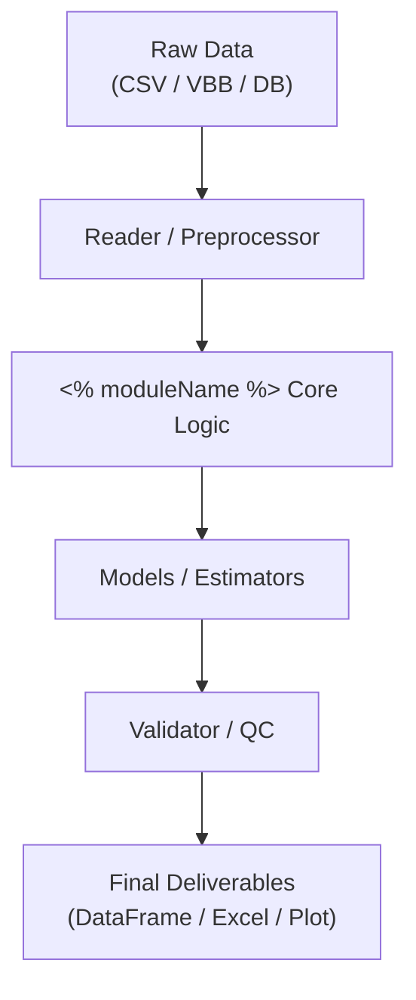

<%*
// ==========================================
// 🛡️ [안전 가드] 템플릿 원본 보호
// ==========================================
if (tp.file.folder(true) === "_System/Templates") {
    new Notice("⚠️ 템플릿 원본 파일에서는 실행할 수 없습니다!", 4000);
    return;
}

const todayStr = tp.date.now("YYYY-MM-DD");

// 1. 모듈명 입력
const moduleInput = await tp.system.prompt("unoUtil 모듈명을 입력하세요 (예: snow_condition, vt_acc_brk):", "module_name");
const moduleName = moduleInput ? moduleInput.trim() : "module_name";

// 2. 자동 작명 및 이동
const newFileName = `${moduleName}_사전`;
await tp.file.rename(newFileName);
-%>
---
id: "unoutil_dict_<% moduleName %>"
title: "<% moduleName %> 모듈 사전"
type: resource
category_main: 회사_업무
category_sub: unoUtil_사전
date: <% todayStr %>
status: 상시운용
tags:
  - 회사_업무
  - unoUtil
  - unoUtil_사전
  - 파이썬_프레임워크
aliases:
  - "<% moduleName %>_사전"
  - "<% moduleName %> 모듈 사전"
---

# 📖 <% moduleName %> 모듈 사전 (Domain Engineering Guide)

> ⚡ **Quick Jump**: [🎯 1. 설계 철학](#-1-설계-철학-및-모듈-개요) · [📚 2. 배경 지식](#-2-배경-지식-및-이론-지식-허브) · [🏗️ 3. 아키텍처](#️-3-아키텍처-및-데이터-파이프라인) · [🚀 4. 실전 워크플로우](#-4-실전-워크플로우-및-종합-스니펫) · [🛠️ 5. 트러블슈팅](#️-5-트러블슈팅-및-튜닝-노하우)

> [!ABSTRACT] 💡 모듈 사전 작성 원칙
> 1. **코드 매뉴얼 분리**: 세부 함수/클래스 단위의 1:1 API 매뉴얼(`xxx.md`)은 소스 코드 폴더(`unoUtil/`) 내부에 격리 보관합니다.
> 2. **본 문서의 역할**: 본 사전 문서는 오프라인 환경에서도 전체 시스템 구조와 실전 사용법, 엔지니어링 배경을 완벽히 조망하는 **'도메인 지식 종합 바이블'**입니다.
> 3. **지식의 원자화 (SSOT)**: 본문에 장황한 수식/이론을 모두 나열하지 않고, 독립적인 물리 공식, 알고리즘, 공학 이론은 반드시 **`04_Resources`** 내 독립 지식 문서로 분리 생성한 후 링크(`[[...]]`)로 연결합니다.

---

## 🎯 1. 설계 철학 및 모듈 개요

### 1.1. 모듈의 탄생 배경과 목적
* **기존 방식의 한계**: 
* **해결 과제**: 
* **핵심 제공 가치**: 

### 1.2. 아키텍처 설계 사상
* **무중단 및 안정성**: 
* **다형성 및 확장성**: 
* **계층형 구조**: 

---

## 📚 2. 배경 지식 및 이론 (지식 허브)

> [!NOTE] 🧠 공학 이론 및 알고리즘 위키 링크 (Knowledge Atomization)
> *세부 수학식이나 물리 모델은 영구 지식 저장소(`04_Resources`)에 원자 단위로 분리 저장하고 아래에 연결합니다.*

* 📄 **핵심 이론/공식 1**: [[관련_이론_문서_링크|이론 명칭 및 핵심 요약]]
* 📄 **핵심 알고리즘 2**: [[관련_알고리즘_문서_링크|알고리즘 명칭 및 핵심 요약]]
* 📄 **실차 평가 데이터 규격**: [[24_유노유틸_파일리더_표준채널명|unoUtil 표준 채널 명세서]]

---

## 🏗️ 3. 아키텍처 및 데이터 파이프라인

### 3.1. 엔드-투-엔드 데이터 흐름도



### 3.2. 핵심 서브모듈 및 역할 분담표

| 서브모듈 파일명 | 담당 클래스 / 함수 | 핵심 책임 및 역할 |
| :--- | :--- | :--- |
| `core.py` | `<% moduleName %>` | 전체 파이프라인 제어 및 진입점 |
| `schema.py` | `StandardSchema` | 데이터프레임 표준 칼럼 검증 및 정규화 |
| `models.py` | `EstimatorModel` | 머신러닝 및 수학적 보정/추정 연산 |
| `plotters.py` | `Plotter` | Non-blocking 시각화 및 자동 저장 |

---

## 🚀 4. 실전 워크플로우 및 종합 스니펫

> [!TIP] 💡 실무 복사-붙여넣기 템플릿
> 단순한 함수 파라미터 나열을 지양하고, 실무에서 데이터를 읽어와서 최종 결과물을 도출하는 가장 대표적인 전체 파이프라인 코드를 기술합니다.

```python
"""
<% moduleName %> 표준 실무 파이프라인 실행 스크립트
"""
from pathlib import Path
import pandas as pd
from unoUtil.<% moduleName %> import (
    # 핵심 클래스 및 함수 임포트
)

# 1. 데이터 로드 및 전처리
data_path = Path("path/to/measurement_data.csv")
# ...

# 2. 핵심 분석 엔진 구동
# ...

# 3. 결과 검증 및 시각화 리포트 출력 (Non-blocking)
# ...
```

---

## 🛠️ 5. 트러블슈팅 및 튜닝 노하우

### 5.1. 실차 데이터 특이점 및 예외 대응
* **센서 이상치 / 노이즈 튐 현상 발생 시**:
  - 원인: 
  - 조치 방법 및 권장 파라미터:
* **시계열 불연속 또는 결측치 발생 시**:
  - 조치 방법:

### 5.2. 성능 튜닝 및 파라미터 가이드
* `parameter_name`: 
* `method`: 
